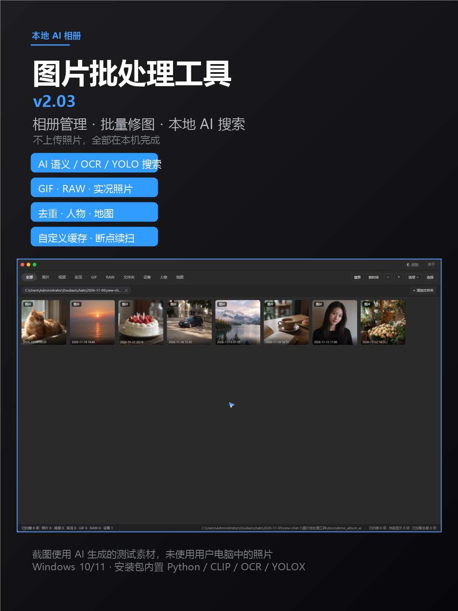
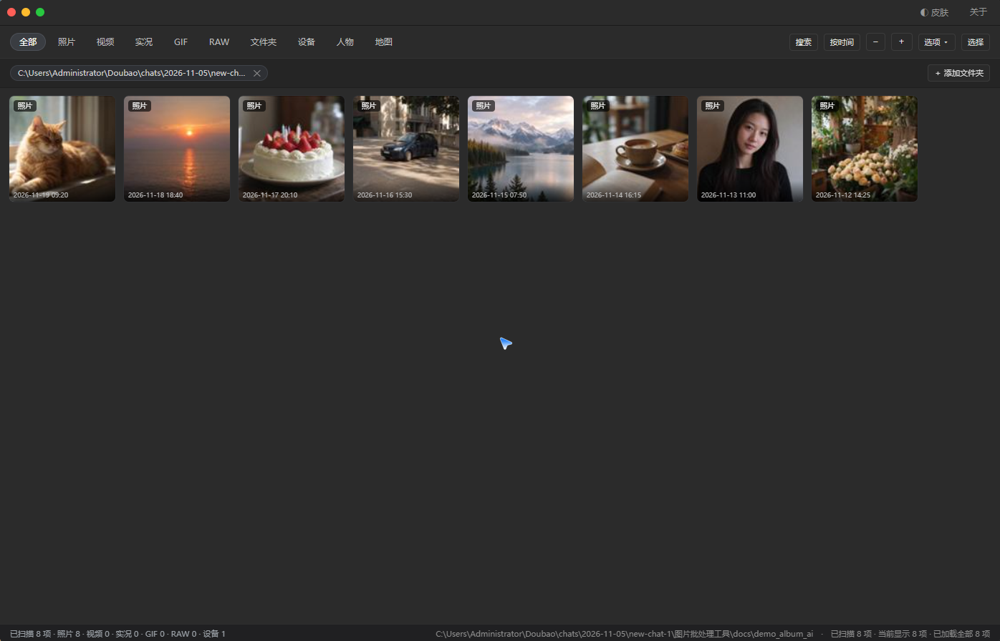
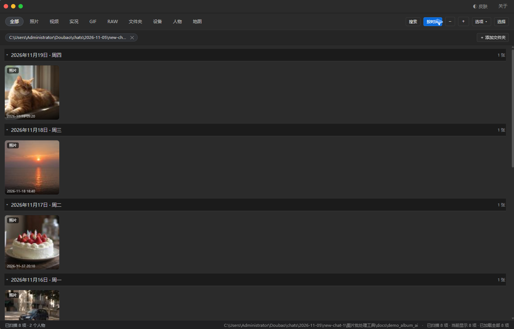
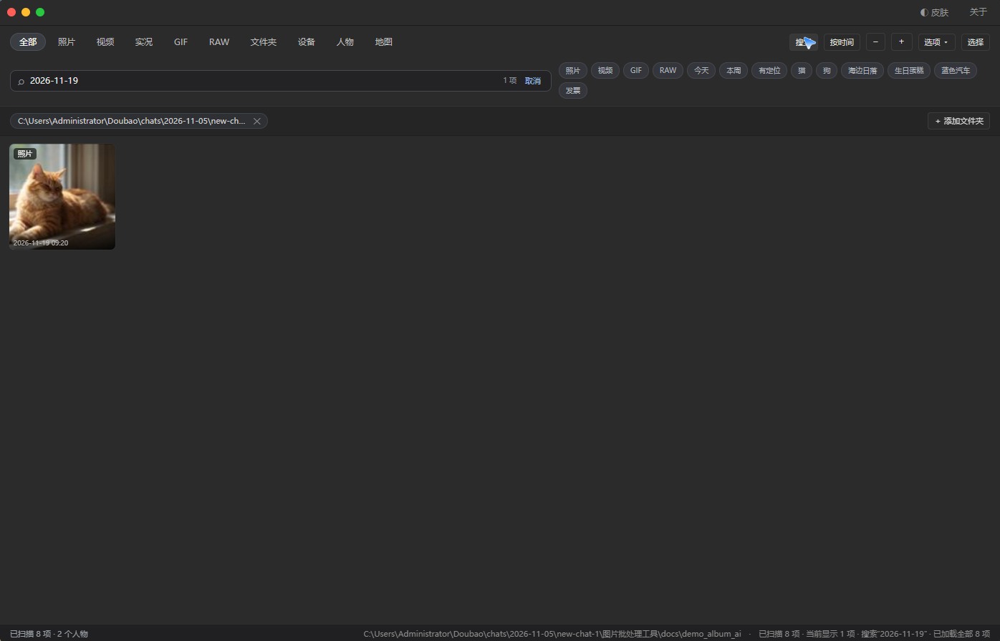
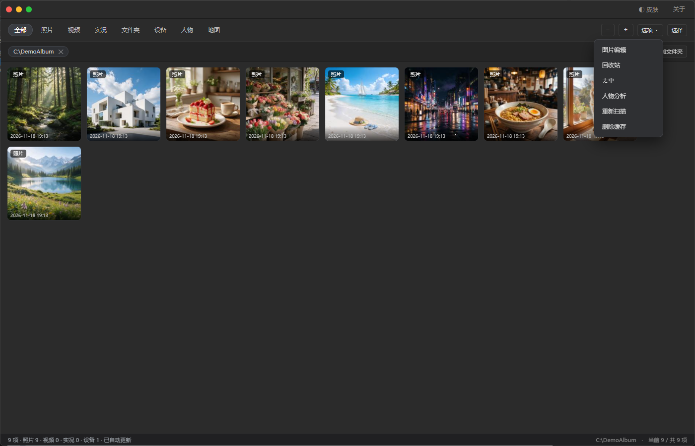
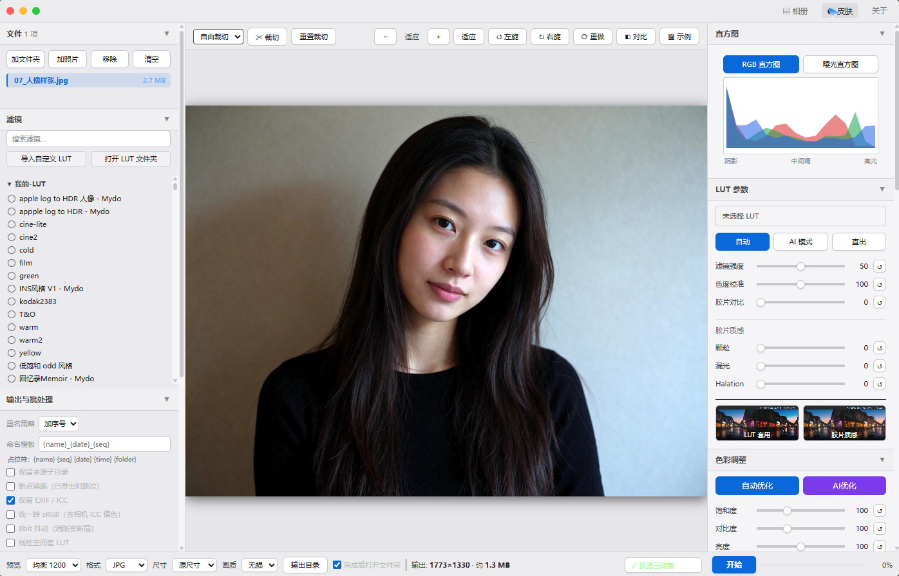
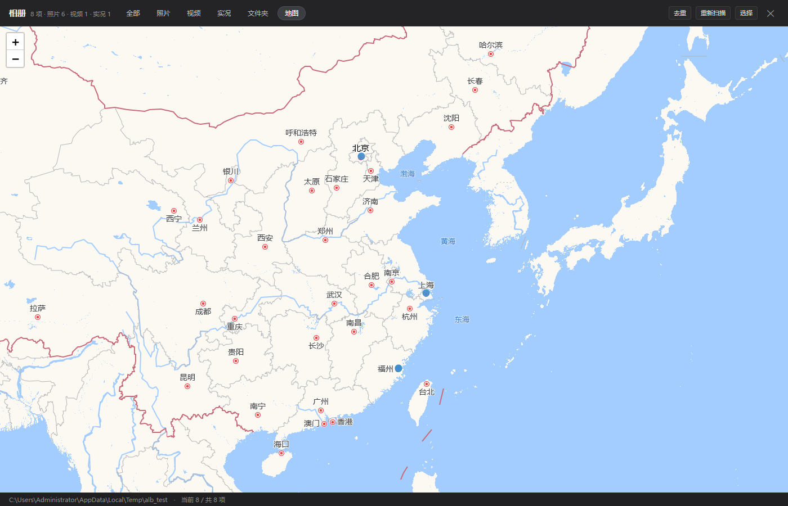

# 图片批处理工具 v2.03

本地 AI 相册 + 批量修图工具。相册支持增量扫描、虚拟滚动、按时间分组、GIF / RAW / 实况照片、人物分析、地图、去重、回收站，以及完全离线的中文语义搜索、OCR 文字搜索和 YOLO 物体搜索。

本版安装包已内置 Python、Chinese-CLIP、PP-OCRv4 与 YOLOX-Tiny，不需要另外安装运行环境或联网下载模型。

## 本版更新

- **本地 AI 语义搜索**：Chinese-CLIP ViT-B/16 ONNX，支持“猫”“海边日落”“生日蛋糕”“蓝色汽车”等画面描述搜索；中文 query 直接编码，不经过翻译。
- **OCR 图片文字搜索**：PP-OCRv4 mobile det + rec，发票、合同、截图、菜单等图片中的中文文字会写入本地索引，搜索时与语义结果合并。
- **YOLO 物体搜索**：YOLOX-Tiny COCO-80，增量识别猫、狗、人、汽车、手机、电脑、餐桌、椅子、蛋糕等常见物体，支持中文别名。
- **完全本地推理**：图像编码优先 DirectML（NVIDIA / AMD / Intel 核显），没有可用 GPU 时自动回退 CPU；照片不上传。
- **增量索引**：按“路径 + 修改时间 + 大小”跳过已索引项；新增、修改、移动只处理变化部分；中途关闭后从已有索引继续。
- **索引性能档**：相册「选项 → 索引性能」提供低 / 中 / 高三档；低档 CPU 单线程并关闭 GPU，中档 GPU + 最多 4 线程，高档 GPU + 全部 CPU 线程 + 高进程优先级。
- **边索引边搜**：首批索引或 OCR 完成后即可搜索；索引结束后自动刷新结果，已索引部分不重算。
- **相册体验**：全部数据加载 + 虚拟滚动；按时间分组、日期 / 文件夹 / 机型标题折叠与整组选择；GIF 与 RAW 分类；实况照片播放；图片坐标跳转地图。
- **缓存与安装**：缓存位置可自定义，修改后自动迁移旧缓存；覆盖安装保留扫描进度和已有缩略图；卸载清理缓存和临时文件。
- **版本统一**：关于界面、安装向导和安装包版本统一为 2.03。

## 界面截图

> 以下截图中的照片均为 AI 生成的测试素材，不使用用户电脑中的现有照片。

相册主界面：全部数据加载 + 虚拟滚动，底部显示真实扫描与加载状态。

按拍摄时间排列并按天分组，日期标题可折叠 / 展开、选择模式下可整组选中。

iOS 风格搜索：支持日期、文件名、机型、类型、位置，以及画面语义、图片内文字和物体搜索。

相册「选项」菜单：图片编辑、回收站、去重、人物分析、重新扫描、删除缓存、缓存位置与索引性能。

图片编辑：LUT / 滤镜、AI 调色、色彩调整、胶片质感、批量输出与命名模板。

相册地图：按 GPS 聚类展示照片位置，可从照片详情跳转到地图。

## 安装包

- 文件：`image-batch-tool_v2.03_setup.exe`
- 大小：1,131,983,933 字节（约 1.05 GiB）
- SHA256：`88E3B19641552DDC69D3FBB7BE9B3AA852C4DF6E7AC481E91F3AC1B4A86A37EA`
- 安装包包含：主程序、内置 Python、Chinese-CLIP、PP-OCRv4、YOLOX-Tiny、LUT 资源与必要运行库。
- 覆盖安装不会清空已有 `cache`、扫描索引和缩略图；需要释放空间时可在相册「选项 → 删除缓存」中清理。

## 系统要求

- Windows 10 64 位或更高版本
- WebView2 Runtime（安装包内置引导）
- 无需单独安装 Python
