# 图片批处理工具 v2.28

Windows 桌面图片批处理与相册管理工具。支持 LUT 滤镜、AI 调色、AI 人像增强、美颜与液化、HDR / 堆栈合成、AI 修复、专业输出，以及本地相册管理。相册与图片编辑是两个可独立安装、独立运行的程序。

v2.28 新增**本地 AI 生成式修图**：单底座 FLUX.2 Klein 4B，提供「修图」与「人像」两类提示词模式，模型在本机运行，照片不上传。

## 下载

- **安装包**：[image-batch-tool_v2.28_setup.exe](https://github.com/lqy072072/image-batch-tool/releases/download/v2.28/image-batch-tool_v2.28_setup.exe)
- **本地构建文件名**：`图片批处理工具_v2.28_安装包.exe`
- **大小**：1,249,640,062 字节（约 1.2 GB）
- **SHA256**：`28B9851051BFA8051795B4A42B473832565A2E4AA744D06DE6B8323BD767725A`

> 基础安装包不预装生成式修图运行时与约 5.3GB 模型。首次在「图片编辑 → 人像 → AI 生成式修图」里点「下载模型（约 6GB）」，程序会断点续传、SHA256 校验并解压到安装目录。原有 AI 模型、Python 运行时和 LUT 仍随安装包内置。

## 本版新增：AI 生成式修图

- **单底座、两套模式**：同一套 FLUX.2 Klein 4B（Apache 2.0，Q4_0 GGUF，4 步蒸馏）切换「修图 / 人像」。
  - **修图**：风格化、换背景、去物体、局部重绘。
  - **人像**：提示词美颜、换妆、换装、瘦身粗调。
- **不进入实时预览链路**：点「生成修图」才取当前裁切 / 校正后的图生成，独立结果弹窗双栏对照；不覆盖原图、不阻塞编辑器继续调参。
- **保脸后处理**：人像模式可开「保脸」，YuNet 检测人脸后只在脸内回注 18% 原图纹理，换背景、换妆时尽量保持五官。
- **结果可落地**：可「作为新图片加入编辑器」，也可「保存到输出目录」；文件名为 `原名_genedit_时间戳.png`。
- **尺寸与显存**：输入强制 64 倍数，避免 VAE 边缘黑边；6GB 显卡默认 768 长边、4 步，8GB 可试 1024。GTX 1660 Ti 6GB 实测 576×768 约 89–100 秒/张。
- **首次下载**：支持断点续传、SHA256 校验、zip 解压与 7GB 磁盘余量检查，进度为全局 0–100%。

## 界面预览

### v2.28 · 生成式修图

  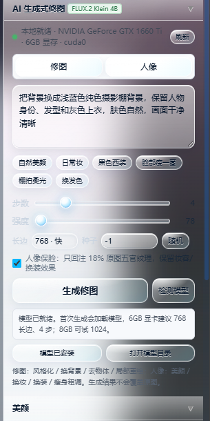
  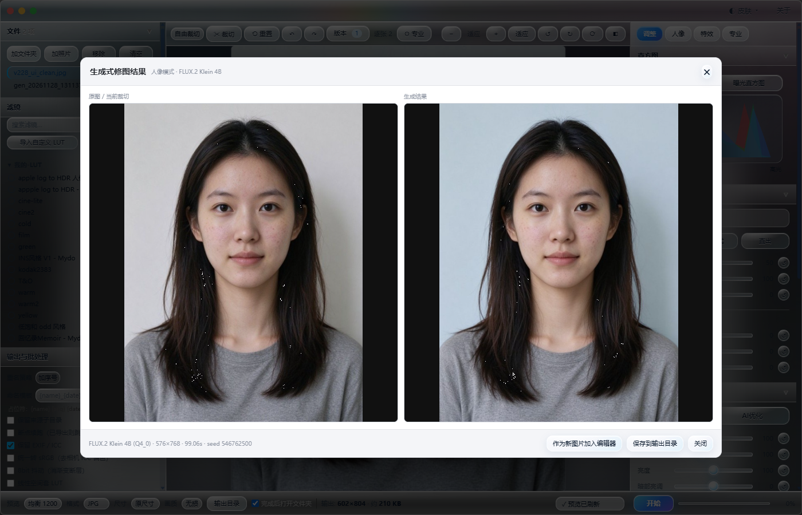

  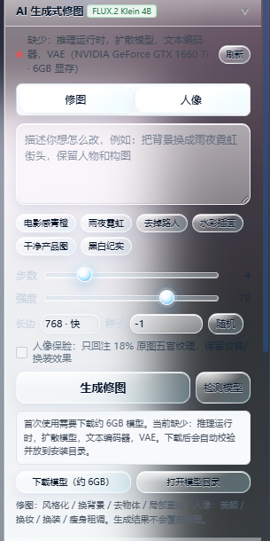

### v2.27 · 液态玻璃

  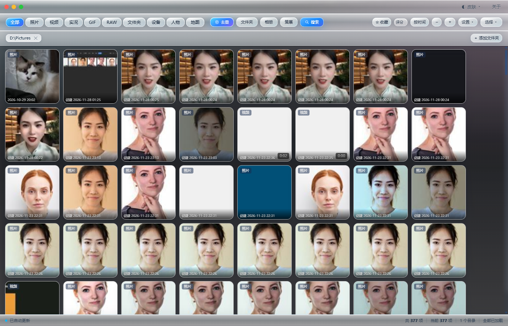
  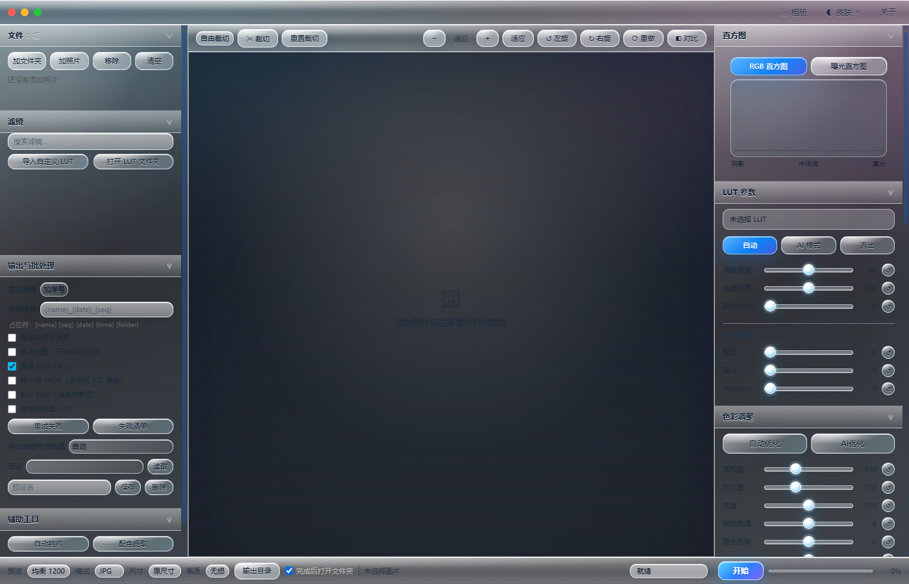

  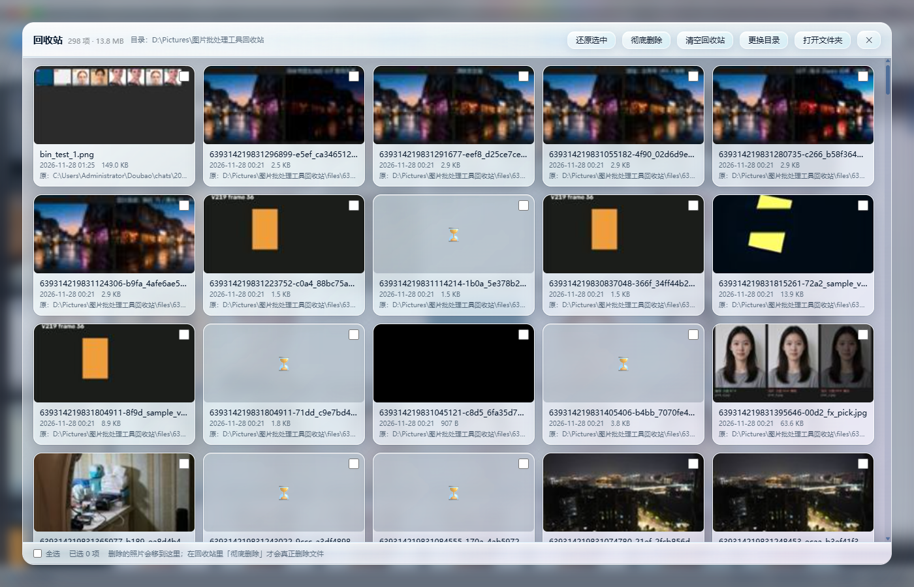
  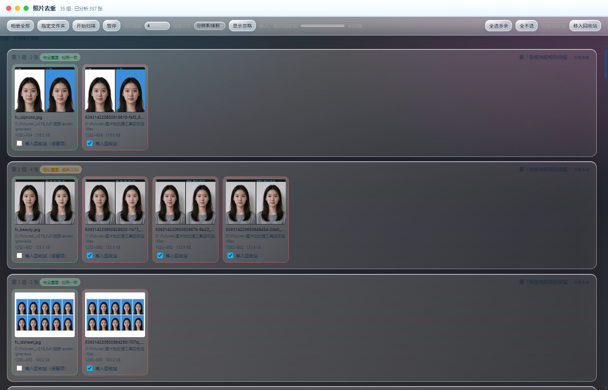

### v2.26 · 四套皮肤

  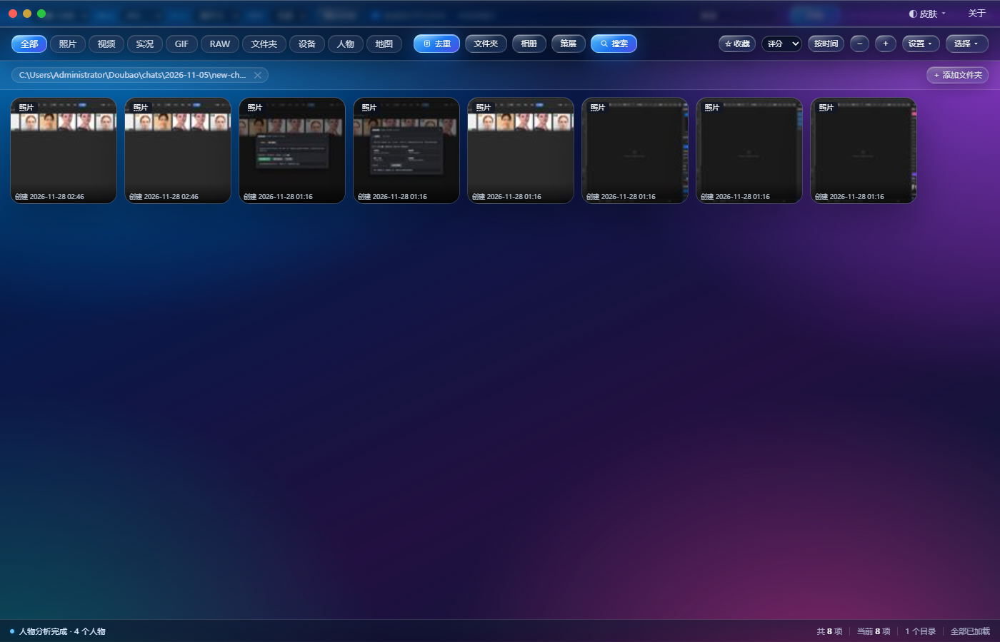
  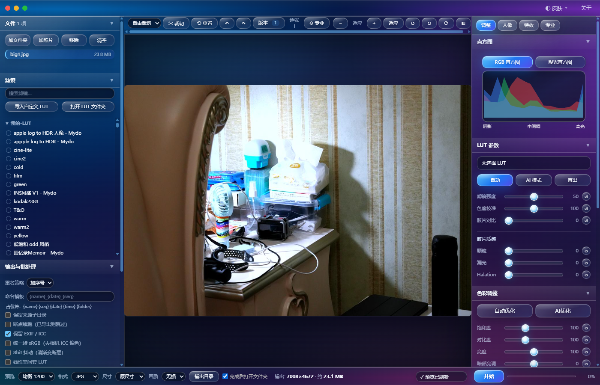

  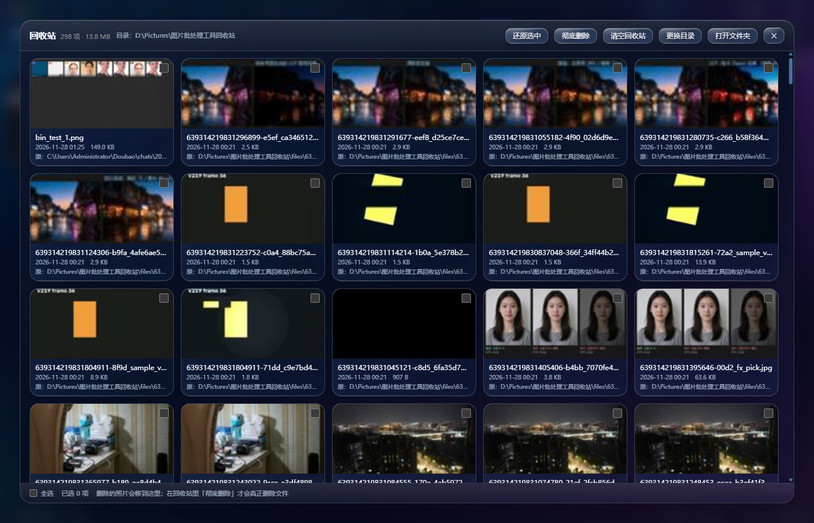
  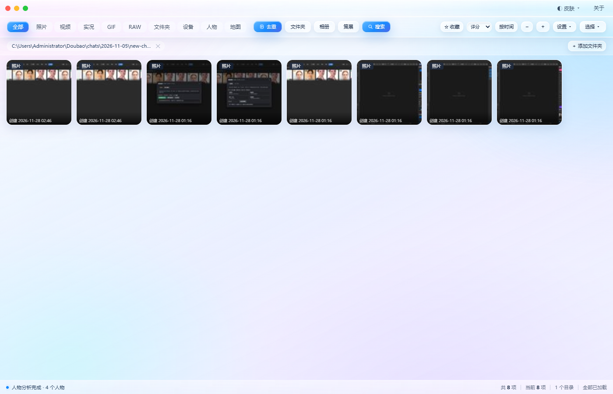

### v2.25 · 磨砂玻璃

  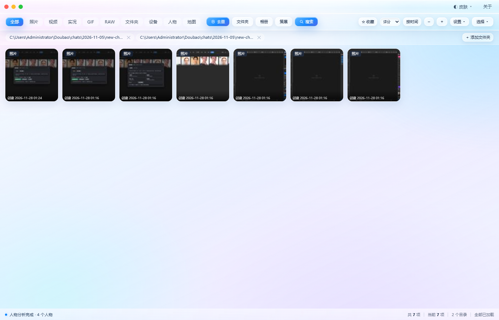
  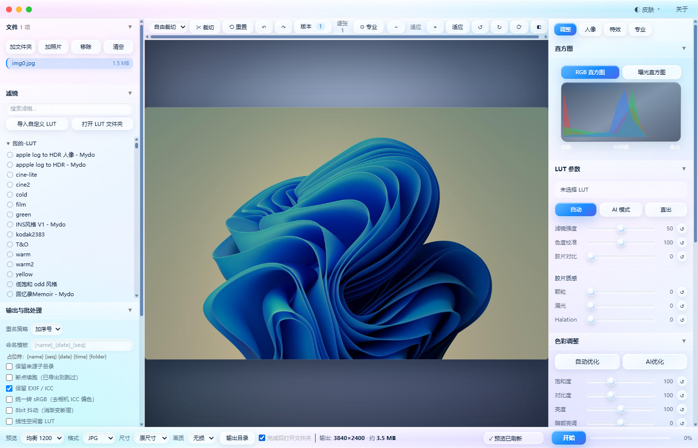

## 功能概览

- **LUT 滤镜**：.cube / .3dl / .lut，内置 ARRI / Canon 等品牌 LUT，自动 / AI / 直出三种模式，可选线性空间与 8bit 抖动。
- **AI 调色**：场景识别 + 像素分析，自动白平衡、曝光、对比度、饱和度。
- **AI 人像增强**：YuNet 人脸检测 + GFPGAN 人脸修复。
- **美颜与液化**：磨皮、美白、祛斑、黑眼圈、亮眼、口红、腮红，瘦脸 / 大眼 / 瘦鼻 / 下巴。
- **HDR / 堆栈**：自动识别曝光包围、焦点堆栈、降噪连拍，OpenCV AlignMTB + Mertens 融合。
- **AI 修复中心**：人脸修复、2×/4× 超分、降噪、污点 / 划痕修复、自动影调。
- **专业输出**：联系表、批量水印、ICC 软打样、证件照、自动挑片、配色提取、参考图→LUT。
- **相册**：多根目录、照片 / 视频 / 人物 / 地图视图、语义搜索、物体搜索、OCR、去重、回收站。
- **批量处理**：多线程、断点续跑、重名策略、保留 EXIF+ICC、命名模板、失败清单、暂停 / 继续 / 停止。
- **五套界面皮肤**：深色、墨色玻璃、浅色、柔光白、液态玻璃。

## 系统要求

- Windows 10 64 位或更高。
- WebView2 Runtime（安装包已内置 Evergreen 引导）。
- 无需安装 Python；原有 AI 模型、运行时和 LUT 已内置。
- 生成式修图建议 NVIDIA 显卡、6GB 及以上显存；无独显时其它图片处理功能仍可正常使用。

## 回归与文档

- 完整记录见仓库内 [`v2.28_回归测试报告.md`](https://github.com/lqy072072/image-batch-tool/blob/main/v2.28_%E5%9B%9E%E5%BD%92%E6%B5%8B%E8%AF%95%E6%8A%A5%E5%91%8A.md)。
- README 已包含 v2.25–v2.28 的界面预览与更新说明，以及更早版本的功能介绍。
- v2.28 实测：GTX 1660 Ti 6GB，576×768、4 步，真实生成 99.06s；人像保脸 1 张脸成功；UI 完成生成、保存、加入列表；静默双组件安装 24.2s 通过。
