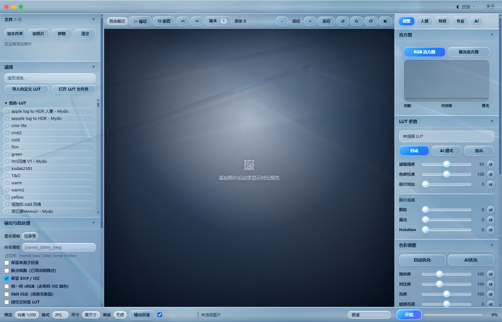
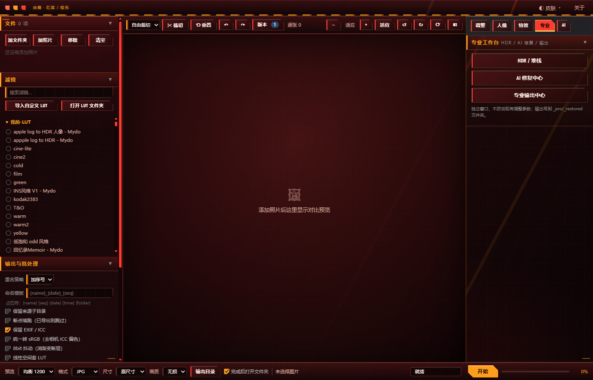
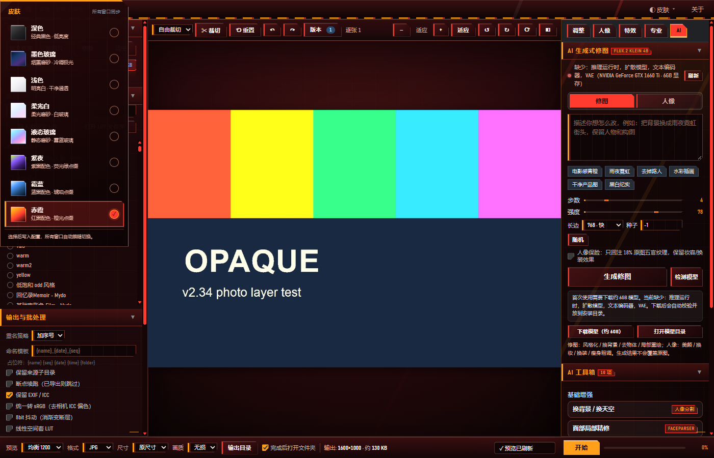

# 图片批处理工具 v2.38

本次更新只动界面皮肤与背景刷新链路，不改照片处理、相册管理、AI 修图、导出等任何业务功能。

## 液态玻璃改为预生成静态底图

- 新增一张 2560×1600 的雾蓝磨砂玻璃底图（浅冰蓝 / 雾青 / 珍珠白 / 淡薰衣草紫），作为「液态玻璃」的静态背景。
- 宿主不再抓屏、不再模糊、不再按帧推送背景；窗口保持不透明浅蓝实底，滚动、拖动窗口与缩放不再驱动底图刷新。
- 照片、相册缩略图、回收站缩略图与去重缩略图始终完全不透明，不会透出背景。

## 三套装甲主题：形状系统深化

「紫夜」「霜蓝」「赤霞」在原有配色的基础上，统一补齐：

- 主界面斜向装甲槽、左右面板直角与回形角标、工程网格背景；
- 按钮右上斜切与左侧识别槽、输入框状态槽与右下切角、标签右上斜切；
- 卡片直角、弹窗顶部装甲条、窗口控制键斜切块；
- 窄体字体 + 中文黑体回落；
- 滑块薄装甲轨与竖向切角推子；
- 皮肤菜单斜切装甲板；
- 全屏斜切光闸、装甲片、扫描线与切肤快门动画。

皮肤菜单与说明只显示正常名称和配色：紫夜（紫黑配色 · 荧光绿点缀）、霜蓝（蓝黑配色 · 琥珀点缀）、赤霞（红黑配色 · 橙光点缀）。

## 安装包

- 资产名：`image-batch-tool_v2.38_setup.exe`
- 本地文件名：`图片批处理工具_v2.38_安装包.exe`
- 大小：1,292,661,371 字节
- SHA256：`AE0172D028CBE3233DDCF9C7F7264885F6DAF9EE6997E37B1636F644D2683AC0`
- 组件：相册、图片编辑可分别勾选安装；两个模块均自带 Python 运行时、OCR 模型与内置 LUT。

> 生成式修图模型（FLUX.2 Klein 4B 等，约 6GB）不预装。首次在「AI → 生成式修图」点「下载模型」即可断点续传、校验并解压。

## 验证

- 源码与安装载荷两套环境均验证：三套主题切换、相册 8 项测试图、回收站 298 项布局、设置菜单、编辑器测试照片、专业 / AI 面板、皮肤菜单、液态玻璃静态背景。
- `album.7z` / `edit.7z` / `common.7z` 均通过 `7z t` 完整性校验。
- 安装器首页显示 v2.38。

完整记录见仓库 [`v2.38_回归测试报告.md`](https://github.com/lqy072072/image-batch-tool/blob/main/v2.38_回归测试报告.md)。
