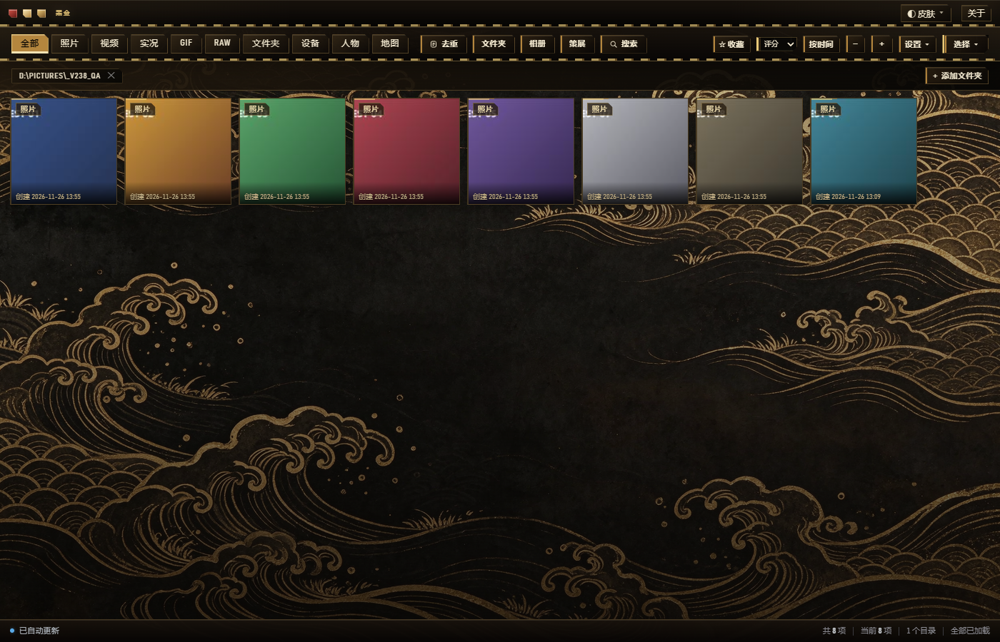
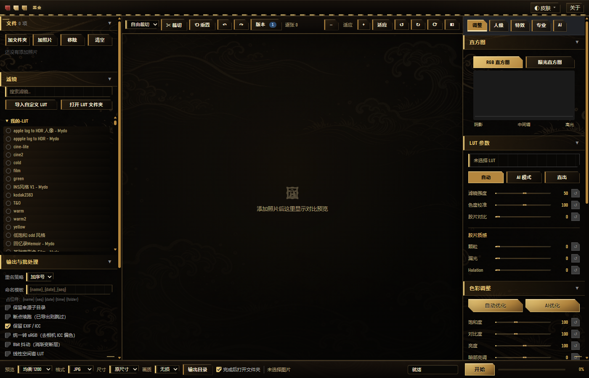
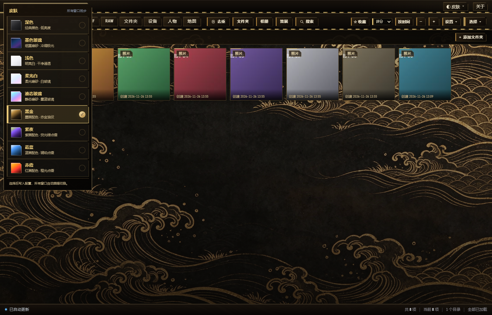
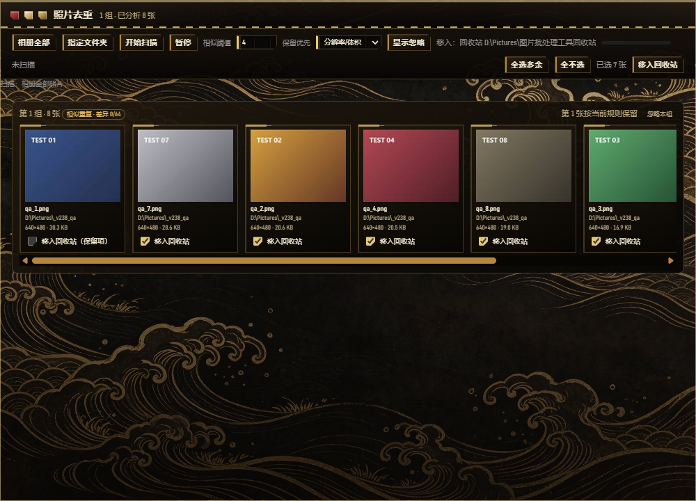

# 图片批处理工具 v2.39

本次更新只动界面皮肤、窗口开关动画与「关于」文案，不改照片处理、导出、AI、LUT、相册索引、去重等任何业务功能。

## 关于页

- 相册与图片编辑的「关于」统一为 `版本 2.39`。
- 追加免责声明：软件按“现状”提供，使用前请备份原始文件；因误操作、软件缺陷、第三方组件或系统环境造成的损失，开发者不承担赔偿责任；请勿用于违法违规用途。
- 追加 GitHub 地址：`https://github.com/lqy072072/image-batch-tool`。
- 制作者、版本结构与关于按钮 / 消息路由保持原样。

## 新增「黑金」皮肤

极深墨黑底 + 古金色日式海浪浮世绘纹，浪花集中在四边、中央保留较暗阅读区。复用现有装甲形状系统，覆盖：

- 相册主界面、顶栏标签、工具栏、搜索 / 收藏 / 设置、缩略图卡片；
- 左右面板、LUT 列表、滑块、输入框 / select / textarea；
- 回收站、去重窗口、设置菜单、下拉、弹窗、皮肤菜单；
- 页面入场金色幕帘、切肤金色装甲片过渡；
- 黑金窗口整窗淡入 / 淡出，去重窗口关闭同样淡出。

侧栏叠加 86%–94% 黑金渐层，保留极淡浪纹，保证 LUT 列表与滑块标签可读；缩略图和分组卡片使用暗色实体底 + 金边。

## 安装包

- 资产名：`image-batch-tool_v2.39_setup.exe`
- 本地文件名：`图片批处理工具_v2.39_安装包.exe`
- 大小：1,297,440,434 字节
- SHA256：`6D7C0CE5DBFA7173A4010548FB67CE0D0D6B9A7F6650CD76B612501B6FEB6EC7`
- 组件：相册、图片编辑可分别勾选安装；两个模块均自带 Python 运行时、OCR 模型与内置 LUT。

> 生成式修图模型（FLUX.2 Klein 4B 等，约 6GB）不预装。首次在「AI → 生成式修图」点「下载模型」即可断点续传、校验并解压。

## 验证

- 相册、图片编辑、去重、回收站、皮肤菜单、关于窗口均实机截图验收。
- 切肤从深色切到黑金，金色幕帘 / 棱镜 / 装甲片 / 环 / 核心正常生成。
- 静默安装到隔离目录（相册 + 图片编辑）退出码 0；启动安装版相册为黑金主题；关于窗口显示 2.39 + 免责声明 + GitHub。
- 静默卸载退出码 0，安装目录与测试快捷方式清理。
- 归档内页面 / 皮肤 / 模块 exe 与构建目录逐文件 SHA256 一致。

完整记录见仓库 [`v2.39_回归测试报告.md`](https://github.com/lqy072072/image-batch-tool/blob/main/v2.39_回归测试报告.md)。
