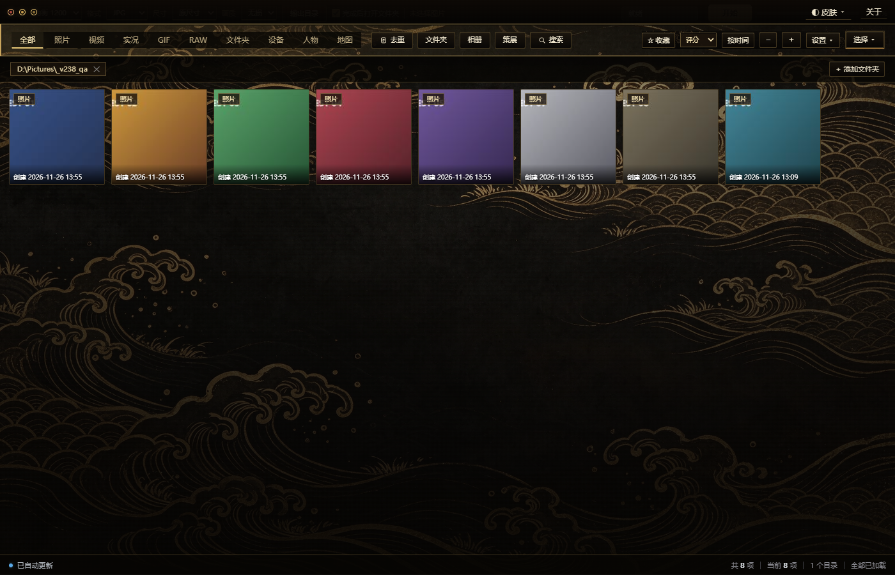
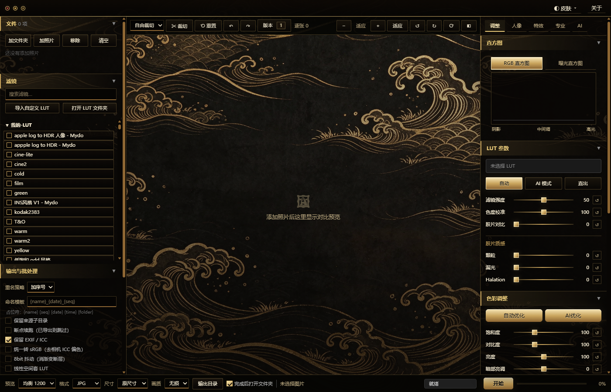
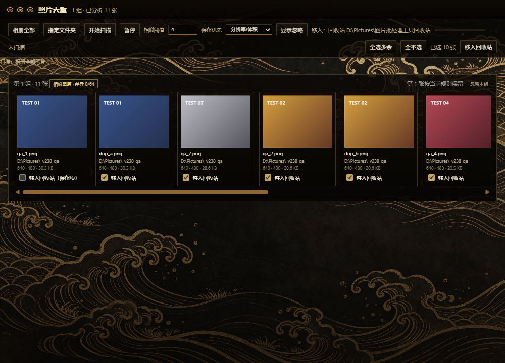
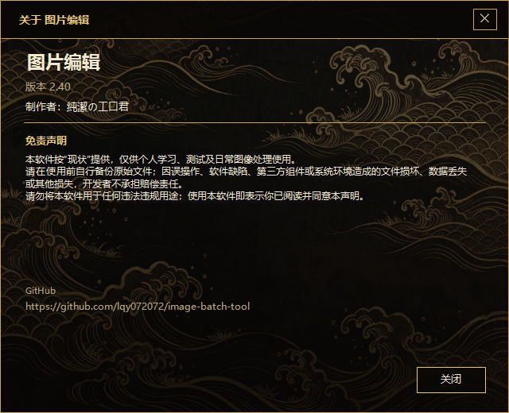

# 图片批处理工具 v2.40

本次更新只动黑金皮肤、子界面底图、关于窗口与版本号，不改照片处理、导出、AI、LUT、相册索引、去重等任何业务功能。

## 黑金主题彻底独立

- `skins/black-gold.css` 删除 `@import url("eva-core.css")`，不再引用 `--eva-*` 变量或 EVA 装甲形状。
- `skin-core.js` 的黑金注册由 `skin-blackgold skin-eva` 改为 `skin-blackgold`，不再添加 `skin-eva-html`。
- 样式表实测只加载 `skin-core.css`、`black-gold.css` 与 Leaflet，`eva-core.css` 不再出现。
- 按钮改为黑漆金边、悬停金底黑字；主按钮金色实心；输入框 / 下拉 / 文本域黑底金边；滑块金色细轨 + 方形金块；标签页金色下划线；复选框黑底细金边、选中赤金方印。
- 图片查看器、回收站、去重工具栏的通用按钮统一为直角黑金样式，删除类操作保留赤色。

## 子界面底图

`skins/black-gold-bg.jpg`（2560×1600）铺到相册主界面、图片查看器、图片编辑中心预览区与左右面板、去重窗口、回收站、设置菜单、皮肤菜单、弹窗；各区域叠加不同强度黑金渐层，保证文字、LUT 列表与缩略图可读。

## 关于窗口跟随主题

- `WebViewApp.cs` 新增自绘 `ThemedAboutForm`，替代原生 `MessageBox`；保留标题、版本、制作者、免责声明、可点击 GitHub 地址、关闭按钮、Esc / Enter 与标题栏拖动。
- 按 `ReadSkinName()` 读取当前皮肤：黑金使用浪纹底图 + 金色标题 / 分隔线 / 按钮；浅色使用浅底深字金线；深色 / 墨色玻璃 / 柔光白 / 液态玻璃 / 紫夜 / 霜蓝 / 赤霞各有对应底色与强调色，不再所有皮肤共用同一个黑金窗口。
- 异常时回退原 `MessageBox`，不影响原有消息路由。

## 安装包

- 资产名：`image-batch-tool_v2.40_setup.exe`
- 本地文件名：`图片批处理工具_v2.40_安装包.exe`
- 大小：1,297,461,152 字节
- SHA256：`804A06E233354350741615AB36EEAEDDD56460A3E0C24D2C9742D006066C701F`
- 组件：相册、图片编辑可分别勾选安装；两个模块均自带 Python 运行时、OCR 模型与内置 LUT。

> 生成式修图模型（FLUX.2 Klein 4B 等，约 6GB）不预装。首次在「AI → 生成式修图」点「下载模型」即可断点续传、校验并解压。

## 验证

- 相册主界面（8 张缩略图）、图片编辑（全部面板 / 控件）、图片查看器、去重（1 组 11 张）、回收站（含缩略图与按钮）均实机截图验收。
- 黑金 body class 实测 `skin-blackgold mode-album`、html class `skin-blackgold-html`，页面不再加载 `eva-core.css`。
- 黑金与浅色关于窗口均实机截图验收；版本显示 2.40，免责声明完整、GitHub 可点击；深色分支已从黑金分支拆开，避免默认深色误用浪纹底图。
- 用最终 `804A...` 安装包以 `/S /D=D:\IBT_v240_final_smoke /ALBUM` 静默安装相册组件，退出码 0；安装后的 exe / html / 黑金 CSS / `skin-core.js` 与构建目录 SHA256 一致；安装注册项与隔离目录已清理。
- `album.7z` / `edit.7z` / `common.7z` 均经 `7z t` 完整校验；安装包 footer `IBPK2`、五个偏移与文件长度自检通过。

完整记录见仓库 [`v2.40_回归测试报告.md`](https://github.com/lqy072072/image-batch-tool/blob/main/v2.40_回归测试报告.md)。
