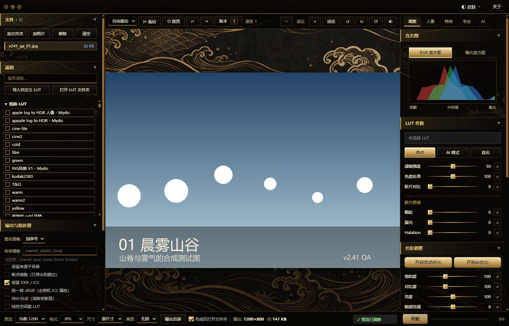
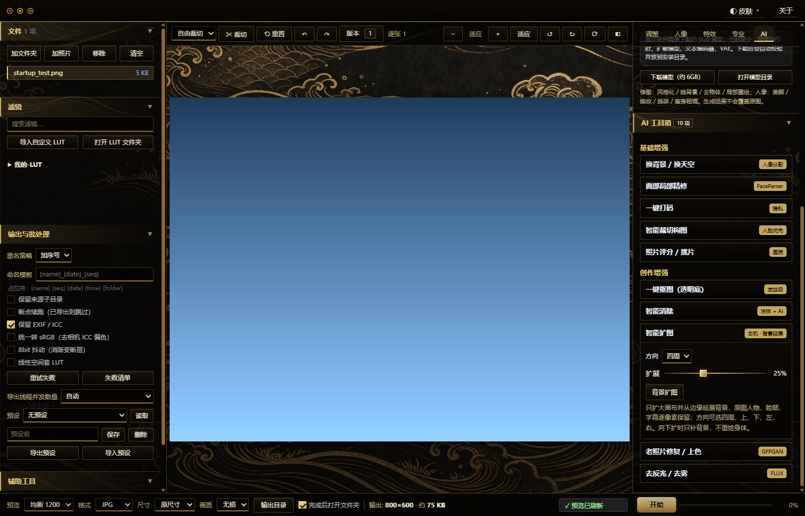
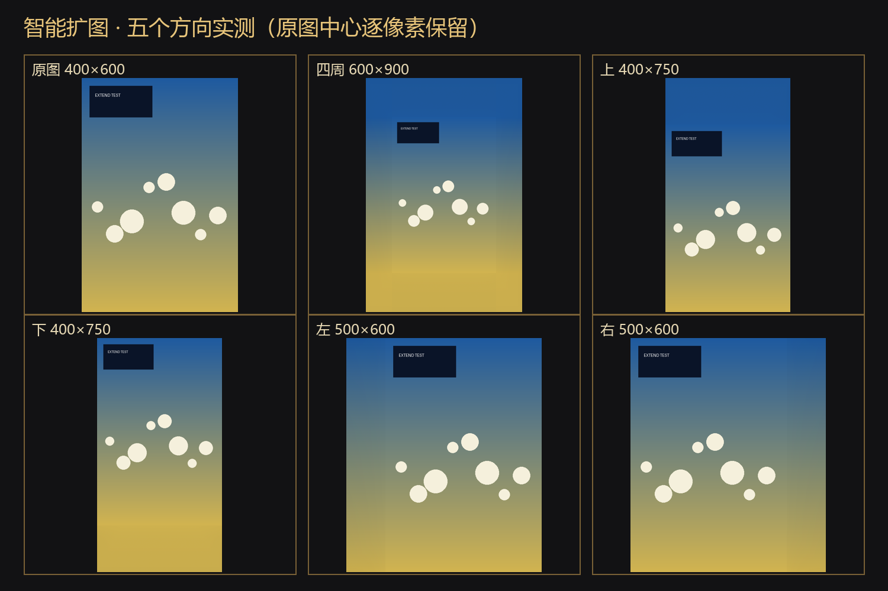
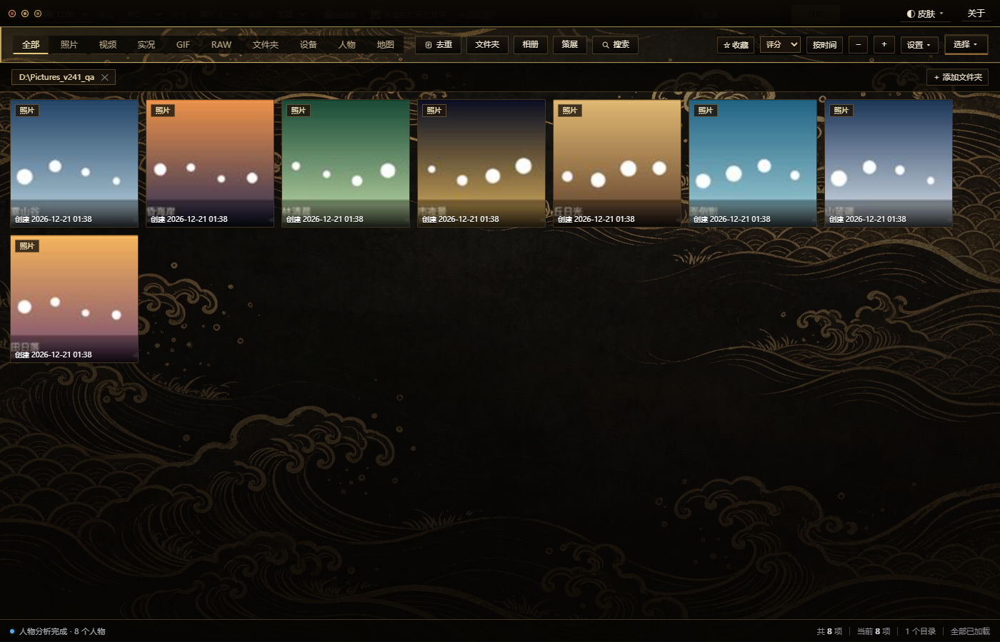

# 图片批处理工具 v2.41

本次更新修掉“导入原图却被自动提亮”的隐式增强，补上明确的自动优化 / AI 优化开关；智能扩图改为四周、上、下、左、右五个方向；并修复相册右键进入旧版内嵌编辑器的问题。

## 自动优化不再是隐形开关

- 根因是编辑器默认 `lutMode=log`，未选 LUT 时 `ApplyLUT()` 仍会调用 `AutoEnhance()`，普通照片可能被提亮约 30%。
- 现在无 LUT 时只有 `ai_opt` 显式打开才执行 AI 影调增强，否则只显示原图；默认导入日志为 `ApplyLUT: LUT未加载，跳过隐式增强`。
- 右侧按钮改为「开启自动优化」「开启AI优化」，开启后变为「关闭自动优化」「关闭AI优化」；`color_auto`、`ai_opt` 初始都是 0，切换照片、读预设、撤销/重做后按钮状态会重新同步。

## 智能扩图五个方向

- 下拉改为「四周 / 上 / 下 / 左 / 右」，值为 `all/top/bottom/left/right`；`horizontal`、`vertical` 保留为兼容别名。
- 后端取消“竖图四周只扩左右”和“禁止向下”的限制；五个方向都只扩背景，原图人物、脸部、字幕逐像素保留，向下不生成腿、不重绘身体。

## 相册右键进入新版编辑器

- 旧版右键进入的是 `album.html` 内置的 `mode-edit` 旧编辑器，所以界面和功能都比独立 `edit.html` 旧。
- 现在 `enterEditorFromAlbum()`、`albEditCurrent()`、`albEditPaths()` 统一发送 `openeditor` 消息；C# 拉起同目录 `图片编辑\图片编辑.exe` 并传入选中图片。旧 `albtoedit` 保留兼容，但新版相册不再使用。
- 已在安装版相册实测：相册日志出现 `从相册启动图片编辑 ... files=1`，新编辑器日志出现 `启动参数导入 1 张` 与 `ApplyLUT: LUT未加载，跳过隐式增强`。

## 安装包

- 资产名：`image-batch-tool_v2.41_setup.exe`
- 本地文件名：`图片批处理工具_v2.41_安装包.exe`
- 大小：1,297,568,072 字节
- SHA256：`5A86B33641A99D2082B0D9DFB423B641E05233F9B69682C7C2135917C9FD42B6`
- 组件：相册、图片编辑可分别勾选安装；两个模块均自带 Python 运行时、OCR 模型与内置 LUT。

> 生成式修图模型（FLUX.2 Klein 4B 等，约 6GB）不预装。首次在「AI → 生成式修图」点「下载模型」即可断点续传、校验并解压。

## 验证

- 最终包 `/S /D=D:\IBT_v241_smoke` 静默安装退出码 0，安装 5,648 个文件、2,827,924,467 字节；exe / html / AI 工具 / `skin-core.js` 与构建目录 SHA256 一致。
- 五个扩图方向用安装版 Python 与合成竖图 400×600 实测：四周 600×900、上/下 400×750、左/右 500×600；中心原图逐像素相等，SHA256 均为 `0e6a1eea9cc53f8b` 前缀同一值。
- 相册主界面 8 张合成缩略图、回收站 314 项缩略图、图片编辑 / AI 工具箱均实机截图验收。
- `album.7z` / `edit.7z` / `common.7z` 均经 `7z t` 完整校验；安装包 footer `IBPK2`、五个偏移与文件长度自检通过。

完整记录见仓库 [`v2.41_回归测试报告.md`](https://github.com/lqy072072/image-batch-tool/blob/main/v2.41_回归测试报告.md)。
