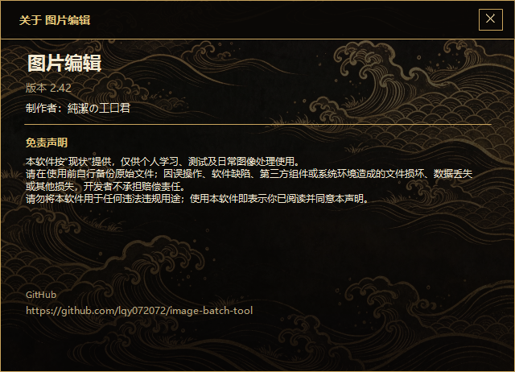

# 图片批处理工具 v2.42

本次只修一个点：删掉「关于 图片编辑」窗口底部点不动的「关闭」按钮，窗口高度同步收紧。

## 关于窗口

- 底部按钮此前只由 `ThemedAboutForm.OnPaint()` 绘制，`OnMouseDown()` 从未给它绑定点击区域，所以看起来有按钮、实际点不动。
- 现在移除底部按钮绘制，窗口从 640×520 收紧到 640×462。
- 顶部右上角 `✕`、`Esc`、`Enter` 三种关闭方式保留。

## 安装包

- 资产名：`image-batch-tool_v2.42_setup.exe`
- 本地文件名：`图片批处理工具_v2.42_安装包.exe`
- 大小：1,297,567,663 字节
- SHA256：`BC0814507BD9EC4606F6AFCF247609304EFB8E3371E79315394F63D3E2DAF71B`
- 组件：相册、图片编辑可分别勾选安装；两个模块均自带 Python 运行时、OCR 模型与内置 LUT。

## 验证

- 用反射测试工具加载生产 `图片编辑.exe`，关于窗口实测 640×462，底部无「关闭」按钮，版本 2.42，GitHub 链接仍在。
- 模拟点击右上角 `✕` 后窗口进程退出，关闭功能正常。
- 安装包 `/S /D=D:\IBT_v242_smoke` 静默安装退出码 0；安装后 `图片编辑.exe`、`相册.exe` 的 SHA256 与构建产物一致。
- `album.7z` / `edit.7z` / `common.7z` 抽取目标哈希与构建目录一致。

完整记录见仓库 [`v2.42_回归测试报告.md`](https://github.com/lqy072072/image-batch-tool/blob/main/v2.42_回归测试报告.md)。
