# 图片批处理工具

[](https://github.com/lqy072072/image-batch-tool/releases)
[](https://github.com/lqy072072/image-batch-tool/releases)
[](LICENSE)

批量图片处理工具，支持 LUT 滤镜套用、AI 调色、AI 人像增强（GFPGAN）、美颜与液化、景深虚化、超分、本地生成式修图（FLUX.2 Klein 4B）与 10 项本地 AI 工具箱，并内置本地相册管理。v2.12 起，相册与图片编辑拆分为两个可独立安装、独立运行的程序。

## 下载安装

> 当前版本 **v2.44**：v2.43 精简图片编辑界面，移除专业工作台、顶部撤销/重做/版本/逐张控件与左侧「输出与批处理」面板；v2.44 修复切组直方图空白和相册导出栏被遮挡。v2.42 的关于窗口修复保持不变。

直接下载最新安装包（约 1.21GB，已内置两个模块各自的 Python 运行时、原有 AI 模型、OCR 模型与 LUT）：

**[👉 前往 Releases 页面下载最新安装包](https://github.com/lqy072072/image-batch-tool/releases)**

GitHub Release 资产名为 `image-batch-tool_v2.44_setup.exe`；本地构建文件名为 `图片批处理工具_v2.44_安装包.exe`（1,297,551,332 字节，约 1.21 GB）；SHA256 `18E076EEAA713485C53E5F8127AC0C970E65EE2EA542AC37B961ECEFEC9049DD`，完整测试记录见 [`v2.44_回归测试报告.md`](v2.44_回归测试报告.md)。

> **生成式修图模型不预装**：基础安装包不含 `ai/genedit` 推理运行时和 `ai/models/genedit` 下的 FLUX.2 Klein 4B / Qwen3-4B / FLUX.2 VAE（约 5.3GB 模型，加运行时合计约 6GB）。首次在图片编辑「AI → 生成式修图」里点「下载模型」，程序会断点续传、SHA256 校验并解压到安装目录；下载前检查磁盘剩余 ≥7GB。

或在 [Releases 页面](https://github.com/lqy072072/image-batch-tool/releases) 查看历史版本。运行安装包后按向导选择「相册」和/或「图片编辑」，默认路径 `D:\Program Files\图片批量处理工具`。只勾选一个也能安装并运行。

## 功能

- **LUT 滤镜**：支持 .cube / .3dl / .lut 格式，内置 ARRI/Canon 等品牌 LUT，支持自动/AI/直出三种套用模式
  - .3dl 多为 3DMESH 整数格点表（10-bit 0–1023，带输入网格声明行），按 **B 最快维**排列，载入时会转置成内部的 R 最快维；.lut 与 .cube 同构，走同一解析
  - **线性空间套 LUT**（可选）：先转线性再查表、输出再回 sRGB，暗部渐变不再断层
  - **8bit 抖动**：8×8 Bayer 抖动，消掉大片渐变里的色阶断层
- **AI 调色**：基于场景识别 + 像素分析，自动白平衡、曝光、对比度、饱和度
- **AI 人像增强**：YuNet 人脸检测 + GFPGAN 人脸修复，默认混合强度 0.7
- **AI 生成式修图（v2.28）**：本地 FLUX.2 Klein 4B（Apache 2.0，Q4_0 GGUF，4 步蒸馏），独立按钮触发、独立结果弹窗，不进入实时预览链路，不覆盖原图
  - **修图模式**：风格化、换背景、去物体、局部重绘；**人像模式**：提示词美颜、换妆、换装、瘦身粗调
  - 取当前 `cachedBase`（已应用裁切 / 水平校正 / 旋转）生成；结果自动回混原图强度，人像可开「保脸」，用 onnxruntime 跑 YuNet 检测人脸，只在脸内回注 18% 原图纹理，尽量保住五官
  - 生成结果可「作为新图片加入编辑器」或「保存到输出目录」；输出为独立 PNG，文件名单带 `_genedit_时间戳`
  - 6GB 显卡默认 768 长边、4 步；8GB 可试 1024。GTX 1660 Ti 6GB 实测 576×768 约 89–100 秒/张
  - 基础包不预装大模型；首次在面板内下载运行时 + 约 5.3GB 模型（合计约 6GB），支持断点续传与 SHA256 校验
- **AI 工具箱（v2.31，10 项本地工具）**：图片编辑「AI」分页内按「基础增强 / 创作增强」分组，无 A/B 编号；全部在本机运行，结果只写入新文件，不覆盖原图
  - **基础增强**：换背景 / 换天空（BiSeNet 人像分割，虚化 / 纯色 / 渐变 / 图片背景 / 换天空）；面部局部精修（FaceParser + 牙齿美白 / 去油光 / 祛斑 / 去红眼）；一键打码（YuNet 人脸 + PP-OCR 车牌，模糊 / 马赛克）；智能裁切构图（人脸构图优先，无脸时按梯度、饱和度与中心先验找主体）；照片评分 / 挑片（清晰度、曝光、对比、色彩、人脸与闭眼）
  - **创作增强**：一键抠图透明底（Alpha PNG，发丝羽化）；智能消除（在图上用画笔涂抹杂物，支持「快速纹理消除」与「AI 消除」，AI 按周围纹理、透视与光线补全背景）；智能扩图（OpenCV 只延展背景并做景深虚化，原图人物 / 脸部 / 字幕逐像素保留；方向可选四周、上、下、左、右，向下扩只补背景，不生成腿或重绘身体）；老照片修复 / 上色（GFPGAN + 划痕修补 + 自动影调，上色走 FLUX）；去反光 / 去雾
  - **人像 AI（人像分页 · 美颜之后）**：眼神光 / 微笑强化（保脸、不做夸张表情）；重新打光（LAB 亮度通道重建左 / 右 / 顶 / 逆 / 柔光与冷暖）；人像造型（商务西装 / 晚礼服 / 婚纱 / 国风汉服 / 新中式旗袍 / 街头潮流 / 复古港风 / 学院风 / 千禧潮流 / 户外机能 / 韩系清新 / 文艺复古，12 种预设 + 自定义输入）
  - **风格化（特效分页 · 移轴之后）**：电影胶片 / 日系动漫 / 古典油画 / 铅笔素描 / 赛博朋克 / 水彩插画 / 水墨丹青 / 像素艺术 / 黏土手办 / 3D 渲染 / 黑白胶片 / 波普拼贴 / 童话插画 / 时尚大片 / 复古胶片 / 极简线稿，16 种预设 + 自定义输入；保留五官、身份与构图
  - 产品边界：不提供换脸 / 身份克隆、脱衣 / 身材性感化、无痕去水印；隐私打码用「一键打码」，污点与划痕修复用「老照片修复」
- **美颜**：磨皮/美白/祛斑/黑眼圈/亮眼/口红（6 色号）/腮红 + 液化（瘦脸/大眼/瘦鼻/下巴），由 BiSeNet 人脸分割 + MediaPipe FaceMesh 468 关键点驱动，全部可调强度
  - 「AI 细节增强」为独立开关：GFPGAN 只提供干净低频，原图高频按边缘门控回注，避免传统 AI 修复常见的「越修越糊」
  - 瘦脸/瘦鼻带刚性保护区（眼/眉/唇），液化不会连带挤压五官
- **胶片质感**：颗粒（按亮度加权）、漏光、halation 三件套，可叠加现有 LUT 风格
- **景深虚化**：Depth Anything V2 Small 出深度图 + 人像解析保护主体，背景虚化、人脸始终清晰
- **全图放大/超分**：分块重叠融合的 2× 放大；`ai/models/` 放入任意 Real-ESRGAN 系列 `.onnx` 即自动切换为 AI 超分，否则走 Lanczos+细节回注兜底
- **证件照**：YuNet 定位 + 人脸解析抠像，白/蓝/红/浅灰换底，一寸/二寸/护照尺寸，可选六寸相纸排版
- **自动挑片**：清晰度（Laplacian 方差）、曝光（剪裁比+平均亮度）、闭眼（468 点 EAR）打分排序，标出建议保留
- **配色提取**：K-means 主色提取，点击色值复制，可直接当设计色板用
- **参考图→LUT**：丢一张喜欢的调色图，自动生成 33³ `.cube` 进「我的-LUT」分组
- **自动优化 / AI 优化**：两个独立显式按钮。默认导入不自动套用；点「自动优化」只做白平衡、曝光和对比度，点「AI 优化」才做 AI 影调增强。按钮状态与当前图片参数同步，切换照片或撤销/重做后仍准确。
- **手动调色**：亮度/对比度/饱和度/色温/色调/暗角/高光/暗部/胶片对比
- **批量导出**：底部导出栏统一设置预览尺寸、格式、输出尺寸、画质与输出目录，多图按当前参数逐张导出
- **交互**：前后对比拉帘、拖放导入与快捷键、参数按图片隔离、列表只渲染可视窗口
- **九套界面皮肤**：深色 / 墨色玻璃 / 浅色 / 柔光白 / 液态玻璃 / 紫夜 / 霜蓝 / 赤霞 / 黑金，WebView2 渲染，独立皮肤文件，可双窗口同步切换。v2.38 起液态玻璃改为预生成的雾蓝磨砂玻璃底图，窗口保持不透明，照片、相册缩略图、回收站缩略图与去重缩略图始终完全不透明；底图不再由宿主抓屏，页面只读取 `skins/aurora-bg.jpg`。三套装甲风主题共用独立外壳样式，新增斜切按钮、装甲输入框、直角卡片、网格背景与快门转场；v2.40 起黑金主题完全独立，使用自有变量、黑漆金边控件、和纸浪纹底图与方形滑块，不再引用 EVA 装甲形状。

## 相册（v2.00 新增，v2.01 增强）

独立「相册」程序（`相册\相册.exe`），与图片编辑分开安装、分开启动，支持多根目录、全部 / 照片 / 视频 / 实况 / 文件夹 / 设备 / 人物 / 地图 八个视图。


- **自动刷新**：监听相册目录，新增 / 删除 / 改名图片或视频后约 2 秒自动增量刷新，保留当前分类与滚动位置
- **启动秒开**：扫描结果与 EXIF / 尺寸 / 地理位置持久化到 `alb_index.dat`，缩略图落盘缓存，第二次打开直接用缓存先展示，后台再核对
- **大目录优化**：枚举阶段只收集图片 / 视频，跳过回收站、系统目录、node_modules 等；界面分页 + 滚动懒加载
- **删除同步**：相册内删除后自动校准计数与其他视图，不需要手动刷新
- **设置菜单**：扫描控制、标签索引 AI（含索引性能）、照片管理、缓存分区；去重已移到相册顶栏，人物识别控制条只出现在人物分类

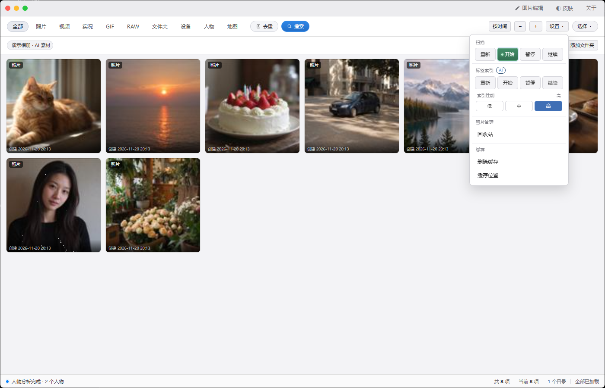

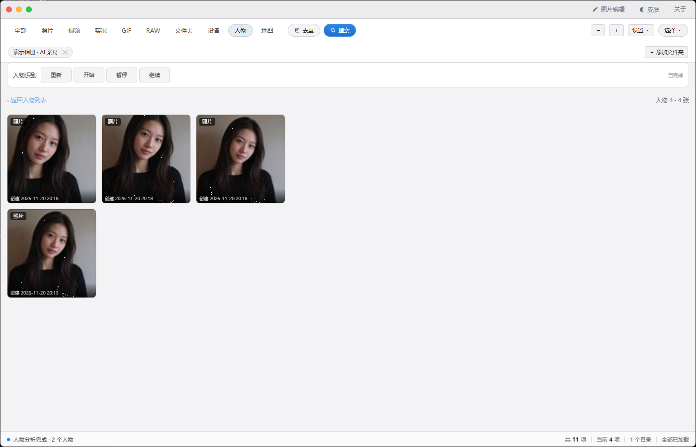

### v2.44 更新

> v2.43 精简图片编辑界面；v2.44 修复切组直方图空白与相册导出栏被遮挡两个实际缺陷。

- **界面精简（v2.43）**：移除顶部「专业」工作台、撤销/重做/版本/逐张控件与左侧「输出与批处理」面板；专业调整保留曲线、HSL、镜头、水平四个子页，超分与景深移入「特效」。
- **直方图修复（v2.44）**：切回「调整」分组时保留上一帧直方图数据，画布不再被清空。
- **导出栏修复（v2.44）**：相册底栏增加 `#albumExportBar` 并抬到 fixed/z700，为全屏遮罩留出 36px，「输出目录」「开始」恢复可见可点。
- **回归**：编辑器核心 19/19、相册核心 13/13；深度 UI 仅 `genProtect` 在「修图」模式下设计性禁用；安装包 3 个 7z 校验通过，关于窗口与安装向导均显示 2.44。详见 [`v2.44_回归测试报告.md`](v2.44_回归测试报告.md)。

### v2.42 更新

> 删除「关于 图片编辑」窗口底部无效的「关闭」按钮；顶部右上角 `✕`、`Esc`、`Enter` 仍可关闭。


- **为什么按钮无效**：底部「关闭」只由 `ThemedAboutForm.OnPaint()` 画出来，`OnMouseDown()` 只处理顶部 `✕` 和 GitHub 链接，从未给它绑定点击区域，所以它一直是装饰、点不动。
- **处理方式**：直接移除底部按钮的绘制代码，窗口高度由 640×520 收紧到 640×462；保留顶部关闭、Esc、Enter 三种关闭方式。
- **回归**：用反射测试工具加载生产 `图片编辑.exe` 弹出关于窗口，截图确认底部无按钮、版本为 2.42、GitHub 链接仍在；模拟点击右上角 `✕` 后窗口进程退出。安装包静默安装返回 0，安装后 `图片编辑.exe`、`相册.exe` 哈希与构建产物一致。详见 [`v2.42_回归测试报告.md`](v2.42_回归测试报告.md)。

### v2.41 更新

> 自动优化、AI 优化改为显式开关；智能扩图方向改为四周 / 上 / 下 / 左 / 右；相册右键进入新版图片编辑。

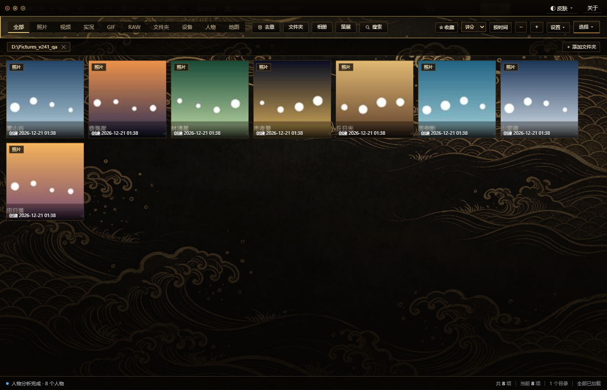


- **自动优化不再隐式提亮**：修复编辑器默认 `lutMode=log` 且未加载 LUT 时仍调用 `AutoEnhance()` 的问题；无 LUT 时只有 `ai_opt` 显式开启才执行 AI 影调增强，否则只显示原图。默认导入日志为 `ApplyLUT: LUT未加载，跳过隐式增强`，`color_auto`、`ai_opt` 初始均为 0。
- **两个按钮都是明确开关**：右侧「开启自动优化」「开启AI优化」分别绑定 `color_auto`、`ai_opt`；开启后文案变为「关闭自动优化」「关闭AI优化」，再点一次恢复原图。按钮状态在切换照片、读预设、撤销/重做后都会从当前图片参数重新同步，不再出现“按钮显示关闭、后台仍生效”。
- **智能扩图五个方向**：下拉改为「四周 / 上 / 下 / 左 / 右」，值为 `all/top/bottom/left/right`；旧值 `horizontal/vertical` 保留为兼容别名。后端取消“竖图四周只扩左右”和“禁止向下”的限制，五个方向都能扩；向下只延展背景，不生成腿、不重绘身体，原图人物、脸部、字幕逐像素保留。
- **相册右键修复**：`album.html` 的右键/顶部编辑入口不再切换内置 `mode-edit`，改为发送 `openeditor` 消息；C# 收到后拉起同目录 `图片编辑\图片编辑.exe`，把选中图片作为启动参数传入。旧 `albtoedit` 消息保留兼容，但新版相册不再使用。此前右键进入的是 `album.html` 自带的旧编辑器，所以界面和功能都比独立编辑器旧。
- **回归**：相册主界面（8 张合成缩略图与完整索引）、图片编辑（自动优化/AI优化按钮、AI 工具箱、智能扩图下拉）、回收站（314 项缩略图）与边角视图均实机截图验收；`all/top/bottom/left/right` 五个方向用合成竖图逐像素比对，非扩图区与原图 SHA256 一致。安装包静默安装与三归档校验见 [`v2.41_回归测试报告.md`](v2.41_回归测试报告.md)。

### v2.40 更新


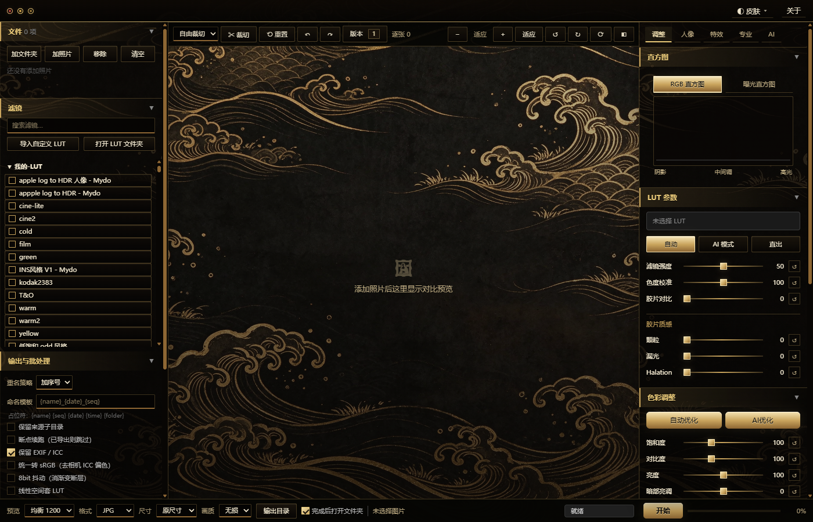


- **黑金彻底独立**：`skins/black-gold.css` 删除 `@import url("eva-core.css")`，不再引用任何 `--eva-*` 变量或 EVA 装甲形状；`skin-core.js` 的黑金注册从 `skin-blackgold skin-eva` 改为 `skin-blackgold`，不再添加 `skin-eva-html`。实测样式表只加载 `skin-core.css`、`black-gold.css` 与 Leaflet，不再加载 `eva-core.css`。
- **控件重做**：按钮改黑漆金边、悬停金底黑字；主按钮金色实心；输入框 / 下拉 / 文本域黑底、金色底边；滑块金色细轨 + 方形金块；标签页金色下划线选中；复选框改为黑底细金边、选中赤金方印；查看器、回收站、去重工具栏的通用按钮统一为直角黑金样式，删除类操作保留赤色。
- **子界面底图**：相册主界面、图片查看器、图片编辑中心预览区与左右面板、去重窗口、回收站、设置菜单、皮肤菜单、弹窗均铺 `skins/black-gold-bg.jpg`，并叠加不同强度的黑金渐层保证文字与缩略图可读。
- **关于窗口跟随主题**：`WebViewApp.cs` 新增 `ThemedAboutForm`，替代原生 `MessageBox`；按 `ReadSkinName()` 取当前皮肤，黑金使用浪纹底图 + 金色标题/分隔线/按钮，浅色使用浅底金线，其余皮肤使用对应底色与强调色。保留制作者、版本、免责声明、可点击 GitHub 地址、Esc/Enter 关闭与标题栏拖动。
- **范围约束**：只改皮肤 CSS、皮肤注册、页面缓存参数与关于窗口；照片处理、导出、AI、LUT、相册索引、去重算法均未改动。
- **回归**：相册主界面（8 张缩略图）、图片编辑（空库全部面板与控件）、图片查看器、去重（11 张 1 组）、回收站（含缩略图与按钮）、黑金与浅色关于窗口均实机截图验收；黑金 body class 实测为 `skin-blackgold mode-album`，html class 为 `skin-blackgold-html`。最终 `804A...` 包静默安装相册组件退出码 0，安装载荷与构建目录 SHA256 一致；三个内部归档均经 `7z t`。完整记录见 [`v2.40_回归测试报告.md`](v2.40_回归测试报告.md)。

### v2.39 更新

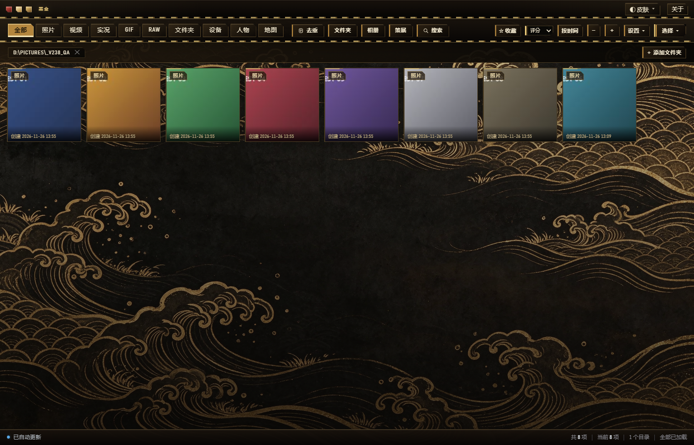

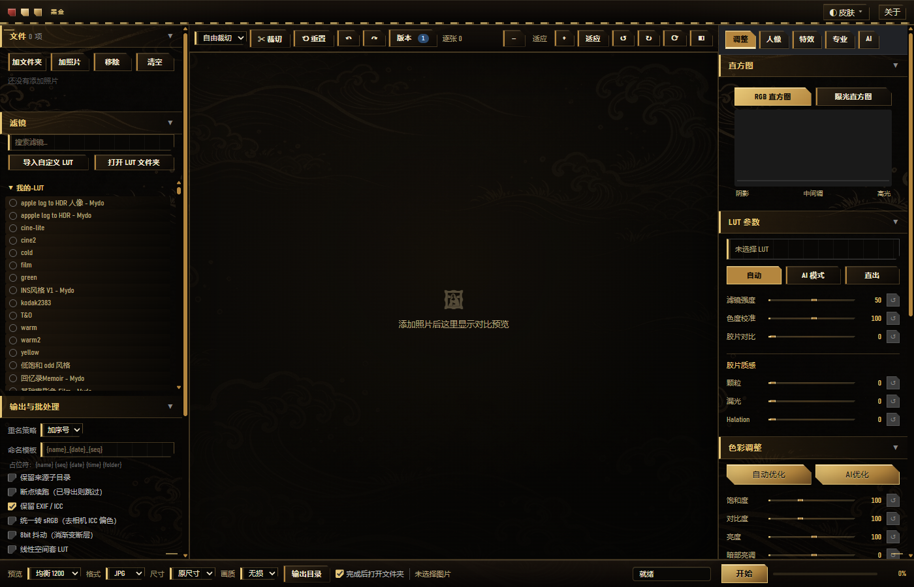


- **新增「黑金」皮肤**：`skins/black-gold-bg.jpg`（2560×1600，约 1.0 MB）为极深墨黑底、古金色日式海浪浮世绘线稿，浪花集中在四边、中央保留较暗阅读区，不含文字 / Logo / 水印 / 人物。`black-gold.css` 复用 `eva-core.css` 装甲形状系统，body 同时挂 `skin-blackgold skin-eva`，只作用于皮肤作用域。
- **覆盖范围**：相册主界面、顶栏标签页、左右面板、按钮、搜索 / 筛选、缩略图卡片、回收站 `.bin-panel`、去重 `#dupPanel`、图片编辑左右侧栏、LUT 列表、滑块、输入框 / select / textarea、设置菜单、下拉、弹窗、皮肤菜单、页面入场金色幕帘与切肤金色装甲片过渡。
- **可读性处理**：黑金 body 使用黑底 + 暗金浪纹；左右侧栏叠加 86%–94% 黑金渐层后保留极淡浪纹，避免 LUT 列表、滑块标签和输入框被亮金线条干扰；缩略图、文件和分组卡片保持暗色实体底与金边。
- **窗口开关动画**：`WebViewApp.cs` 为黑金增加整窗淡入（约 256ms）与关闭淡出（约 224ms），只对黑金生效；去重窗口关闭同样淡出。其他皮肤保持原行为，不改变窗口生命周期和业务逻辑。
- **关于页**：两个模块的关于文案统一为 `版本 2.39`，追加免责声明和 `GitHub：https://github.com/lqy072072/image-batch-tool`；原有制作者、版本结构和消息路由不变。
- **兼容修复**：`skin-core.js` 的 `apply()` 改为按空白拆分 `def.cls` 后逐个 `classList.add`，避免 `skin-blackgold skin-eva` 这类多 class 触发 `InvalidCharacterError`；未选中皮肤不再误显示勾选；临时调试日志已移除。
- **回归**：相册 / 图片编辑 / 去重 / 回收站 / 皮肤菜单均实机截图验收；静默安装、启动、关于窗口、静默卸载均在隔离目录完成。只改 UI 与关于文案，照片处理、导出、AI、LUT、相册索引、去重等业务函数未动。完整记录见 [`v2.39_回归测试报告.md`](v2.39_回归测试报告.md)。

### v2.38 更新


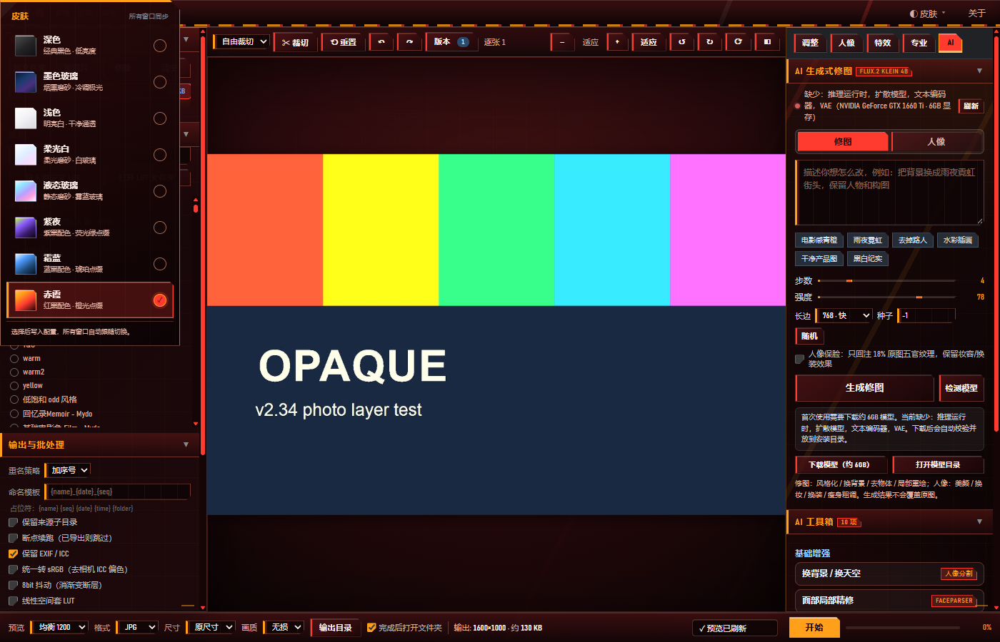

- **液态玻璃改为静态底图**：新增 `skins/aurora-bg.jpg`（2560×1600，205 KB），浅冰蓝 / 雾青 / 珍珠白 / 淡薰衣草紫的磨砂玻璃材质；`body.skin-aurora` 直接加载图片并叠柔和冷色渐层。宿主 `WebViewApp.cs` 在 aurora 下不再调用 `PrimeDesktop()`、不再启用 `GlassBackdrop`、不再发送 `glassbg` 帧，窗口与 WebView2 使用 `rgb(214,230,243)` 浅蓝实底，保留 14px 圆角裁剪。背景只参与一次静态合成，滚动、拖窗、缩放不再驱动底图刷新。
- **三套主题 renamed + 形状系统**：显示名改为 `紫夜`、`霜蓝`、`赤霞`，描述只保留配色：「紫黑配色 · 荧光绿点缀」「蓝黑配色 · 琥珀点缀」「红黑配色 · 橙光点缀」；标题栏 HUD 同步改为普通短名。旧配置的内部标识仅用于兼容，不在界面展示。
- **形状与质感**：按钮统一斜切右上角、左侧装甲识别槽、内嵌高光；输入框左侧状态槽 + 右下切角 + 内嵌刻度；标签 / 分段右上斜切；卡片直角 + 左上装甲线；弹窗顶部 3px 装甲条；窗口控制键由圆形改为斜切装甲块；左右面板加顶部装甲线与右下回形角标；背景加入工程网格、斜向装甲带与冷光渐层；字体切换为窄体 Bahnschrift + 中文黑体回落。
- **切肤动画**：保留原有 1.18s 转场骨架，增加全屏斜切光闸、装甲片、扫描线与 `skin-switching` 快门层；`prefers-reduced-motion` 下自动关闭转场，只保留静态形状。
- **范围约束**：所有新增规则均限定在三套主题的作用域和 `body.skin-aurora` 背景规则内，不改 DOM、布局尺寸、点击区域、事件、协议或任何业务函数；三套主题的输入框、按钮、标签、弹窗、回收站、去重、专业 / AI 面板和皮肤菜单均已实测。

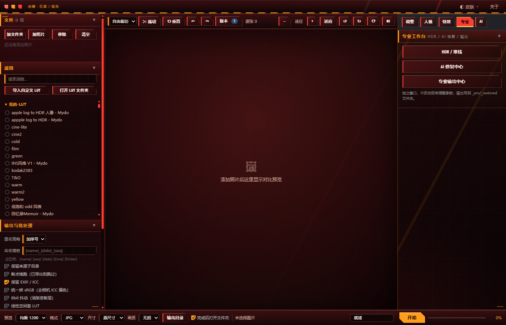

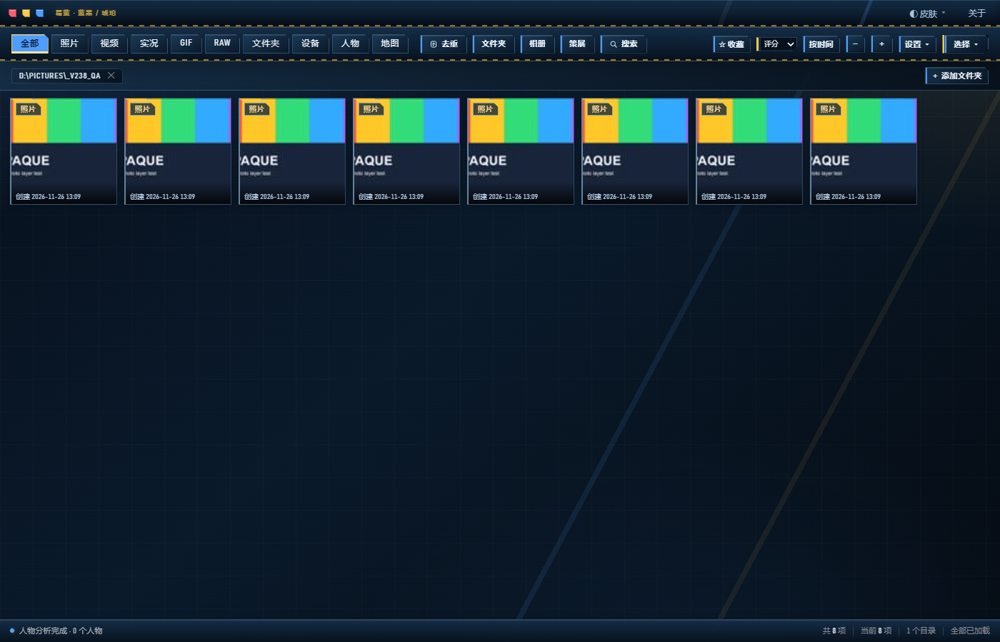

### v2.37 更新

- **液态玻璃卡顿修复**：`GlassBackdrop` 不再每 420ms 抓屏、模糊、JPEG/Base64 编码并整窗推帧；改为按需刷新，窗口激活、移动结束、缩放结束后延迟 520ms 取一帧，拖拽和缩放过程中不抓屏，缩略底图宽度上限从 640 降到 560。相册打开时只推启动帧和激活帧，日志中不再出现持续刷屏。
- **相册抽风修复**：`aurora-glass.css` 关闭 `.alb-cell`、`.bin-cell`、`.dup-group` 的逐格入场动画（原动画含 `opacity + transform + filter:blur(3px)`，377 个格子会生成大量带模糊的合成层），同时关闭相册 / 回收站 / 去重面板、左右栏、整页揭幕、顶栏无限扫光和逐格横向光带的大图层动画；弹窗只保留轻量淡入。只改视觉层，布局、事件和业务函数未动。
- **实测帧率**：液态玻璃相册 377 项，`.alb-cell` 的 `animationName` 为 `none`；热缓存连续滚动 115 帧，平均 16.68ms、P50 16.70ms、P95 16.80ms、最大 16.90ms，稳定 60fps；冷缓存首轮滚动可能夹一次缩略图解码长帧（实测约 150ms），属于单次图片解码，不是持续掉帧。缩略图仍按可视区懒加载，滚动中不再出现整屏闪白或抖动。
- **新增三套装甲风主题**：`紫夜`（紫黑配色 + 荧光绿点缀，`#8a5cff` / `#b9ff3d`）、`霜蓝`（蓝黑配色 + 琥珀点缀，`#4f9dff` / `#ffc94a`）、`赤霞`（红黑配色 + 橙光点缀，`#ff3b30` / `#ff9f1a`）。三套共用独立外壳样式，分别配置配色；覆盖标题栏、工具栏、底栏、左右面板、按钮、输入框、滑块、标签页、LUT 列表、相册网格、相册顶栏 / 底栏、设置菜单、右键菜单、弹窗、回收站、去重、专业工具、AI 面板和皮肤菜单。所有规则只作用于主题作用域，不接管页面 DOM、不修改任何业务函数。
- **主题识别元素**：标题栏左侧 HUD 标识分别为 `紫夜 · 紫黑 / 荧光绿`、`霜蓝 · 蓝黑 / 琥珀`、`赤霞 · 红黑 / 橙光`；紫夜为绿色六边形装甲片转场 + 核心闪光，霜蓝为蓝色菱形同步片 + 双线同步环，赤霞为斜切装甲片 + 横向橙红斩击。三套主题的窗口底色、启动 Splash、按钮 / 激活标签 / 输入框 / 滑块 / 弹窗 / 回收站 / 去重卡片均按各自配色。
- **主题层回归中修掉的问题**：相册激活标签实际类名是 `.on` 而非 `.active`，已补 `.on`；回收站缩略图使用内联 `background-image`，原规则用 `background` 简写会清空图片，已改为只设 `background-color`；编辑器内回收站 `.bin-grid` 行高塌成 2px，已补 `grid-auto-rows:max-content`；编辑器顶部分组标签、二级标签、专业弹窗标签和内联蓝 / 紫按钮已补主题规则；标题栏原半透明会透出下层程序文字，已改为实底 + 装甲层。
- **切肤样式隔离**：`skin-core.js` 切肤后移除其他 `link[data-skin-css]`，页面不再同时驻留多套主题 CSS，减少样式冲突与额外合成开销；三套装甲主题也加入 html / body class 和切肤动画清理。
- **命名说明**：三套主题只按配色与气质命名，不使用作品、角色或代号名称；旧版配置的内部标识仅作为兼容，不在皮肤菜单、README 或界面文案中展示。
- **安装包**：`图片批处理工具_v2.37_安装包.exe` 1,292,386,703 字节，SHA256 `496D46461CA75D561A06B0FC7AC19D7A3EBC87CCC9B3052194F2794C74A6E785`；内部 offsets `141824,704000,2596864,2708803,581137221`，footer marker `IBPK2`；相册包与编辑包已通过 7z 完整性校验。完整记录见 [`v2.37_回归测试报告.md`](v2.37_回归测试报告.md)。

### v2.36 更新

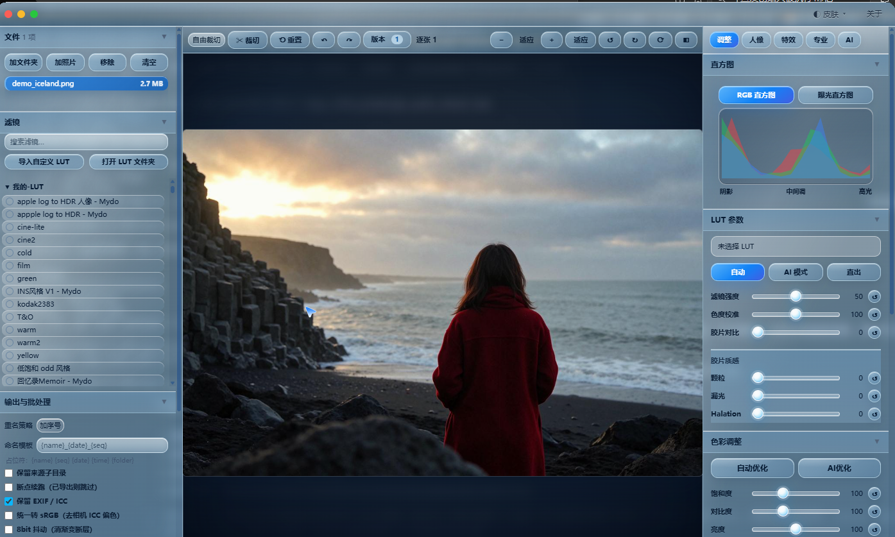

- **背景不再是乳白**：液态玻璃从高白乳白改成冷蓝烟玻璃。窗口本身保持不透明，页面底层显示 C# 端每 420ms 更新的桌面模糊快照，上面叠冷蓝薄雾与深色 veil；左右面板、标题栏、工具栏、相册内容区、底栏全部换成带斜向反光的饱和冷蓝玻璃。
- **照片不再跟着透明**：去掉整窗 `LWA_ALPHA` 后，照片、相册缩略图、回收站缩略图、去重缩略图作为不透明 CSS 图像叠在玻璃上层，强制 `opacity:1`；同时删除相册 / 回收站 / 去重格子上的 `::before / ::after` 白色装饰高光，避免照片被白雾盖住。只有界面背景、菜单和浮层允许半透明。
- **窗口 R 角恢复**：主窗口和鼠标桥接层都设置同形状 14px GDI `Region`，四角不再出现直角黑边。编辑页与相册全窗截图 `corner_tl/tr/bl/br` 均实测为圆角。
- **菜单 / 子界面可读性**：皮肤菜单、相册设置菜单、相册下拉 / 右键 / 导入弹窗改为“实底 `background-color` + 近实底渐变”，不再只依赖 alpha 渐变；标题、分区标题、条目、描述、脚注统一压深并加粗，按钮和输入框保持深色字。文件列表选中行改为高饱和蓝底白字。
- **验收**：编辑页加载 1600×1000 测试图，照片完全饱和、无下层透出；实际鼠标点击皮肤按钮可展开菜单，菜单文字清晰；相册 377 项缩略图不透明，回收站 298 项 / 13.8MB 缩略图正常；去重窗口 33 组 / 357 张缩略图不透明；编辑页和相册四角均实测圆角。
- **安装包**：`图片批处理工具_v2.36_安装包.exe` 1,292,270,766 字节，SHA256 `3E9C40EF6F8E0A4466659790744D6B9B47ECD7BA298F966D19D403A17A5E43D5`；内部 offsets `43008,605184,2498048,2609987,581030480`。完整记录见 [`v2.36_回归测试报告.md`](v2.36_回归测试报告.md)。

### v2.33 更新


- **点击穿透根因**：v2.32 用 Fuchsia 色键做透明，Windows 会把整窗命中测试当成透明区域跳过，WebView2 子窗口再带 `WS_EX_TRANSPARENT`，鼠标消息全部落到下层窗口；界面能看到但所有按钮、标签、输入框都点不中。
- **改用整窗 alpha**：删除 `TransparencyKey`，改为 `WS_EX_LAYERED + SetLayeredWindowAttributes(LWA_ALPHA)`；空状态 alpha 238、载入照片 250、相册 244，可在页面内用 `glassalpha|…` 动态调整。分层样式必须等 WebView2 真正画出第一帧后再加，否则整块网页会不显示；因此首帧前保持不透明深色，`ready` 后 260ms 再切半透明。
- **鼠标桥接层**：WebView2 透明页必须保留 `WS_EX_TRANSPARENT` 才能显示，而它又会放行鼠标。v2.33 在主窗口上方铺一层 1.2% 不透明度的无边框、`WS_EX_NOACTIVATE` 桥接窗口，截住鼠标后把 `WM_MOUSEMOVE / LBUTTONDOWN / LBUTTONUP / LBUTTONDBLCLK / RBUTTON… / MOUSEWHEEL` 原样转给 `Chrome_RenderWidgetHostHWND`；点击、滑块拖拽、滚轮、双击、输入框聚焦和键盘输入均恢复。顶部空白条走原生 `HTCAPTION` 拖动，左右交通灯与「皮肤 / 关于」仍交给网页。
- **原生对话框不挡**：窗口失焦（打开系统文件 / 文件夹对话框）时桥接层自动隐藏，回到前台再出现，避免 1.2% 的覆盖层挡住资源管理器对话框。
- **去重窗口降级为不透明深色**：去重是独立顶层窗口、长列表且没有桥接层，继续用透明页会既难读又点不中；v2.33 统一映射为深色不透明皮肤，扫描、全选、忽略本组、移入回收站等按钮全部可点。
- **验收**：编辑页实际鼠标点击皮肤菜单、切换人像 / 特效分页、在「搜索滤镜」输入 `kodak` 均通过；相册实际点击「照片」筛选从 377 项变 361 项，设置菜单→回收站 298 项缩略图正常，回收站关闭按钮可用；去重窗口 33 组 / 357 张，点击「开始扫描」后缩略图正常载入；拖动窗口从 50,50 移到 360,136 后桥接层同步跟随。四套非液态皮肤原生点击正常。
- **安装包**：`图片批处理工具_v2.33_安装包.exe` 1,275,631,872 字节，SHA256 `49F543BE1ADC60510BAA6F1C3628CF6E451EBD1CADEF4508A230F53858E19798`；内部 offsets `43008,605184,2498048,2609987,573233071`。静默双组件安装退出码 0，`版本说明.txt` 为 v2.33，安装版编辑器 / 相册 EXE 与页面哈希同源码一致，卸载后目录、快捷方式与 HKCU 卸载项均清理干净。完整记录见 [`v2.33_回归测试报告.md`](v2.33_回归测试报告.md)。

### v2.32 更新


- **液态玻璃改为真透明（v2.33 已替换）**：v2.31 的背景是启动时抓的一张桌面位图，窗口本身仍不透明，所以拖动窗口时画面不跟随、看着像「贴了一张图」。v2.32 改为 Win32 `TransparencyKey` 色键 + `BackColor` 同色 + WebView2 `DefaultBackgroundColor=Transparent`，同时移除页面 `html/body` 的深色不透明底；窗口边缘、标题栏和面板间隙现在会实时透出下方窗口与桌面。该方案在部分系统上会导致整窗点击穿透，v2.33 已改为「整窗 alpha + 鼠标桥接」。
- **面板改为乳白磨砂玻璃**：真透明下若面板过透，壁纸和浏览器文字会穿透、影响阅读。左右面板 `rgba(249,253,255,.90)`，标题栏 / 工具栏 / 底栏 `.86`，折叠标题 `.80`，仍保留原有径向与线性高光；照片预览区保持不透明深色画布，避免桌面内容透进照片。相册内容区增加 `.alb-body` 乳白磨砂承托。
- **Windows 端能力边界**：WebView2 的 `backdrop-filter` 只对页面自身内容生效，无法对桌面做系统级高斯模糊；因此液态玻璃是「真透明 + 半透明乳白磨砂」而不是桌面系统原生材质模糊。已验证 DWM Mica/Acrylic、legacy Accent、`WS_EX_NOREDIRECTIONBITMAP`、`DwmEnableBlurBehindWindow` 等方案在 Windows 10 + WebView2 组合下均拿不到可用的实时桌面模糊，未采用。
- **智能扩图修复比例失真**：旧 `bottom + 50%` 把 360×584 扩成 360×876，OpenCV 模板匹配确认输出顶部 75% 与原图 `scale=1.0 (0,0)` 分数 1.000，错误全部来自新增底部 292px：模型在遮罩区自行补下半身，身体比例与近景头肩不一致，形成「头大身子小」。v2.32 改为 `b3_extend`：只扩大画布，原图矩形逐像素贴回，新增区只做背景延展与景深虚化，不再重绘人物。
- **两种背景延展策略**：左右窄边顶部 45% 做 Canny 边缘密度检测，<5% 判为纯色 / 棚拍背景，按左右窄边中位色与上下明暗渐变铺满；复杂背景从边缘取窄条、翻转重采样后高斯虚化，避免出现硬框和竖向拉伸条纹。
- **竖图不再向下补腿**：方向 `all` 对竖图固定 `top=0 / bottom=0`，只扩左右；`vertical`、`bottom` 已从下拉框移除，仅保留「四周 · 竖图只扩左右 / 左右 / 向左 / 向右 / 向上」。UI 标签由 `Outpaint` 改为「本机 · 背景延展」，按钮「背景扩图」，状态文案明确「只扩背景，人物比例不变；竖图不补腿」。
- **回归结果**：编辑页 1400×900 真透明实测，`html/body` 计算背景 `rgba(0,0,0,0)`、`--live-glass` 为空、`glass-static` 已移除；运行时 frost→aurora 切换后仍恢复真透明。相册 377 项、回收站 298 项、皮肤菜单、AI 工具箱面板均实测。B3 复杂背景输出 720×584，纯色背景人像输出 930×806，人物完整、头身比正常，接缝为柔和软边界。
- **安装包**：`图片批处理工具_v2.32_安装包.exe` 1,275,743,625 字节，SHA256 `143BC1B90A1DA0BE624334FF391443B2ADFCB494FF3DF5E7818C8662E7554008`；静默双组件安装退出码 0，`版本说明.txt` 为 v2.32，两个 EXE 均内嵌「版本 2.32」，安装版 `ai_tools.py` / `edit.html` 与源码哈希一致。完整记录见 [`v2.32_回归测试报告.md`](v2.32_回归测试报告.md)。

### v2.31 更新


- **液态玻璃菜单修复**：`skin-core.css` 的 `lgPopIn` 动画组不再作用于 `.skin-menu`，选中皮肤后菜单即时收起；编辑页 CDP 实测关闭后 `class=skin-menu`、`opacity 0`、`pointer-events:none`，再点触发按钮可重新打开。
- **液态玻璃观感重做**：固定粉 / 青 / 紫 / 薄荷环境光 + `screen` 混合；左右面板、顶栏、底栏、折叠标题改为半透明乳白玻璃，加 40px 模糊、205% 饱和与内侧高光；菜单提高不透明度并保留彩色折射。相册顶栏、路径栏、底栏、回收站面板同步覆盖。背景仍是启动时一帧桌面快照，拖动窗口不实时跟随（v2.32 已改为真透明窗口，v2.33 再改为可点击的整窗半透明）。
- **AI 工具箱去编号、去说明**：15 项精简为 10 项；删除所有 `A1–A7 / B1–B8` 前缀，只显示「基础增强 / 创作增强」和功能名称；删除「全部在本机运行…」「选择一张图片，展开对应工具。」以及底部产品边界文案。分组为：
  - 基础增强：换背景 / 换天空、面部局部精修、一键打码、智能裁切构图、照片评分 / 挑片
  - 创作增强：一键抠图（透明底）、智能消除、智能扩图、老照片修复 / 上色、去反光 / 去雾
- **删除文字找图**：AI 工具箱中的文字找图入口、前端 `aiA6`、标签映射均已删除，不再出现在界面。
- **人像 AI 独立分区**：眼神光 / 微笑强化、重新打光、人像造型移到「人像」分页，排列在「美颜」之后、「证件照」之前，独立为「人像 AI · FLUX」折叠组。
- **风格化移到特效页**：风格化生成从 AI 工具箱移到「特效」分页，位于「移轴效果」之后，独立为「风格化 · FLUX」。
- **风格化 16 种 + 自定义**：电影胶片、日系动漫、古典油画、铅笔素描、赛博朋克、水彩插画、水墨丹青、像素艺术、黏土手办、3D 渲染、黑白胶片、波普拼贴、童话插画、时尚大片、复古胶片、极简线稿；新增自定义输入，填写后优先于预设，提示词保留五官、身份与构图。
- **人像造型 12 种 + 自定义**：商务西装、晚礼服、婚纱、国风汉服、新中式旗袍、街头潮流、复古港风、学院风、千禧潮流、户外机能、韩系清新、文艺复古；新增自定义输入，保留脸型、五官、身份、姿势与背景。
- **智能扩图重做**：旧镜像拼贴 / 全图重绘会产生矩形接缝、黑条和「第二件衣服」。新版先裁掉 1–8px 纯黑边，顶部为纯色背景时用 `BORDER_REPLICATE` + 高斯羽化在本机延展，原图矩形严格保护，0.1s 返回；人像竖图自动禁止向下拉长身体。复杂背景仍走 FLUX 遮罩续画，模型方案在强对比衣缘仍有接缝风险（v2.32 已改为纯本机背景延展，不再调用 FLUX）。
- **智能消除新增图上涂抹**：点「智能消除」先打开全屏涂抹层，画笔 8–120、橡皮、清空、补充说明；红色笔迹导出为黑白 mask，可选「快速纹理消除」（OpenCV Telea 修复，0.1s 级）或「AI 消除」（FLUX 遮罩重绘，约 80s）。结果进入统一预览，可加入编辑器或保存输出。
- **安装包**：`图片批处理工具_v2.31_安装包.exe` 1,275,731,132 字节，SHA256 `5BF529AB37AFABF772C9E3E42C93B37224BB60CA83ACC8C43F2789DEFA8330AB`；静默双组件安装到 `C:\tmp_v231_qa` 退出码 0，`版本说明.txt` 为 v2.31，两个 EXE 均内嵌「版本 2.31」。完整记录见 [`v2.31_回归测试报告.md`](v2.31_回归测试报告.md)。

### v2.30 更新


- **顶部去掉「专业」按钮**：图片编辑预览图上方的工具栏已移除「⚙ 专业」，该位置只保留「逐张」；右侧分组里的「专业」入口、专业中心与原有功能保持不变。
- **右侧第 5 分组更名「AI」**：原「生成式」分组文本改为「AI」，内部 `data-g="gen"`、分页映射与生成式修图面板均不变，避免破坏已有功能。
- **AI 分页新增 15 项工具**：A1–A7 基础增强、B1–B8 创作增强，入口全部在「AI」分页；每项都有独立参数、运行状态与结果弹窗，结果可「作为新图片加入编辑器」或「保存到输出目录」。
- **本地执行**：A 组以 ONNX / OpenCV 小模型为主，B 组复杂生成走本地 FLUX。输入取当前编辑底图，输出独立文件，不覆盖原图；A6 只在当前编辑列表内检索，不扫描整块硬盘。
- **新皮肤文字可读性重做**：液态玻璃、柔光白、墨色玻璃三套皮肤下，编辑页正文与 LUT 列表、AI 工具箱、相册缩略图 meta / 角标、回收站实体面板、去重页分组与按钮统一提高对比度；浅色皮肤用深色正文与白卡片，墨色玻璃用深底白字与轻阴影。只改 CSS / 配色，不改 DOM 事件与业务逻辑。
- **实测**：A1 虚化 / 纯色 / 渐变 / 换天空，A2 面部精修，A3 人脸打码，A4 横构图 626×352，A5 评分 80，A6 语义排序（安装版 3 张），B1 透明底，B2 消除，B3 扩图 938×1226，B4 修复 / 上色，B5 微笑强化，B6 重新打光，B7 去反光 / 去雾，B8 人像造型均通过 UI 实跑；编辑页三皮肤、相册三皮肤、回收站三皮肤、去重页液态 / 墨色 / 柔光白均截图核对。完整记录见 [`v2.30_回归测试报告.md`](v2.30_回归测试报告.md)。
- **安装包**：`图片批处理工具_v2.30_安装包.exe` 1,234,472,562 字节，SHA256 `879D0EC512FF35EF64AE443411403918E32377B1ADC5F94B33BC5C27FEFDD6AA`；静默双组件安装通过，安装版 `图片编辑.exe` / `相册.exe` 均内嵌「版本 2.30」，`版本说明.txt` 为 v2.30。

### v2.29 更新

- **液态玻璃性能重做**：移除 `GlassBackdrop` 的 170ms 桌面抓帧、缩放、BoxBlur、JPEG/Base64 编码与 WebView2 逐帧推帧链路；改为启动时只取一帧桌面底图（不落盘），之后不启动定时器。玻璃层次由 `aurora-glass.css` 的半透明面板 + 极光叠层承载，并在静态模式下关闭面板的二次 `backdrop-filter` 与顶栏 8 秒扫光。整棵 WebView2 进程树实测：编辑版空闲 8 秒 CPU 增量 0.17s（约 2.1% 单核，v2.28 同口径 4.08s / 81.6%）；相册版 0.02s（约 0.2%）。
- **生成式独立标签**：图片编辑右侧分组从 4 个扩展为「调整 / 人像 / 特效 / 专业 / 生成式」；「AI 生成式修图」从「人像」移到「生成式」，按钮排列在「专业」之后。v2.30 起该分组文本更名为「AI」。
- **兼容性说明**：Win11 25H2 的系统 Acrylic 实测会把窗口整体染灰且不透出下方窗口，因此 v2.29 不依赖 DWM Acrylic，也不使用透明色键；玻璃底图由一次性桌面快照 + 页面 CSS 叠层负责，避免再次引入系统合成差异。

### v2.28 更新


- **新增本地生成式修图**：图片编辑「人像」分组、美颜之前新增「AI 生成式修图」面板，标 `FLUX.2 Klein 4B`。这是生成式重绘，不是传统滤镜、磨皮或液化；模型在本机跑，不上传照片。
- **单底座、两套提示词模式**：同一套 FLUX.2 Klein 4B 权重，面板切「修图 / 人像」。修图覆盖风格化、换背景、去物体、局部重绘；人像覆盖提示词美颜、换妆、换装、瘦身粗调。6 个预设 chips 覆盖自然美颜、日常妆、黑色西装、脸部瘦一圈、棚拍柔光、换发色。
- **不打断实时预览**：模型不接入滑块预览链路。点「生成修图」才取当前 `cachedBase`（已应用裁切 / 水平校正 / 旋转）另存临时 PNG，交给 Python 生成；结果进独立弹窗，双栏对照原图与结果，不覆盖原图、不阻塞编辑器继续调参。
- **参数可控**：步数默认 4（蒸馏版），强度默认 0.78，长边 768 / 1024，种子 -1 随机或固定复现；人像模式可开「保脸」。
- **保脸后处理**：用 onnxruntime 直接跑 YuNet，手动解码 `cls / obj / bbox` 三个尺度并 NMS；检测到人脸椭圆后，只在脸内回注 18% 原图纹理。这样换背景、换妆、瘦身时五官不会完全被模型改写。OpenCV 5.0 的 DNN 解析器读不了该 YuNet ONNX，因此没有走 `cv2.dnn`。
- **尺寸与黑边修正**：输入按长边缩放且强制 64 倍数，VAE 解码不再出现边缘黑边；`sd-cli` 增加 `--vae-conv-direct`、`--cfg-scale 1.0`、`--guidance 1.0`、`--offload-to-cpu`，6GB 卡追加 `--max-vram 5.2`。
- **结果落地**：弹窗提供「作为新图片加入编辑器」「保存到输出目录」「关闭」。加入编辑器会以唯一文件名插入左侧列表并选中；保存写独立 PNG，文件名 `原名_genedit_时间戳.png`；未设输出目录时回落到当前原图所在目录，不再写进缓存目录。
- **首次下载**：基础安装包不含运行时和大模型。面板显示「缺少：推理运行时、扩散模型、文本编码器、VAE」与「下载模型（约 6GB）」，下载 `stable-diffusion.cpp` CUDA12、cudart、`flux-2-klein-4b-Q4_0.gguf`、`Qwen3-4B-Q4_K_M.gguf`、`flux2-vae.safetensors`；支持断点续传、SHA256 校验、zip 解压和 7GB 磁盘余量检查，进度改为全局 0–100%。
- **实测**：GTX 1660 Ti 6GB、驱动 621.24，576×768、4 步、强度 0.8，三次真实生成 98.24s / 99.04s / 99.06s；第一次 512×768 为 89.42s。人像保脸检测 1 张脸并成功回注。UI 端到端完成参数设置、生成、原图/结果弹窗、加入列表（文件数 1→2→3）、保存到源图目录；安装版首次启动正确显示缺模型状态。
- **安装包**：`图片批处理工具_v2.28_安装包.exe` 1,249,640,062 字节，SHA256 `28B9851051BFA8051795B4A42B473832565A2E4AA744D06DE6B8323BD767725A`；静默双组件安装 24.2s 通过，安装后 `ai/gen_edit.py`、`ai/genedit_install.py`、`edit.html` 均到位，`ai/genedit` 与 `ai/models/genedit` 确认为空。完整记录见 [`v2.28_回归测试报告.md`](v2.28_回归测试报告.md)。

### v2.27 更新

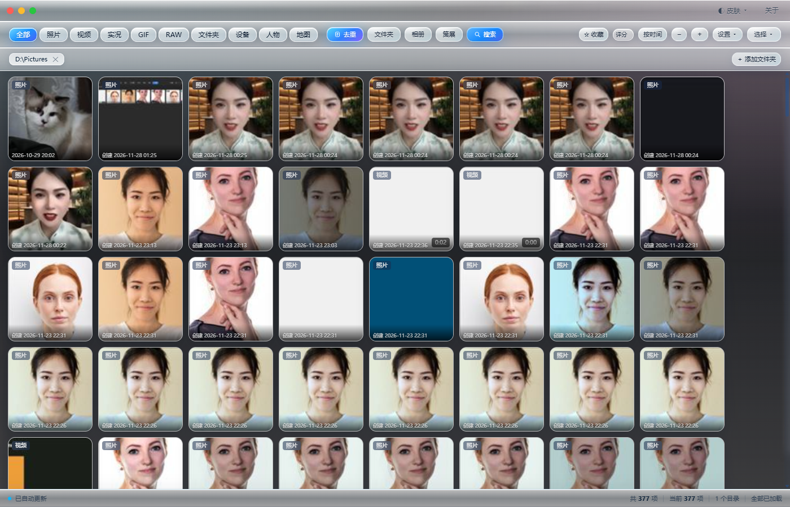

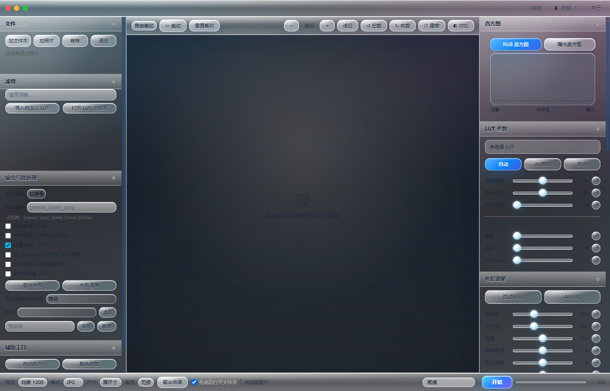


- **五套皮肤与排列**：菜单固定为「深色 / 墨色玻璃 / 浅色 / 柔光白 / 液态玻璃」——两套深色在前、两套浅色居中、液态玻璃压轴；选择后写入 `skin.txt` 与 `%APPDATA%\ImageBatchTool\skin_shared.txt`，相册、图片编辑、去重窗口同步跟随。
- **旧深色玻璃保留为「墨色玻璃」**：完整保留原深色半透明玻璃、冷调极光和烟熏磨砂观感，只更名与调整菜单位置，不改视觉文件内容。
- **液态玻璃改为真实实时背景**：新增 `GlassBackdrop` 桌面抓帧管线，按窗口在屏幕上的实际位置裁切、模糊、低频采样，再把帧推给页面的 `html.skin-aurora-html` 承载层。窗口移动、缩放、跨屏时背景随位置实时变化，是一层真正透出桌面的毛玻璃，不是静态画出来的假背景；透明窗口与 WebView2 合成在 Windows 上走的是“抓帧回填”，不依赖系统亚克力。
- **液态玻璃覆盖全部界面**：相册顶栏 / 工具栏 / 分类标签 / 照片卡 / 设置菜单 / 右键菜单 / 回收站、图片编辑标题栏 / 左栏 / 右栏 / 直方图 / 底栏 / 工具按钮 / 输入框 / 下拉 / 滑块 / 弹窗，以及专业 HDR、AI 修复、输出中心、去重独立窗口的分组卡片、工具条与数字阈值框；按钮为高光液态胶囊，输入框和下拉为半透明玻璃底，避免透明窗口下被采样成黑块。
- **子窗口顶栏统一**：去重窗口顶栏改为与主窗口一致的 38px 高度、红黄绿圆点、标题/副标题层级；五种皮肤分别跟随主窗口顶栏的深色、浅色、磨砂白与液态玻璃风格，不再出现独立窗口固定深色顶栏的割裂感。
- **换肤与页面过渡重做**：换肤使用玻璃棱镜撕裂、液体透镜、碎片飞散、中心爆闪、光带与环形扩散多图层组合，约 1.65s；页面进入加入整页斜向玻璃揭幕、顶栏/工具栏/底栏上浮、左右面板滑入、中心模糊缩放，弹窗与菜单弹入。所有动画均在 UI 层，不阻塞业务。
- **只改界面**：页面业务函数、C# 图片处理流程、去重算法、相册扫描 / 索引 / 回收站逻辑均未改动；五套皮肤由独立 CSS 承载，可单独替换。
- **回归结果**：五套皮肤逐一切换、五项菜单顺序与选中态、相册照片网格 / 回收站缩略图、图片编辑空态与注入照片态、去重 35 组 / 357 张、液态玻璃实时背景窗口移动前后对比、换肤冻结帧与页面揭幕中间帧均已实测。完整记录见 [`v2.27_回归测试报告.md`](v2.27_回归测试报告.md)

### v2.26 更新

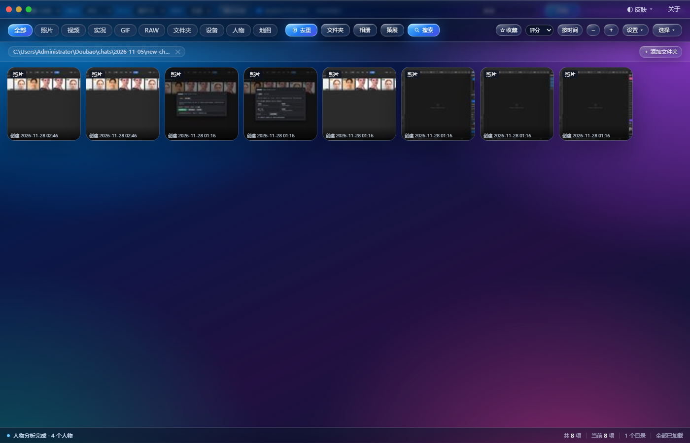


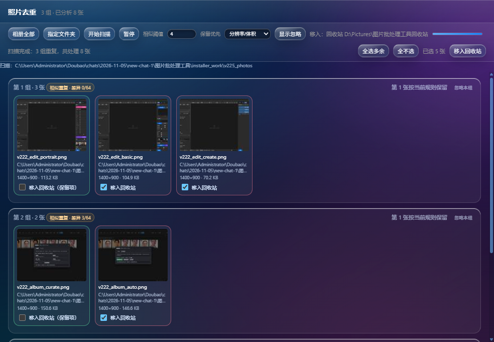

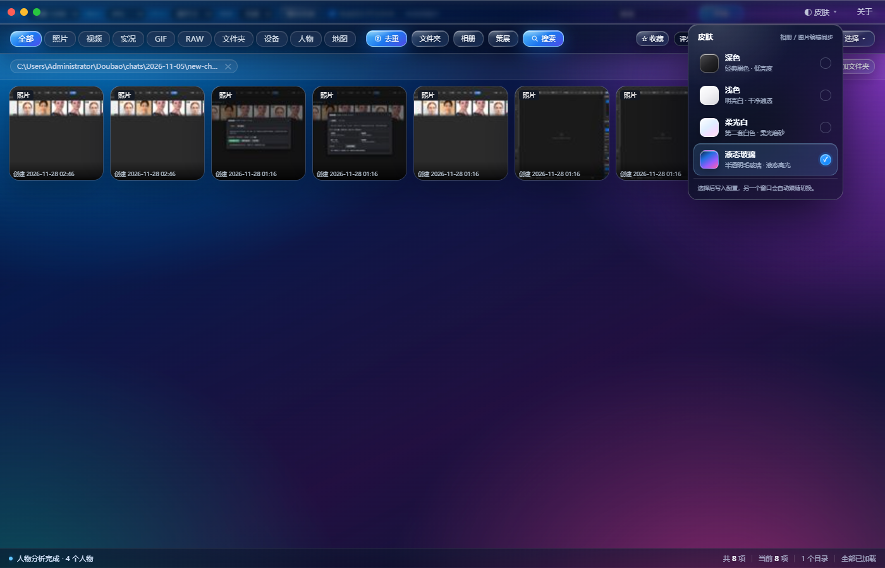


- **四套皮肤**：深色、浅色、柔光白、液态玻璃；上一版白玻璃观感完整保留为「柔光白」，新液态玻璃改为半透明烟熏玻璃 + 极光底色 + 液态高光控件。
- **全界面覆盖**：相册主界面、设置 / 右键菜单、照片卡、回收站、去重独立窗口、图片编辑空态与真实照片、专业工具 / HDR 弹窗、皮肤菜单全部适配；输入框、下拉、文本域、滑块和滚动条统一深玻璃与白色文字。
- **独立皮肤文件**：`skin-core.css` / `skin-core.js` 管菜单外壳、注册表、持久化与跨窗口同步；每一套皮肤一个独立 CSS，改一套不影响其它皮肤。
- **文案约束**：皮肤名称与介绍只描述外观，不写外部系统或品牌名称；菜单、README、发布说明均保持一致。
- **回归结果**：相册 298 项回收站、去重 3 组 / 8 张、图片编辑 7008×4672 实图、双进程皮肤同步、浅色 / 深色回归全部实测。完整记录见 [`v2.26_回归测试报告.md`](v2.26_回归测试报告.md)

### v2.25 更新

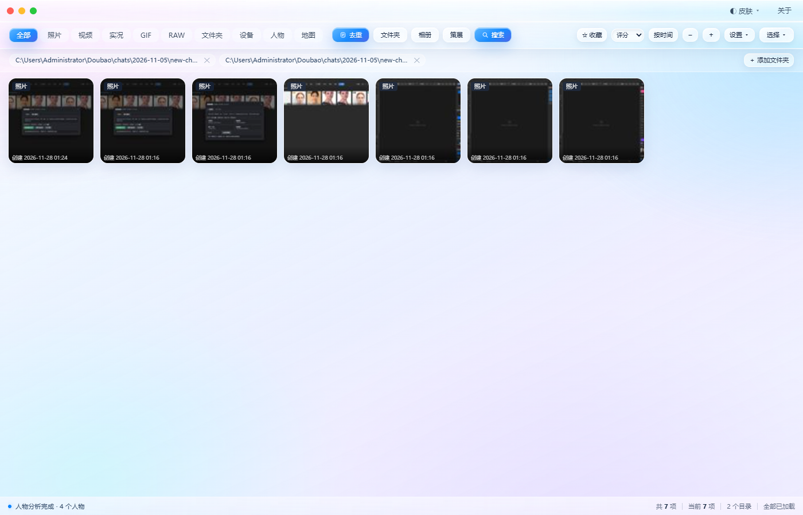

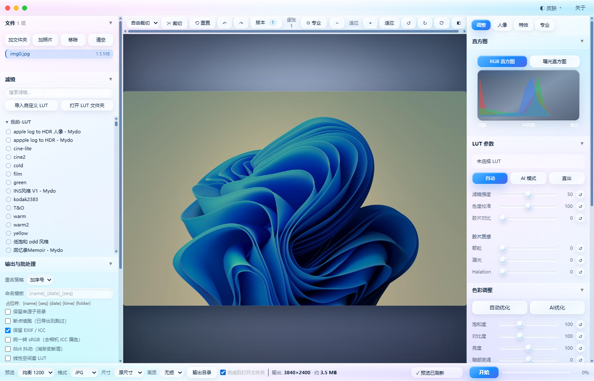

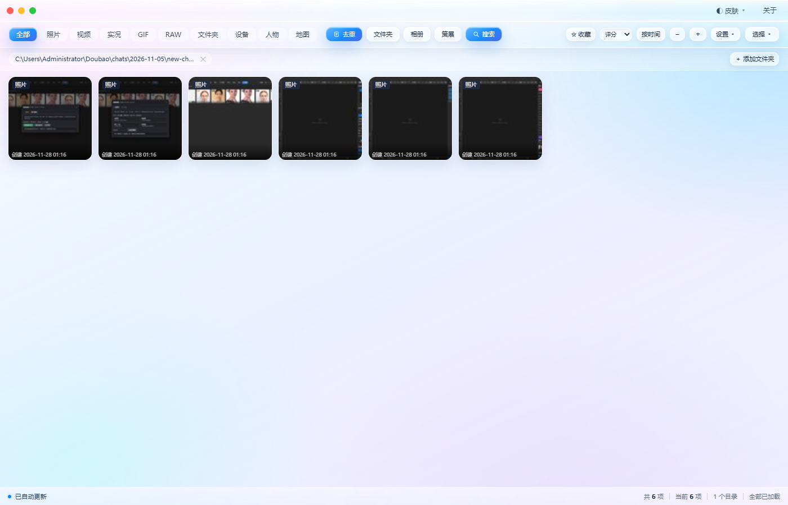

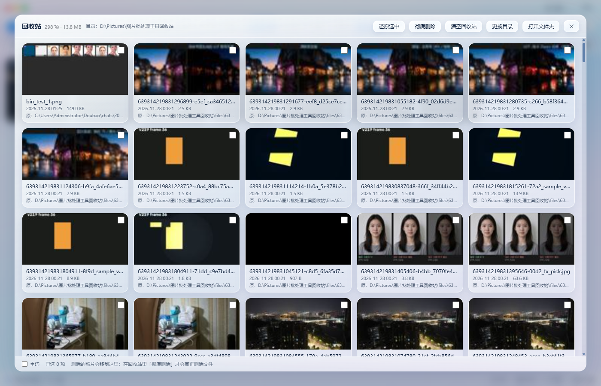

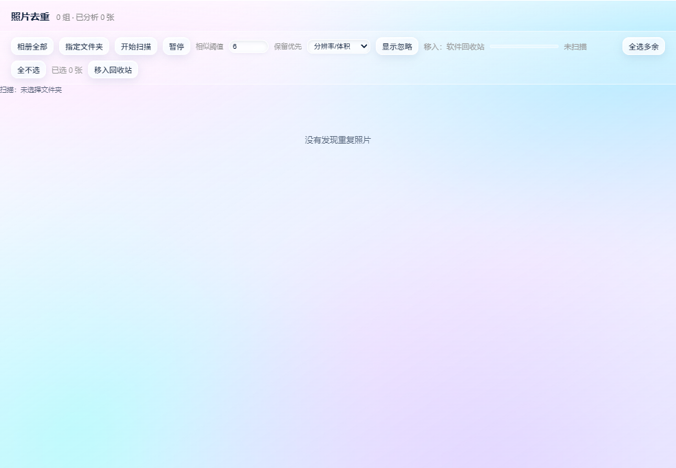

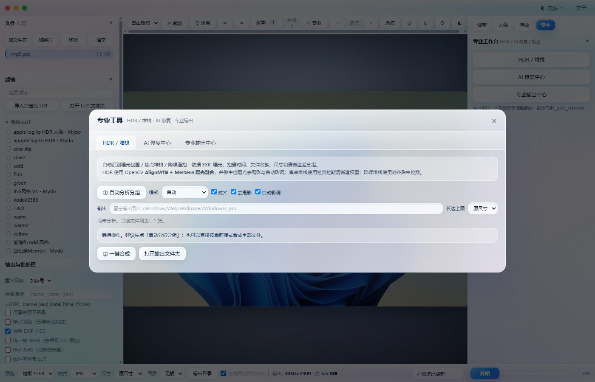

- **新增第三套磨砂玻璃皮肤（v2.26 起改名「柔光白」）**：以半透明磨砂玻璃、蓝色/粉色柔光背景、细高光描边和轻折射高光为基底，覆盖相册与图片编辑的标题栏、左右面板、预览区、底部栏、工具栏按钮、输入框、搜索框、下拉、滑块、滚动条、直方图、设置菜单、右键菜单、弹窗和回收站；去重独立窗口同步适配
- **切换过渡动画**：颜色与背景平滑过渡，进入磨砂玻璃时叠加柔光扫过与玻璃面板上浮入场；深色/浅色皮肤仍沿用原有切换方式，不新增扫光效果
- **皮肤入口改为下拉菜单**：相册与图片编辑右上角「皮肤」点击展开菜单，列出深色、浅色、磨砂玻璃三项并显示当前选中状态；选择后写入 `skin.txt`，另一个已打开窗口自动跟随切换
- **启动外观对齐**：页面启动后主动向宿主读取一次当前皮肤，即使浏览器 `localStorage` 与 `skin.txt` 不一致，也会自动对齐，避免启动时短暂或持续显示旧皮肤
- **独立皮肤架构**：新增 `skins/skin-core.css`（菜单外壳与切换过渡）、`skins/skin-core.js`（注册表/应用/持久化/同步/菜单）、`skins/liquid-glass.css`（磨砂玻璃全部外观）。页面只保留一行核心脚本引用，新增皮肤只需增加一个独立 CSS 并在 `SKINS` 注册表加一条，不改页面业务逻辑，也不影响其它皮肤
- **回归结果**：相册主界面/照片卡/设置菜单/回收站 298 项、图片编辑空态/加载真实照片/人像/特效/专业工具、去重窗口全部以磨砂玻璃实测；深色/浅色静态界面保持原样；安装包内两模块均包含 `skins/` 三份文件。完整记录见 [`v2.25_回归测试报告.md`](v2.25_回归测试报告.md)

### v2.24 更新

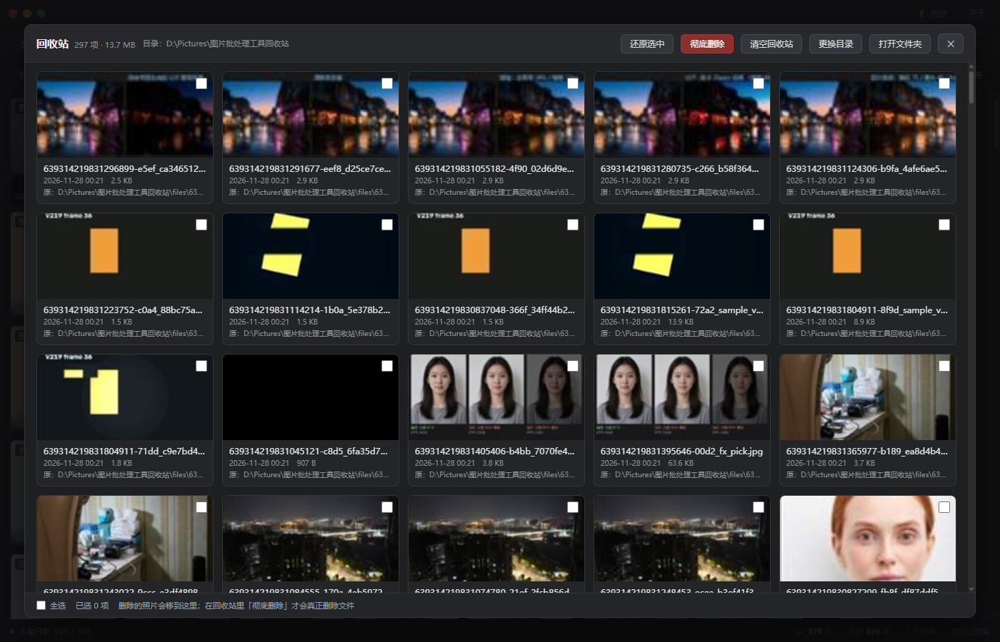

- **修复回收站缩略图消失**：`album.html` 的 `.bin-grid` 原先把隐式行高按 `auto` 计算，WebView2 中每行被压成 2px，卡片内容被 `overflow:hidden` 裁掉；缩略图其实已加载但完全看不见。已给网格加 `grid-auto-rows:max-content`，行高恢复为 186px，缩略图和文件名正常显示。
- **真机验证**：用实际 297 项回收站数据验证，页签显示 `297 项 · 13.7 MB`，297 个格子均为 186px 高，297 张缩略图全部有背景图；浅色/深色皮肤均正常。
- **回归测试补充**：本轮同时确认 v2.23 的「调整 / 人像 / 特效 / 专业」标签、7 个 `.fx-row` 隐藏、双组件安装与 `/S` 静默卸载仍正常。
- **测试流程补充**：以后涉及页面/布局改动，必须实际打开回收站、相册、编辑器等页面确认缩略图和内容真的渲染，不能只验证 DOM 数量、`display` 或接口返回。

### v2.23 更新

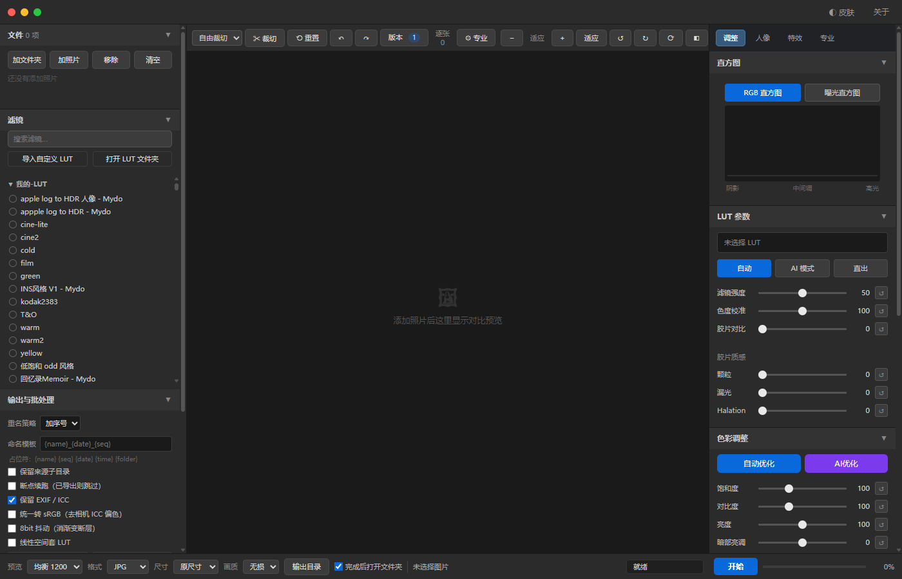

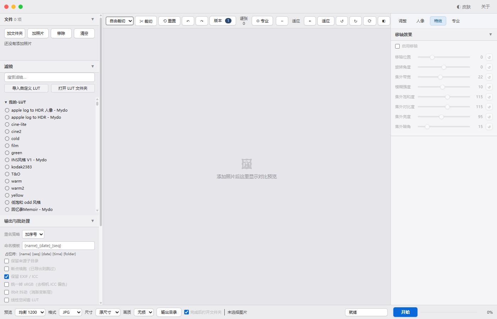

- **示例缩略图全部移除**：编辑器 AI 增强下的「超分 2× / 景深」、辅助工具区「自动挑片 / 配色提取 / 参考图→LUT」、以及「8bit 抖动」等 `.fx-row` 缩略示意卡不再显示；相册等其他页面的同类图卡同步隐藏。只做视觉隐藏，`showFx()` 与图卡 DOM 保留，不改业务逻辑和事件。
- **新增「特效」标签**：编辑器右侧分组改为「调整 / 人像 / 特效 / 专业」；「移轴效果」从「人像」移入「特效」，参数、开关、参考线与合成逻辑保持原样，仅调整 UI 归类。
- **回归结果**：源码与安装后编辑器标签顺序均为 `调整 → 人像 → 特效 → 专业`，7 个 `.fx-row` 全部 `display:none`、可见示例图为 0；移轴启用/参数仍可用。相册页面 7 个 `.fx-row` 同样隐藏。安装包通过双组件、仅相册、仅编辑器、含空格路径安装与 `/S` 静默卸载。完整记录见 [`v2.23_回归测试报告.md`](v2.23_回归测试报告.md)

### v2.22 更新

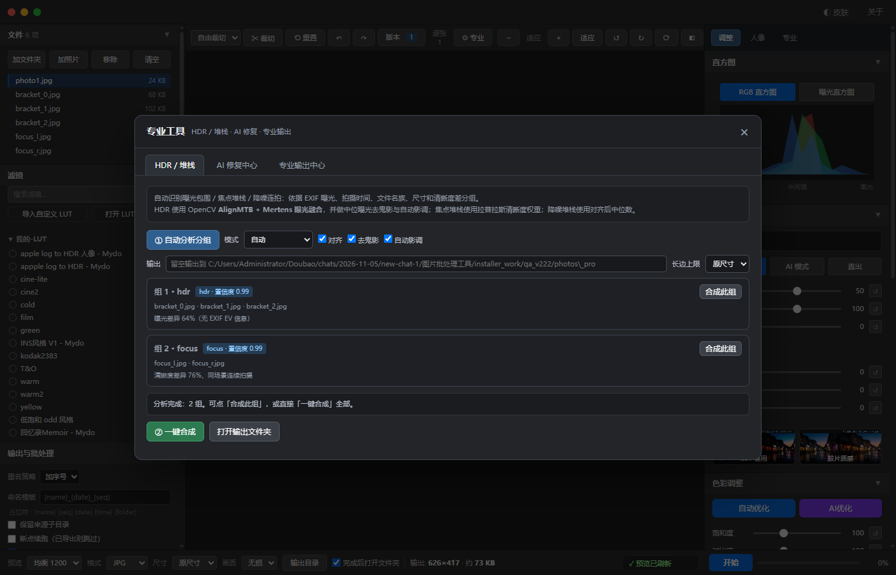

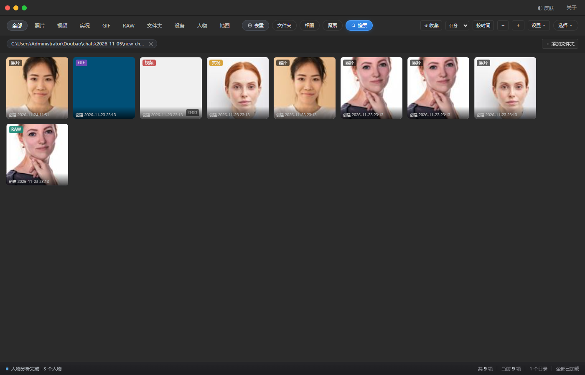

- **AI 模型全部内置**：相册端 CLIP 图像/文本编码、YOLOX、OCR、SFace、YuNet，编辑器端 GFPGAN v1.4、Swin2SR x4、Depth Anything V2、BiSeNet、FaceMesh、YuNet 均随安装包释放；首次启动无需联网下载模型
- **HDR / 堆栈**：新增 `ai/hdr_stack.py`。HDR 使用 OpenCV `AlignMTB + Mertens` 曝光融合，按中位曝光做去鬼影与自动影调；焦点堆栈按拉普拉斯清晰度加权融合；降噪堆栈使用对齐后的中位数。自动分析会按 EXIF 曝光/拍摄时间、目录、尺寸、文件名族、亮度差、清晰度差把素材分成 HDR / 焦点 / 降噪组，并给出置信度；支持逐组「合成此组」与多组「一键合成」批量输出
- **AI 修复中心**：新增 `ai/restore_center.py`，复用包内 GFPGAN、YuNet、Swin2SR，提供人脸细节修复、人脸修复强度、2×/4× 超分、降噪、污点/划痕修复、自动影调；批量处理后可预览结果
- **专业输出中心**：新增 `ai/output_center.py`，支持联系表（含中文标题/文件名标签）、批量水印（九宫格位置/透明度/字号/白边/可选 logo）、ICC 软打样（先转目标 ICC 再回 sRGB 生成预览，不改原片），并可打开输出目录
- **编辑器 UI 重排**：顶部工具栏新增「⚙ 专业」入口；右侧栏改为「调整 / 人像 / 专业」三个 sticky 分组，按原有 `.right-section` 标题归类，分组只控制显隐，不移除 section、不修改事件处理器
- **相册智能策展**：顶栏「相册」旁新增「策展」，可按全部照片、收藏精选、评分 ≥4 星、当前搜索、年度/月份创建智能相册；规则写入 `meta.albums` 的 `smart/rule`，复用现有过滤与保存逻辑，不移动/删除照片
- **相册导入自动化**：设置菜单「照片管理」新增「导入自动化…」，集中展示既有 `FileSystemWatcher` 的监视根目录、索引条目、AI 标签数量/状态，并提供添加监视文件夹、重新扫描、打开设置
- **功能归位**：修图类功能（AI 修复、人脸/超分/降噪/划痕、专业输出）归入图片编辑端；相册策展、智能相册、导入自动化归入相册端；两端入口互不混用
- **HDR 技术说明**：本轮调研了 AHDRNet、DeepHDR 等 AI HDR 方案，但其 PyTorch 权重与当前便携 onnxruntime 包不兼容，因此采用成熟的 OpenCV 融合 + 启发式自动分组；界面标为「HDR 使用 OpenCV AlignMTB + Mertens 曝光融合」，没有把启发式分组宣称为 AI 模型
- **安装器**：安装向导补齐图标；卸载器支持 `/S`（等价 `--quiet`）静默卸载，静默模式仍执行目录、桌面快捷方式、HKCU 卸载项与配置清理
- **回归结果**：干净全量 stage 与最终安装包均完成编辑器加载/撤销重做/批量导出、HDR 自动分组与批量合成、AI 修复 6/6、联系表/水印/ICC、相册 AI 索引 9/9 + 语义搜索、智能策展、导入监听、双组件/单组件安装、含空格路径、静默卸载与 GUI 向导验收。完整记录见 [`v2.22_回归测试报告.md`](v2.22_回归测试报告.md)

### v2.21 更新

- **修复私密相册「修改密码」崩溃**：`albPrivateSetDo()` 里用于保存新密码的 `p` 原为 `const`，进入修改密码分支后重新赋值会抛 `Assignment to constant variable`，界面停在原页且密码不生效；已改为 `let p`，并回归「启用 / 两次输入不一致 / 错误密码 / 查看隐藏照片 / 修改密码 / 旧密码失效 / 关闭私密相册 / 关闭后不可隐藏」全流程
- **修复预设导出文件名版本不一致**：图片编辑导出预设的下载名在 v2.21 里仍写死为 `_v220预设.json`，已改为 `_v221预设.json`；预设 JSON 的 `version` 同步为 2.21，导入/非法文件提示保持正常
- **回归结果**：相册全控件套件 15/15、图片编辑控件套件 22/22、去重控件 7/7，另补去重阈值 2/14、五种保留优先规则、忽略组显示/隐藏专项；私密相册专项全流程通过；安装器 UI、静默单装相册/单装图片编辑/双组件、含空格中文路径、快捷方式、注册表、卸载确认/取消均通过。完整记录见 [`v2.21_回归测试报告.md`](v2.21_回归测试报告.md)
- **版本规则**：本轮源码有修改，版本按约定从 2.20 升到 2.21；v2.21 安装包已重新组装并验证载荷 SHA256

### v2.19 更新

- **相册管理全量落地**：根目录文件夹树、手动/智能相册、收藏与 1–5 星评分、☆ 收藏筛选、评分筛选、保存搜索 chips 与搜索历史；顶栏「文件夹」「相册」入口和右键菜单补全
- **照片整理**：设置菜单/选择菜单加入导入照片与视频、批量重命名、批量移动/复制、隐藏/取消隐藏、加入相册；人物页支持重命名、合并、拆分选中、隐藏/显示隐藏人物
- **私密相册**：独立密码入口，密码摘要优先走浏览器 `crypto.subtle`，不可用时回退后端 SHA-256；隐藏项通过统一筛选管线生效，浅色皮肤同步适配
- **导入向导**：来源/目标目录、按拍摄日期建子目录、跳过同名同大小文件、导入后移动原文件，带进度条与统计
- **去重增强**：支持「相册全部 / 指定文件夹」范围、相似阈值 2–14、保留优先规则（分辨率 / 文件夹层级 / 修改时间新或旧 / 收藏评分）、显示/隐藏忽略组；组头区分「完全重复 / 相似重复」并显示差异位数 N/64，忽略组持久化到 `localStorage.ibt_dup_ignored`
- **去重引擎**：移除 6000 张桶上限，改为 4×16 位 band 候选索引；后端输出 `k:"exact"|"similar"`、最小汉明距离 `sim` 及修改时间/文件夹/评分字段，阈值 2–14 均可用
- **图片编辑专业调整**：新增曲线（master + RGB，5 控制点单调三次插值）、HSL（6 色相带）、镜头校正（桶形/枕形、色差、暗角）、水平校正（自动裁最大内接矩形）、1–3 个径向羽化局部蒙版、智能消除（邻近纹理矩形填充 + 羽化）
- **编辑工作流**：每张独立撤销/重做栈、版本菜单、逐张参数快照与恢复、批量参数下发、预设 JSON 导入导出、曲线画布、蒙版拖动/滚轮调半径、消除框选
- **素材与交付**：关键词/XMP 读写、视频抽帧与按时间裁剪、WebDAV 云备份（Basic Auth、TLS 1.2、AES-256-CBC 可选加密）
- **RAW 与格式**：图片识别新增 `.webp` 及 `.cr2/.cr3/.nef/.nrw/.arw/.srf/.sr2/.dng/.orf/.rw2/.raf/.srw/.pef/.raw`；系统解码失败时自动扫描内嵌 JPEG 预览并选最大可解码图（内嵌预览回退，不是完整去马赛克 RAW 解码）
- **安装包策略**：保留全部模型、Python 运行时与 LUT，不做瘦身；仅替换与 v2.19 功能相关的程序/页面/脚本

> 说明：当前环境没有 ffmpeg，视频裁剪使用 OpenCV mp4v，输出不含原音频；智能消除是纹理填充而非生成式模型；WebDAV 当前提供编辑器备份，暂未提供下载/解密恢复界面。

### v2.17 更新
- **修复相册底栏「开始」假导出**：独立相册原先只发送导出消息，后端用于批处理的文件列表为空，界面停在“开始渲染...”且不产出文件。现在按「已勾选照片 → 当前查看器照片 → 提示先选择」的顺序收集路径，并走新的 `albexport` 命令后台导出
- **修复相册快速开关查看器被旧定时器误关**：进入 / 退出定时器各自维护可取消句柄，快速关闭后再打开不会在 230ms 后被上一次的 hide 定时器重新隐藏
- **补齐美颜强度复位按钮**：图片编辑 40 个可见滑块现在全部带 ↺ 复位按钮，`beauty_strength` 点击后稳定回到 70
- **穷举回归**：图片编辑控件套件 22/22、相册控件套件 15/15、去重独立窗口 7/7；另覆盖编辑器与相册的原生对话框、窗口最大化/最小化、右键菜单、回收站浮层、文件夹/设备分组与人物/地图入口
- **安装与卸载真实闭环**：v2.17 安装包完成双组件静默安装、GUI 向导全流程、仅相册安装、仅图片编辑安装，以及取消卸载 / 确认卸载 / 静默卸载；安装文件、桌面快捷方式、HKCU 卸载项与卸载隔离均通过
- 完整记录见 [`v2.17_回归测试报告.md`](v2.17_回归测试报告.md)

### v2.16 更新
- **修复文件夹重复添加**：父目录与子目录先后加入时，不再因路径分隔符/大小写差异重复收录同一张图；拖放、文件/文件夹选择、移除、清空统一按归一化全路径去重
- **修复断点续跑 0 字节残留**：输出目录存在 0 字节同名文件时直接覆盖重导，不再生成 `_2` 并留下空文件
- **修复相册全选**：扫描完成后「全选」不再被误判为“扫描还在进行”，可正常选中全部已扫描照片
- **修复去重完成状态被覆盖**：扫描完成后稳定显示“扫描完成：N 组重复，共处理 M 张”，不再被“后台预分析”文案盖掉
- **补入图片编辑 `dedup.html`**：修复编辑包缺少去重页面资源的问题，`edit.7z` 文件数 2,559 → 2,560
- **回归结果**：图片编辑 43/43、相册 27/27，共 70/70 项通过；完整记录见 [`v2.16_回归测试报告.md`](v2.16_回归测试报告.md)

### v2.15 更新
- **修复「色温一动就全屏绿」**：统一 GPU / CPU 原生 / C# 兜底三条色彩链路的量纲；色温、色调不再被放大 100 倍，极小步进恢复为温和偏色
- **色彩调整全量回归**：图片编辑 GPU 34/34、CPU 34/34、C# 34/34；默认自动/AI 模式与全部滑块边界 37/37；相册 GPU 32 项、CPU 27 项通过；PNG/JPEG 导出与 3 张批量导出闭环通过
- **打包回归修复**：恢复安装器/卸载器的 v2.14 多分辨率图标，避免 v2.15 首次重编译时图标丢失
- **安装包清理**：构建时排除 WebView2 QA 缓存，安装包不再携带测试缓存
- 完整记录见 [`v2.15_回归测试报告.md`](v2.15_回归测试报告.md)

### v2.14 更新
- **相册重叠根目录去重**：父目录与子目录同时加入相册根时，同一文件只保留一条索引，修复总数虚高、分页缺项以及实况照片类型被覆盖的问题
- **根目录变更后自动补页**：移除/重新添加相册根后主动向后台补拉第一页，避免界面长时间停在 0 张
- **重复开始保护**：批量导出运行中再次点“开始”会被拒绝并提示，防止两个批次并发写同一输出列表、停止提示被后一个批次覆盖
- **完整回归**：相册 14 项、图片编辑 33 项及安装/卸载隔离全部通过；详见 `v2.14_回归测试报告.md`

### v2.13 更新
- **输出格式修复**：JPG / PNG / WebP 选择现在真实生效，证件照三种格式尺寸正确
- **GPU 并发崩溃修复**：预览与导出线程共用 D3D11 资源时加锁，原生 GPU 模块补资源失败检查与安全释放
- **停止批次提示修复**：停止后显示“已停止：完成 N/M 张”，不再被预览刷新提示覆盖

### v2.12 更新
- **相册 / 图片编辑彻底拆分**：两个独立 EXE、独立入口页、独立配置与缓存目录；安装后分别为 `相册\相册.exe` 与 `图片编辑\图片编辑.exe`
- **组件选择安装**：安装向导可勾选「相册」「图片编辑」，至少选一个；未勾选的组件不会释放任何文件，只装其中一个也能正常运行
- **安装载荷分块**：安装包内部拆为 `common` / `相册` / `图片编辑` 三个独立 7z，按勾选只解压对应模块；公共包仅含卸载程序和版本说明
- **配置隔离**：相册继续使用 `%APPDATA%\ImageBatchTool`（保留已有路径、人物和回收站数据），图片编辑改用 `%APPDATA%\ImageBatchTool_Edit`
- **卸载隔离**：卸载程序按实际安装的组件清理各自配置、快捷方式和注册表项，不再误删另一套独立安装
- **中文路径修复**：自动挑片、证件照、参考图 LUT 等 OpenCV 脚本改为 Unicode 安全读写，含中文的安装/图片路径不再失败
- **相册搜索修复**：文件名精确命中时不再合并 AI 全量结果；CLIP 语义搜索增加相似度阈值，避免无关查询返回整本相册

### v2.10 更新
- **去重窗口修正**：去掉去重窗口内容区重复的关闭按钮，只保留系统标题栏关闭；打开去重窗口时自动置顶并切到前台，不再被相册主窗口压在后面
- **顶栏重排**：去重、搜索移到分类标签右侧，与「设置 / 选择」等功能按钮分开；搜索按钮改为蓝色渐变胶囊并带放大镜图标，搜索展开时显示激活态
- **设置菜单**：原「选项」改名为「设置」；索引性能移到「标签索引 AI」四键下方，缓存分区只保留删除缓存和缓存位置
- **选择按钮**：点击「选择」直接进入选择模式并展开下拉，再点一次退出并收起；菜单只保留全选 / 编辑选中 / 删除选中，按钮在选择模式下显示蓝色开关态
- **四键状态反馈**：扫描、标签索引、人物识别的重新 / 开始 / 暂停 / 继续按钮会根据当前运行、暂停或空闲状态高亮对应按钮
- **人物重新分析**：修复从某个人物分组详情里点「重新」后，重聚类结束仍停留在旧分组、看起来没有结果的问题；分析完成或进度变化会刷新人物页空状态

### v2.09 更新
- **扫描四键控制**：选项菜单的「扫描」支持重新 / 开始 / 暂停 / 继续；暂停在枚举、缓存核对和逐文件读取阶段都会生效，继续从当前文件接着扫，不丢进度
- **标签索引 AI 四键控制**：新增「标签索引 AI」分区，可重新 / 开始 / 暂停 / 继续本地标签索引；暂停时索引进程保存进度退出，继续后接着处理，不重复计算已索引照片
- **人物识别控制条**：人物识别从选项菜单移到人物分类页顶部，只在「人物」分类显示；同样支持重新 / 开始 / 暂停 / 继续，切到其他分类自动隐藏
- **选项菜单重排**：按「扫描、标签索引 AI、照片管理、缓存与索引性能」四组分类摆放，常用操作更容易找
- **去重独立入口**：去重从选项菜单移到相册顶栏搜索左侧，点击仍打开原独立去重窗口
- **搜索栏精简**：移除搜索框后面的快速搜索词，只保留输入框和结果计数；详情页标签点击仍会自动填入搜索
- **选择操作收进下拉**：顶栏「选择 ▾」点击后展开进入/退出选择模式、全选、编辑选中、删除选中，未进入选择模式时相关项灰显
- **对比拉帘跟手修复**：原图对比横杠改用 Pointer Events + 指针捕获，并修正鼠标坐标与预览容器坐标的换算，拖动不再偏移、不会中途丢事件
- **任务栏点击不最小化**：点击任务栏图标只把窗口恢复到前台，不再收起；界面自带的最小化按钮仍可正常最小化
- **移除示例按钮**：图片编辑工具条去掉「示例」入口，其他效果按钮和缩略图预览保持不变

### v2.08 更新
- **标签点击即搜索**：相册详情页的 AI 索引标签可直接点击，标签会自动填入搜索框并只检索相同标签的图片（走本地多标签索引，不混入 CLIP 语义相近结果）；保留原有三模型颜色区分和详情页其他操作
- **图片编辑对比滑杆**：预览区新增「原图 ↔ 修改后」左右对比滑杆，拖动底部滑块或蓝色分割线即可查看完全未处理的原图与当前修改效果；对比层会跟随缩放/平移和预览刷新，不影响原有对比开关与其他编辑功能
- **去重独立窗口**：相册「去重」改为独立原生窗口，可自由移动到相册窗口之外、缩放和最小化，不再被相册窗口边界限制；扫描文件夹、分组、缩略图、放大对比和移入回收站等原有去重功能保留

### v2.07 更新
- **三模型各自标签**：YOLO 物体、CLIP 画面、OCR 文字不再跨模型去重，同一张图会保留三套模型各自给出的索引标签；详情页用蓝 / 绿 / 橙三色和 `YOLO` / `CLIP` / `OCR` 前缀区分来源
- **旧索引自动升级**：已有非空标签但缺少来源字段时，会在下一次索引时补算一次，老照片也能显示三模型来源；空标签项不会无故重算
- **扫描阶段并行索引**：相册扫描过程中按实时清单启动索引，不再等整次扫描结束；扫描结束做完整增量清理
- **单图优先索引**：打开某张图片详情时立即把该图排到优先队列，先完成这张图的标签，再做相册后台索引
- **相册底栏整合**：扫描状态、当前数量、已加载状态合并到底栏；分类和文件夹/设备分组内统一按拍摄时间新→旧，未知拍摄时间排最后
- **交互修复**：地图「选项」菜单层级修正；相册「图片编辑」入口移到顶栏并加铅笔图标

### v2.03 更新
- **本地 AI 语义搜索**：相册搜索不再只匹配文件名，可直接输入「猫」「海边日落」「生日蛋糕」「蓝色汽车」这类画面描述；使用 Chinese-CLIP ViT-B/16 ONNX（中文图文特征 512 维），中文 query 直接编码，不经过翻译
- **本地物体搜索（YOLO）**：新增 YOLOX-Tiny COCO-80 物体检测，扫描时增量记录画面里的猫、狗、人、汽车、手机、电脑、餐桌、椅子、蛋糕等物体，并映射中文别名；输入「狗」「汽车」「手机」可直接命中，模型约 20MB，Apache-2.0，随安装包内置，不上传照片
- **物体搜索边界**：YOLOX 只覆盖 COCO 80 类常见物体，发票、合同、中文招牌、商品细节等仍主要由 OCR 和 CLIP 语义搜索负责；复杂插画、遮挡、极小物体可能漏检，后续可替换更强检测模型而不用重建整个相册
- **本地推理，不上传照片**：图像编码走 DirectML（NVIDIA/AMD/Intel 核显均可），没有可用 GPU 时自动回退 CPU；文本编码 CPU 约 45ms/query
- **图片内文字搜索（OCR）**：已接入 PP-OCRv4 mobile det+rec ONNX，发票、合同、截图、菜单等图片里的中文文字会被识别并写入本地索引；搜索时 OCR 命中优先，再与画面语义结果合并。OCR 模型约 15MB，随安装包内置，首次使用不需要联网下载
- **增量索引**：扫描完成后延迟 12 秒在后台建立/更新语义与 OCR 索引，按「路径 + 修改时间 + 大小」跳过已索引项，只处理新增、修改和移动过的文件；中途关闭后下次从已有索引继续，已处理项不会重算
- **索引性能档**：相册「选项 → 索引性能」提供低 / 中 / 高三档；低挡 CPU 单线程并关闭 GPU，中挡 GPU + 最多 4 CPU 线程，高挡 GPU + 全部 CPU 线程 + 高进程优先级。切换档位时若正在索引，会提交当前进度后按新档位继续
- **边索引边搜**：首批图片索引或 OCR 完成后即可搜索，不必等全部 16 万张跑完；索引结束后自动刷新结果，已索引部分不会重复计算；打开搜索会立即启动索引，不等待延迟
- **保留原有搜索维度**：日期（今天/本周/昨天…）、类型（照片/视频/实况/GIF/RAW）、有定位、人物分组、文件名/路径/机型/镜头仍走前端元数据匹配；元数据命中时也会合并 OCR/语义命中，避免图片内文字被漏掉
- **索引缓存**：`cache/search/index.db` + `manifest.json`，随缓存位置设置整体迁移；「删除缓存」会一并清理，下次扫描重新建立
- **模型说明**：Chinese-CLIP ViT-B/16（图像 347MB + 文本 409MB + 词表 109KB，约 757MB）+ PP-OCRv4 mobile（det 4.5MB + rec 10.4MB + 字典 26KB，约 15MB）+ YOLOX-Tiny（20MB，Apache-2.0），全部内置在安装包；人物命名继续复用现有 YuNet + SFace
- **自定义缓存位置**：相册「选项 → 缓存位置」可把缩略图、视频封面、WebView2、索引等全部缓存改到任意文件夹
- **缓存迁移**：修改后程序自动重启，在 WebView2 打开缓存目录前把旧缓存完整迁移到新位置，并继续读取新位置缓存
- **安全校验**：禁止选择安装目录本身、磁盘根目录或与旧缓存互相包含的路径；所选文件夹非空时自动使用其下的 `ImageBatchToolCache` 子目录，避免和用户文件混在一起
- **版本统一**：关于界面、安装向导版本改为 2.03；安装包已内置 CLIP + OCR 模型

### v2.02 更新
- **缓存统一到安装目录**：缩略图、视频封面、WebView2、人物分析、AI 处理、美颜、证件照、自动挑片等缓存和临时文件统一放到安装目录下的 `cache`
- **旧缓存迁移**：启动时迁移旧版 `%TEMP%\ibt_thumbs`、`ibt_vthumbs`、`ImageBatchTool_cache`、`%LOCALAPPDATA%\ImageBatchTool\cache` 和旧索引，尽量保留已有缩略图与扫描进度
- **覆盖安装保留进度**：安装包不包含 `cache`，覆盖安装不会清掉已有索引、缩略图和扫描断点
- **卸载程序更新**：卸载器使用新的简洁风格图标，并清理旧版外部缓存与临时文件
- **版本统一**：关于界面、安装向导与安装包版本统一为 2.02

### v2.01 更新
- **断点续扫**：扫描过程中每 3 秒或每完成一个目录落盘一次进度，关闭后再启动会跳过已完成目录，从断点继续
- **右键定位**：相册右键菜单新增「打开图片所在文件夹」，单选时打开资源管理器并选中文件，多选时灰态
- **覆盖升级保留进度**：扫描索引、缩略图、去重指纹保存在安装目录 `cache`，覆盖安装后先显示上次已加载内容，再做增量核对
- **任务栏图标**：相册与图片编辑按启动模式显示对应图标，安装包使用图片编辑图标
- **加载更流畅**：扫描/去重线程降为低于正常优先级，后台补缩略图时主动给看图操作让路，边扫边显示改为分帧插入
- **版本统一**：关于界面、安装向导与安装包版本统一为 2.01
- **分类按时间分组**：照片、视频、实况分类与「全部」一致，可按拍摄时间倒序排列并按天分组
- **标题折叠 / 展开**：日期、文件夹、机型标题均可点击折叠或展开，保留折叠状态
- **标题整组选择**：选择模式下点击日期 / 文件夹 / 机型标题，可一次选中该组全部内容

- **删除缓存**：一键清理扫描索引、缩略图与视频封面缓存、修图临时文件，并提示释放空间
- **EXIF 详情、地图聚类、人物聚类、dHash 去重、应用内回收站、右键菜单（详细信息 / 另存为 / 编辑 / 删除）、批量导入修图**

## 技术栈

- C# / .NET Framework 4.0 / WinForms
- WebView2（前端 UI）
- Python 嵌入（onnxruntime + numpy + Pillow + OpenCV）
- ONNX 模型：SqueezeNet（场景分类）、YuNet（人脸检测）、GFPGAN v1.4（人脸修复）、BiSeNet ResNet18（人脸分割）、MediaPipe FaceMesh 468（关键点）、Chinese-CLIP ViT-B/16（相册语义搜索）、PP-OCRv4 mobile（图片内文字识别）

## 系统要求

- Windows 10 64位 或更高
- WebView2 Runtime（已内置 Evergreen 引导）
- 无需安装 Python（已嵌入）

## 编译

需要 .NET Framework 4.x 的 `csc.exe`。相册版和图片编辑版用不同编译符号分别输出，两个模块都要带上 `AppModule.cs`、`AlbumMeta.cs`、`Extras.cs`，并引用 `System.Web.Extensions`：

```bat
C:\Windows\Microsoft.NET\Framework64\v4.0.30319\csc.exe /target:winexe /platform:x64 /optimize+ /unsafe /nologo /d:ALBUM_BUILD /win32icon:相册.ico /out:"相册.exe" /r:System.dll /r:System.Core.dll /r:System.Drawing.dll /r:System.Windows.Forms.dll /r:System.Web.Extensions.dll /r:Microsoft.Web.WebView2.Core.dll /r:Microsoft.Web.WebView2.WinForms.dll WebViewApp.cs AppModule.cs AlbumMeta.cs Extras.cs

C:\Windows\Microsoft.NET\Framework64\v4.0.30319\csc.exe /target:winexe /platform:x64 /optimize+ /unsafe /nologo /d:EDIT_BUILD /win32icon:相册_编辑.ico /out:"图片编辑.exe" /r:System.dll /r:System.Core.dll /r:System.Drawing.dll /r:System.Windows.Forms.dll /r:System.Web.Extensions.dll /r:Microsoft.Web.WebView2.Core.dll /r:Microsoft.Web.WebView2.WinForms.dll WebViewApp.cs AppModule.cs AlbumMeta.cs Extras.cs
```

安装程序与卸载程序单独编译（使用独立图标）：

```bat
C:\Windows\Microsoft.NET\Framework64\v4.0.30319\csc.exe /target:winexe /platform:x64 /optimize+ /nologo /win32icon:app.ico /out:"安装程序.exe" /r:System.dll /r:System.Core.dll /r:System.Drawing.dll /r:System.Windows.Forms.dll installer\Installer.cs

C:\Windows\Microsoft.NET\Framework64\v4.0.30319\csc.exe /target:winexe /platform:x64 /optimize+ /nologo /win32icon:卸载.ico /out:"卸载图片批处理工具.exe" /r:System.dll /r:System.Core.dll /r:System.Drawing.dll /r:System.Windows.Forms.dll Uninstaller.cs
```

> 从源码构建还需 AI 模型：`GFPGANv1.4.onnx`、`model.onnx`、`face_detection_yunet.onnx` 已在仓库（LFS），`bisenet_resnet18.onnx`（人脸分割）与 `face_mesh_468.onnx`（关键点）体积超出仓库直推上限，请从 [Release 资产](https://github.com/lqy072072/image-batch-tool/releases) 下载后放入 `ai/models/`。
>
> 相册语义搜索还需 `ai/models/cnclip/` 下的 3 个文件：
> - `cnclip_vitb16.img.fp32.onnx`（347,613,176 字节）
> - `cnclip_vitb16.txt.fp32.onnx`（409,536,348 字节）
> - `cn_vocab.txt`（109,540 字节）
>
> 下载地址：
> `https://github.com/ZHEQIUSHUI/CLIP-ONNX-AX650-CPP/releases/download/cnclip/cnclip_vitb16.img.fp32.onnx`
> `https://github.com/ZHEQIUSHUI/CLIP-ONNX-AX650-CPP/releases/download/cnclip/cnclip_vitb16.txt.fp32.onnx`
>
> DirectML 版 onnxruntime 解包在 `ai/models/cnclip/dml/`（`onnxruntime_directml-1.24.4-cp313-cp313-win_amd64.whl`），缺失时会自动用 CPU 跑，功能不变但索引会慢很多。

## 目录结构

```
├── WebViewApp.cs          # C# 主程序（相册 / 图片编辑共用，按编译符号分模块）
├── AppModule.cs           # 编译期模块标识与版本/图标/配置目录
├── AlbumMeta.cs           # 相册元数据（收藏/评分/相册/隐藏/人物名）
├── Extras.cs              # 专业调整算法（曲线/HSL/镜头/局部/消除）
├── album.html             # 相册前端
├── edit.html              # 图片编辑前端
├── dedup.html             # 去重独立窗口
├── skins/                 # 独立皮肤层（新增皮肤只改这里）
│   ├── skin-core.css      # 皮肤菜单外壳 / 切换过渡
│   ├── skin-core.js       # 皮肤注册、应用、持久化、跨窗口同步
│   ├── smoke-glass.css    # 墨色玻璃：深色半透明烟熏玻璃
│   ├── frosted-white.css  # 柔光白：磨砂白玻璃
│   ├── aurora-glass.css   # 液态玻璃：预生成雾蓝磨砂底图（静态 JPG）+ 半透明玻璃 / 液态高光
│   ├── eva-core.css       # 三套装甲主题共用外壳（仅视觉层，限定 .skin-eva* 作用域）
│   ├── eva-unit01.css     # 紫夜：紫黑配色 + 荧光绿点缀
│   ├── eva-unit00.css     # 霜蓝：蓝黑配色 + 琥珀点缀
│   └── eva-unit02.css     # 赤霞：红黑配色 + 橙光点缀
├── ui.html                # 旧版单程序前端（保留）
├── app.ico                # 应用图标
├── 相册.ico               # 相册模块图标
├── 相册_编辑.ico          # 图片编辑模块图标
├── 卸载.ico               # 卸载程序图标
├── Uninstaller.cs         # 卸载程序源码
├── ai/
│   ├── video_tools.py      # 视频抽帧 / 按时间裁剪
│   ├── ai_process.py       # AI 调色脚本
│   ├── beauty.py           # GFPGAN 美颜脚本
│   ├── beauty_pro.py       # 美颜 + 液化主脚本（分割/关键点）
│   ├── ai_tools.py         # v2.32 AI 工具箱 10 项本地执行器（含 B3 背景延展）
│   ├── clip_common.py      # Chinese-CLIP 分词/预处理/推理公共模块
│   ├── ocr_common.py       # PP-OCRv4 检测/识别公共模块
│   ├── search_index.py     # 相册语义 + OCR 增量索引（SQLite）
│   ├── search_server.py    # 常驻文本编码、OCR 命中与相似度查询服务
│   └── models/
│       ├── model.onnx      # SqueezeNet 场景分类
│       ├── GFPGANv1.4.onnx
│       ├── bisenet_resnet18.onnx
│       ├── face_mesh_468.onnx
│       ├── face_detection_yunet.onnx
│       ├── cnclip/         # Chinese-CLIP ViT-B/16 ONNX + 中文词表 + DirectML
│       └── ocr/            # PP-OCRv4 mobile det/rec + 中文字典
├── luts/                  # .cube / .3dl / .lut LUT 文件
├── installer/
│   └── Installer.cs        # 安装包向导（WinForms）源码
├── native/                # C++ 原生图像处理 DLL 源码
└── webview2/               # WebView2 SDK
```

## 更新记录

### v1.07
- 美颜新增 **去油光 / 牙齿美白 / 脖子肤色统一 / 眼神光**（只压不抬、口腔区保护、上脸肤色增益上限、虹膜左上补真实高光点）
- 证件照质量三项：**肩线水平检测**（输出倾角）、**发丝边缘颜色去污**（按与底色色差压 alpha，消除亮边）、**300dpi 校验并写入 DPI 元数据**（冲印按 300dpi 打印）
- 输出新增 **统一转 sRGB**：读取源图内嵌 ICC 做真实色彩转换，解决相机 Adobe RGB 图在手机/网页偏色
- Real-ESRGAN 真超分权重接入说明与分块推理（有 onnx 权重时自动启用，否则 Lanczos 兜底）
- 关于页版本号改为 1.07

### v1.06
- 新增 **输出与批处理**：多线程并发（AI 相关分支自动退回串行）、断点续跑、重名策略（覆盖/加序号/跳过）、EXIF + ICC 元数据保留（方向归一）
- 新增 **胶片质感**：颗粒 / 漏光 / halation
- 新增 **线性空间套 LUT + 8bit 抖动**（GPU/原生路径会绕过，启用时自动走逐像素路径保证一致）
- 新增 **景深虚化**（Depth Anything V2 Small，人像解析保护主体）、**2× 放大/超分**（有 Real-ESRGAN onnx 时自动启用）
- 新增 **证件照**（换底 + 尺寸预设 + 六寸排版）、**自动挑片**（清晰度/曝光/闭眼）、**配色提取**、**参考图→LUT 生成**
- 新增 **交互**：前后对比拉帘、单张重做、预设保存/读取/记忆、文件列表只渲染可视窗口
- 新增 **滤镜列表 LUT 分类与右键管理**：参考图生成的 LUT 单独成组（`luts/参考图生成`），任意 LUT 可右键 **重命名 / 删除**，并自动处理当前生效 LUT
- 证件照：**按头部轮廓自动水平居中**；排版相纸可选（五寸 / 六寸 / 七寸 / 八寸 / A4），不再写死 1800×1200
- 界面重排：美颜、证件照各自独立成面板；超分与景深并入「色彩调整」；输出与批处理、辅助工具移到左栏；「并发」更名「导出线程并发数量」
- 修复挑片 / 配色结果中文乱码（改 ASCII 转义 + 强制 UTF-8），结果框限高 132px 且与应用互斥
- 关于页版本号改为 1.06

### v1.05
- **新增美颜面板**（磨皮、美白、祛斑、黑眼圈、亮眼、口红 6 色号、腮红 + 液化：瘦脸、大眼、瘦鼻、下巴）
  - 分割用 BiSeNet ResNet18（MIT）、关键点用 MediaPipe FaceMesh 468（Apache-2.0），全部本地 ONNX 推理
  - 处理顺序：LUT → 色彩调整 → 移轴 → 美颜 → GFPGAN，预览与批量走同一套参数
- 修复**下巴液化方向反了**导致「双下颌 / 下边缘撕裂」：改为以上唇中线为不动点的纵向拉伸，边界位移归零并在下巴上下做权重衰减
- 修复**瘦鼻会把嘴唇一起挤窄、瘦脸会带动眼唇边缘**：眼/眉/唇设为刚性保护区，瘦鼻纵向作用带收窄
- 修复**AI 细节增强反而让画面变糊**：中转 JPEG(Q75) 改为无损 PNG，GFPGAN 输出只取低频、原图高频按边缘门控回注，贴回改羽化
- 输出 JPEG 改用 4:4:4 抽样，减少彩色边缘渗色
- 面板标题改为「美颜」

### v1.04
- 重写「自动优化」算法：近中性样本白平衡（亮度守恒）、智能黑白场端点保留 [8,247] 余量、中灰锚定 gamma、高光软滚降
- AI 模式主流程接入引擎的高光/阴影参数（此前仅「AI 优化」按钮使用）
- 修复无 Python 环境下 AI 静默失败：自动探测常见安装路径与沙箱运行时
- 修复默认 LUT 模式值非法，导致「自动」实际按直出执行
- 安装包内置 864 个可用 LUT（v1.03 为 190 个），支持 .3dl / .lut

### v1.03
- 首个公开版本

## License

MIT

