# 图片批处理工具

[](https://github.com/lqy072072/image-batch-tool/releases/download/v2.03/image-batch-tool_v2.03_setup.exe)
[](https://github.com/lqy072072/image-batch-tool/releases)
[](LICENSE)

批量图片处理工具，支持 LUT 滤镜套用、AI 调色、AI 人像增强（GFPGAN）、美颜与液化，并内置本地相册管理。

## 下载安装

直接下载最新安装包（约 1.1GB，已内置 Python 运行时、Chinese-CLIP 与 PP-OCRv4 模型）：

**[👉 下载 image-batch-tool_v2.03_setup.exe](https://github.com/lqy072072/image-batch-tool/releases/download/v2.03/image-batch-tool_v2.03_setup.exe)**

或在 [Releases 页面](https://github.com/lqy072072/image-batch-tool/releases) 查看历史版本。运行安装包后按向导安装，默认路径 `D:\Program Files\图片批量处理工具`。

## 功能

- **LUT 滤镜**：支持 .cube / .3dl / .lut 格式，内置 ARRI/Canon 等品牌 LUT，支持自动/AI/直出三种套用模式
  - .3dl 多为 3DMESH 整数格点表（10-bit 0–1023，带输入网格声明行），按 **B 最快维**排列，载入时会转置成内部的 R 最快维；.lut 与 .cube 同构，走同一解析
  - **线性空间套 LUT**（可选）：先转线性再查表、输出再回 sRGB，暗部渐变不再断层
  - **8bit 抖动**：8×8 Bayer 抖动，消掉大片渐变里的色阶断层
- **AI 调色**：基于场景识别 + 像素分析，自动白平衡、曝光、对比度、饱和度
- **AI 人像增强**：YuNet 人脸检测 + GFPGAN 人脸修复，默认混合强度 0.7
- **美颜**：磨皮/美白/祛斑/黑眼圈/亮眼/口红（6 色号）/腮红 + 液化（瘦脸/大眼/瘦鼻/下巴），由 BiSeNet 人脸分割 + MediaPipe FaceMesh 468 关键点驱动，全部可调强度
  - 「AI 细节增强」为独立开关：GFPGAN 只提供干净低频，原图高频按边缘门控回注，避免传统 AI 修复常见的「越修越糊」
  - 瘦脸/瘦鼻带刚性保护区（眼/眉/唇），液化不会连带挤压五官
- **胶片质感**：颗粒（按亮度加权）、漏光、halation 三件套，可叠加现有 LUT 风格
- **景深虚化**：Depth Anything V2 Small 出深度图 + 人像解析保护主体，背景虚化、人脸始终清晰
- **全图放大/超分**：分块重叠融合的 2× 放大；`ai/models/` 放入任意 Real-ESRGAN 系列 `.onnx` 即自动切换为 AI 超分，否则走 Lanczos+细节回注兜底
- **证件照**：YuNet 定位 + 人脸解析抠像，白/蓝/红/浅灰换底，一寸/二寸/护照尺寸，可选六寸相纸排版
- **自动挑片**：清晰度（Laplacian 方差）、曝光（剪裁比+平均亮度）、闭眼（468 点 EAR）打分排序，标出建议保留
- **配色提取**：K-means 主色提取，点击色值复制，可直接当设计色板用
- **参考图→LUT**：丢一张喜欢的调色图，自动生成 33³ `.cube` 进「我的-LUT」分组
- **自动优化**：自适应白平衡 + 智能黑白场 + 中灰锚定 + 高光保护（v1.04 重写算法：正常图不再产生死白、过曝图不再压成黑片、暖偏色不再拉低整体亮度）
- **手动调色**：亮度/对比度/饱和度/色温/色调/暗角/高光/暗部/胶片对比
- **批量处理**：多线程并发（AI 模式自动串行，避免模型状态竞争）、断点续跑、重名策略（覆盖/加序号/跳过）、保留 EXIF+ICC
  - **命名模板**：`{name} {seq} {date} {time} {folder}` 组合，可选「保留来源子目录」，批量出片直接成目录结构
  - **失败清单**：失败的图单独记到输出目录 `_failures_*.csv`，界面点「重试失败」只重跑那几张
  - **暂停 / 继续 / 停止**：上千张跑到一半可以停下改参数，或只放弃剩余
  - **拖放导入 + 快捷键**：文件夹/照片直接拖进窗口；Ctrl+O 加文件、Ctrl+Shift+O 加文件夹、Ctrl+Enter 开始、Del 移除、空格拉帘对比
- **交互**：前后对比拉帘（拖动分割线）、单张重做、参数预设保存/读取/记忆、列表只渲染可视窗口
- **深色 Mac 风格 UI**：WebView2 渲染

## 相册（v2.00 新增，v2.01 增强）

独立「相册」入口（`相册.lnk --album`），与图片编辑分开启动，支持多根目录、全部 / 照片 / 视频 / 实况 / 文件夹 / 设备 / 人物 / 地图 八个视图。


- **自动刷新**：监听相册目录，新增 / 删除 / 改名图片或视频后约 2 秒自动增量刷新，保留当前分类与滚动位置
- **启动秒开**：扫描结果与 EXIF / 尺寸 / 地理位置持久化到 `alb_index.dat`，缩略图落盘缓存，第二次打开直接用缓存先展示，后台再核对
- **大目录优化**：枚举阶段只收集图片 / 视频，跳过回收站、系统目录、node_modules 等；界面分页 + 滚动懒加载
- **删除同步**：相册内删除后自动校准计数与其他视图，不需要手动刷新
- **选项菜单**：图片编辑 / 回收站 / 去重 / 人物分析 / 重新扫描 / 删除缓存 / 缓存位置


### v2.03 更新
- **本地 AI 语义搜索**：相册搜索不再只匹配文件名，可直接输入「猫」「海边日落」「生日蛋糕」「蓝色汽车」这类画面描述；使用 Chinese-CLIP ViT-B/16 ONNX（中文图文特征 512 维），中文 query 直接编码，不经过翻译
- **本地物体搜索（YOLO）**：新增 YOLOX-Tiny COCO-80 物体检测，扫描时增量记录画面里的猫、狗、人、汽车、手机、电脑、餐桌、椅子、蛋糕等物体，并映射中文别名；输入「狗」「汽车」「手机」可直接命中，模型约 20MB，Apache-2.0，随安装包内置，不上传照片
- **物体搜索边界**：YOLOX 只覆盖 COCO 80 类常见物体，发票、合同、中文招牌、商品细节等仍主要由 OCR 和 CLIP 语义搜索负责；复杂插画、遮挡、极小物体可能漏检，后续可替换更强检测模型而不用重建整个相册
- **本地推理，不上传照片**：图像编码走 DirectML（NVIDIA/AMD/Intel 核显均可），没有可用 GPU 时自动回退 CPU；文本编码 CPU 约 45ms/query
- **图片内文字搜索（OCR）**：已接入 PP-OCRv4 mobile det+rec ONNX，发票、合同、截图、菜单等图片里的中文文字会被识别并写入本地索引；搜索时 OCR 命中优先，再与画面语义结果合并。OCR 模型约 15MB，随安装包内置，首次使用不需要联网下载
- **增量索引**：扫描完成后延迟 12 秒在后台建立/更新语义与 OCR 索引，按「路径 + 修改时间 + 大小」跳过已索引项，只处理新增、修改和移动过的文件；中途关闭后下次从已有索引继续，已处理项不会重算
- **索引性能档**：相册「选项 → 索引性能」提供低 / 中 / 高三档；低挡 CPU 单线程并关闭 GPU，中挡 GPU + 最多 4 CPU 线程，高挡 GPU + 全部 CPU 线程 + 高进程优先级。切换档位时若正在索引，会提交当前进度后按新档位继续
- **边索引边搜**：首批图片索引或 OCR 完成后即可搜索，不必等全部 16 万张跑完；索引结束后自动刷新结果，已索引部分不会重复计算；打开搜索会立即启动索引，不等待延迟
- **保留原有搜索维度**：日期（今天/本周/昨天…）、类型（照片/视频/实况/GIF/RAW）、有定位、人物分组、文件名/路径/机型/镜头仍走前端元数据匹配；元数据命中时也会合并 OCR/语义命中，避免图片内文字被漏掉
- **索引缓存**：`cache/search/index.db` + `manifest.json`，随缓存位置设置整体迁移；「删除缓存」会一并清理，下次扫描重新建立
- **模型说明**：Chinese-CLIP ViT-B/16（图像 347MB + 文本 409MB + 词表 109KB，约 757MB）+ PP-OCRv4 mobile（det 4.5MB + rec 10.4MB + 字典 26KB，约 15MB）+ YOLOX-Tiny（20MB，Apache-2.0），全部内置在安装包；人物命名继续复用现有 YuNet + SFace
- **自定义缓存位置**：相册「选项 → 缓存位置」可把缩略图、视频封面、WebView2、索引等全部缓存改到任意文件夹
- **缓存迁移**：修改后程序自动重启，在 WebView2 打开缓存目录前把旧缓存完整迁移到新位置，并继续读取新位置缓存
- **安全校验**：禁止选择安装目录本身、磁盘根目录或与旧缓存互相包含的路径；所选文件夹非空时自动使用其下的 `ImageBatchToolCache` 子目录，避免和用户文件混在一起
- **版本统一**：关于界面、安装向导版本改为 2.03；安装包已内置 CLIP + OCR 模型

### v2.02 更新
- **缓存统一到安装目录**：缩略图、视频封面、WebView2、人物分析、AI 处理、美颜、证件照、自动挑片等缓存和临时文件统一放到安装目录下的 `cache`
- **旧缓存迁移**：启动时迁移旧版 `%TEMP%\ibt_thumbs`、`ibt_vthumbs`、`ImageBatchTool_cache`、`%LOCALAPPDATA%\ImageBatchTool\cache` 和旧索引，尽量保留已有缩略图与扫描进度
- **覆盖安装保留进度**：安装包不包含 `cache`，覆盖安装不会清掉已有索引、缩略图和扫描断点
- **卸载程序更新**：卸载器使用新的 iOS 风格图标，并清理旧版外部缓存与临时文件
- **版本统一**：关于界面、安装向导与安装包版本统一为 2.02

### v2.01 更新
- **断点续扫**：扫描过程中每 3 秒或每完成一个目录落盘一次进度，关闭后再启动会跳过已完成目录，从断点继续
- **右键定位**：相册右键菜单新增「打开图片所在文件夹」，单选时打开资源管理器并选中文件，多选时灰态
- **覆盖升级保留进度**：扫描索引、缩略图、去重指纹保存在安装目录 `cache`，覆盖安装后先显示上次已加载内容，再做增量核对
- **任务栏图标**：相册与图片编辑按启动模式显示对应图标，安装包使用图片编辑图标
- **加载更流畅**：扫描/去重线程降为低于正常优先级，后台补缩略图时主动给看图操作让路，边扫边显示改为分帧插入
- **版本统一**：关于界面、安装向导与安装包版本统一为 2.01
- **分类按时间分组**：照片、视频、实况分类与「全部」一致，可按拍摄时间倒序排列并按天分组
- **标题折叠 / 展开**：日期、文件夹、机型标题均可点击折叠或展开，保留折叠状态
- **标题整组选择**：选择模式下点击日期 / 文件夹 / 机型标题，可一次选中该组全部内容

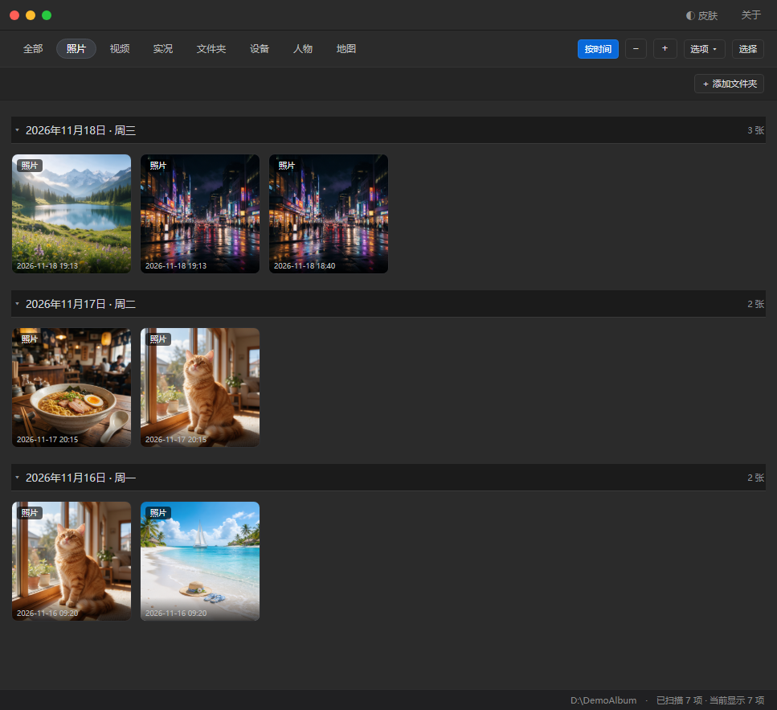

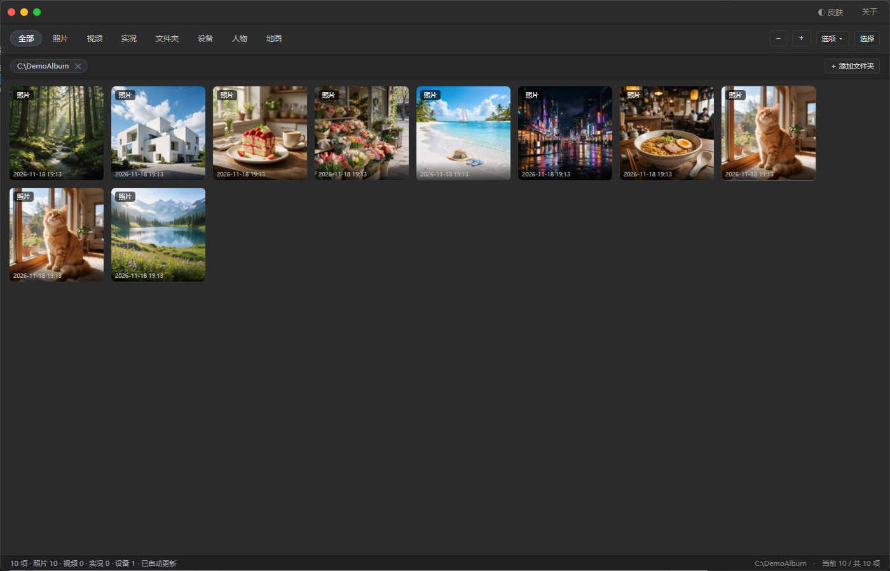

- **删除缓存**：一键清理扫描索引、缩略图与视频封面缓存、修图临时文件，并提示释放空间
- **EXIF 详情、地图聚类、人物聚类、dHash 去重、应用内回收站、右键菜单（详细信息 / 另存为 / 编辑 / 删除）、批量导入修图**

## 技术栈

- C# / .NET Framework 4.0 / WinForms
- WebView2（前端 UI）
- Python 嵌入（onnxruntime + numpy + Pillow + OpenCV）
- ONNX 模型：SqueezeNet（场景分类）、YuNet（人脸检测）、GFPGAN v1.4（人脸修复）、BiSeNet ResNet18（人脸分割）、MediaPipe FaceMesh 468（关键点）、Chinese-CLIP ViT-B/16（相册语义搜索）、PP-OCRv4 mobile（图片内文字识别）

## 效果预览

每张都是「原图 / 处理结果」对照，均由程序实际处理输出（超分一项在缺少 Real-ESRGAN 权重时为 Lanczos 回退）。

**调色 · LUT**

| | |
|:--:|:--:|
| 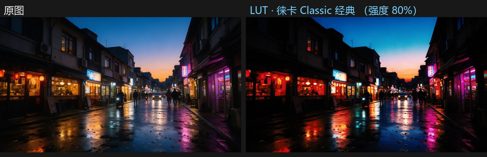<br>**LUT 套用**（徕卡 Classic，强度 80%） | <br>**胶片质感**（颗粒 75 / 漏光 45 / halation 65） |
| 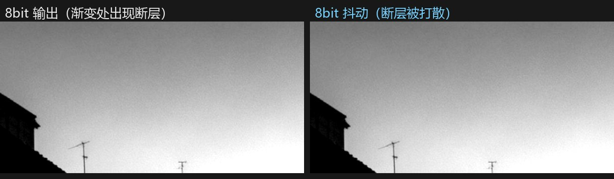<br>**8bit 抖动**（渐变断层 vs 抖动打散） | 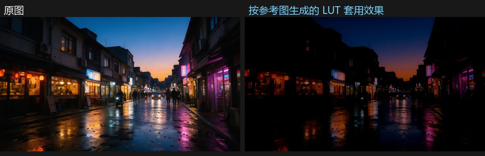<br>**参考图 → 33³ .cube** |

**色彩与画质**

| | |
|:--:|:--:|
| <br>**色彩调整**（饱和/对比/阴影/高光/色温） | 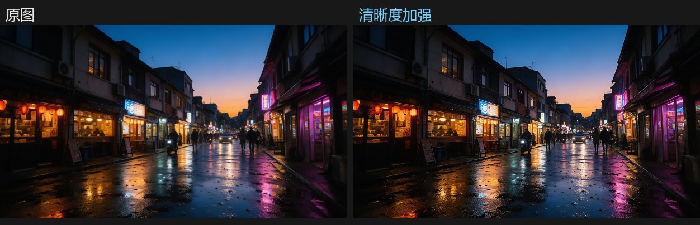<br>**清晰度加强** |
| <br>**全图超分 2×**（左：双线性放大） | <br>**景深虚化**（主体保护，强度 80 / 对焦 50%） |
| 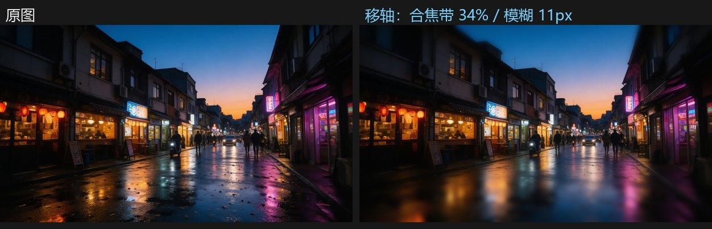<br>**移轴**（合焦带 34% + 模糊 11px） | |

**人像**

| | |
|:--:|:--:|
| 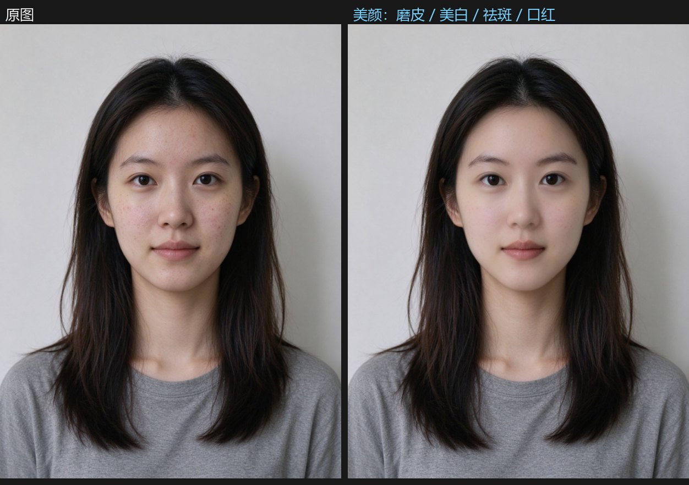<br>**美颜**（磨皮/美白/祛斑/口红） | <br>**液化**（下巴双下颌修正） |

**证件照**

| | |
|:--:|:--:|
| 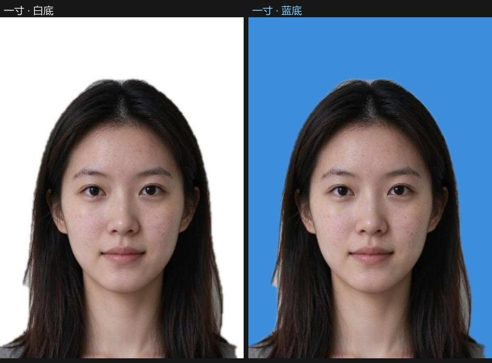<br>**换底色 + 自动居中**（一寸 295×413） | 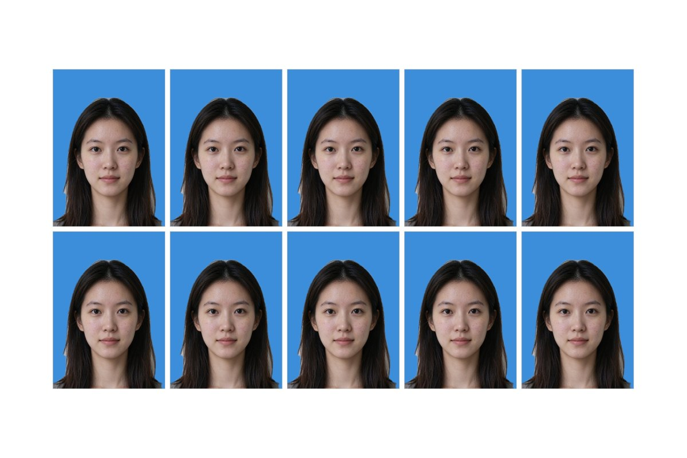<br>**相纸排版**（六寸 1800×1200 + 裁切线） |

**辅助工具**

| | | |
|:--:|:--:|:--:|
| 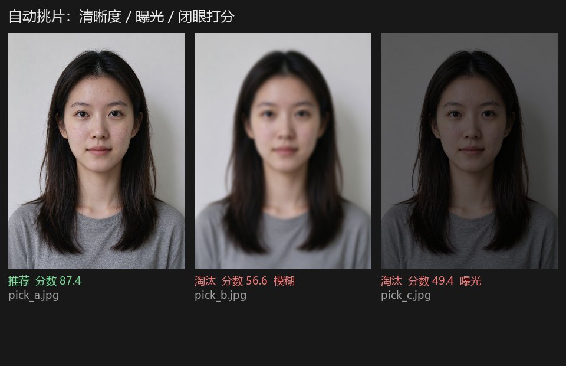<br>**自动挑片**（清晰度/曝光/闭眼打分） | <br>**配色提取**（主色 + 占比） | |

更多 v1.05 实拍对比：[美颜四格](docs/screenshots/美颜效果对比.png) · [下巴修复](docs/screenshots/下巴修复对比.png) · [AI 细节增强](docs/screenshots/AI增强对比.png) · [美颜全套样张](docs/screenshots/美颜示例_全套.jpg)

## 系统要求

- Windows 10 64位 或更高
- WebView2 Runtime（已内置 Evergreen 引导）
- 无需安装 Python（已嵌入）

## 编译

```bash
C:\Windows\Microsoft.NET\Framework64\v4.0.30319\csc.exe /target:winexe /platform:x64 /optimize+ /unsafe /nologo /win32icon:app.ico /out:"图片批处理工具.exe" /r:System.dll /r:System.Core.dll /r:System.Drawing.dll /r:System.Windows.Forms.dll /r:Microsoft.Web.WebView2.Core.dll /r:Microsoft.Web.WebView2.WinForms.dll WebViewApp.cs Extras.cs
```

卸载程序单独编译（使用独立图标）：

```bash
C:\Windows\Microsoft.NET\Framework64\v4.0.30319\csc.exe /target:winexe /platform:x64 /optimize+ /nologo /win32icon:卸载.ico /out:"卸载图片批处理工具.exe" /r:System.dll /r:System.Core.dll /r:System.Drawing.dll /r:System.Windows.Forms.dll Uninstaller.cs
```

> 从源码构建还需 AI 模型：`GFPGANv1.4.onnx`、`model.onnx`、`face_detection_yunet.onnx` 已在仓库（LFS），`bisenet_resnet18.onnx`（人脸分割）与 `face_mesh_468.onnx`（关键点）体积超出仓库直推上限，请从 [Release 资产](https://github.com/lqy072072/image-batch-tool/releases) 下载后放入 `ai/models/`。
>
> 相册语义搜索还需 `ai/models/cnclip/` 下的 3 个文件：
> - `cnclip_vitb16.img.fp32.onnx`（347,613,176 字节）
> - `cnclip_vitb16.txt.fp32.onnx`（409,536,348 字节）
> - `cn_vocab.txt`（109,540 字节）
>
> 下载地址：
> `https://github.com/ZHEQIUSHUI/CLIP-ONNX-AX650-CPP/releases/download/cnclip/cnclip_vitb16.img.fp32.onnx`
> `https://github.com/ZHEQIUSHUI/CLIP-ONNX-AX650-CPP/releases/download/cnclip/cnclip_vitb16.txt.fp32.onnx`
>
> DirectML 版 onnxruntime 解包在 `ai/models/cnclip/dml/`（`onnxruntime_directml-1.24.4-cp313-cp313-win_amd64.whl`），缺失时会自动用 CPU 跑，功能不变但索引会慢很多。

## 目录结构

```
├── WebViewApp.cs          # C# 主程序
├── ui.html                # WebView2 前端界面
├── app.ico                # 应用图标
├── 卸载.ico               # 卸载程序图标
├── Uninstaller.cs         # 卸载程序源码
├── ai/
│   ├── ai_process.py       # AI 调色脚本
│   ├── beauty.py           # GFPGAN 美颜脚本
│   ├── beauty_pro.py       # 美颜 + 液化主脚本（分割/关键点）
│   ├── clip_common.py      # Chinese-CLIP 分词/预处理/推理公共模块
│   ├── ocr_common.py       # PP-OCRv4 检测/识别公共模块
│   ├── search_index.py     # 相册语义 + OCR 增量索引（SQLite）
│   ├── search_server.py    # 常驻文本编码、OCR 命中与相似度查询服务
│   └── models/
│       ├── model.onnx      # SqueezeNet 场景分类
│       ├── GFPGANv1.4.onnx
│       ├── bisenet_resnet18.onnx
│       ├── face_mesh_468.onnx
│       ├── face_detection_yunet.onnx
│       ├── cnclip/         # Chinese-CLIP ViT-B/16 ONNX + 中文词表 + DirectML
│       └── ocr/            # PP-OCRv4 mobile det/rec + 中文字典
├── luts/                  # .cube / .3dl / .lut LUT 文件
├── installer/
│   └── Installer.cs        # 安装包向导（WinForms）源码
├── native/                # C++ 原生图像处理 DLL 源码
└── webview2/               # WebView2 SDK
```

## 更新记录

### v1.07
- 美颜新增 **去油光 / 牙齿美白 / 脖子肤色统一 / 眼神光**（只压不抬、口腔区保护、上脸肤色增益上限、虹膜左上补真实高光点）
- 证件照质量三项：**肩线水平检测**（输出倾角）、**发丝边缘颜色去污**（按与底色色差压 alpha，消除亮边）、**300dpi 校验并写入 DPI 元数据**（冲印按 300dpi 打印）
- 输出新增 **统一转 sRGB**：读取源图内嵌 ICC 做真实色彩转换，解决相机 Adobe RGB 图在手机/网页偏色
- Real-ESRGAN 真超分权重接入说明与分块推理（有 onnx 权重时自动启用，否则 Lanczos 兜底）
- 关于页版本号改为 1.07

### v1.06
- 新增 **输出与批处理**：多线程并发（AI 相关分支自动退回串行）、断点续跑、重名策略（覆盖/加序号/跳过）、EXIF + ICC 元数据保留（方向归一）
- 新增 **胶片质感**：颗粒 / 漏光 / halation
- 新增 **线性空间套 LUT + 8bit 抖动**（GPU/原生路径会绕过，启用时自动走逐像素路径保证一致）
- 新增 **景深虚化**（Depth Anything V2 Small，人像解析保护主体）、**2× 放大/超分**（有 Real-ESRGAN onnx 时自动启用）
- 新增 **证件照**（换底 + 尺寸预设 + 六寸排版）、**自动挑片**（清晰度/曝光/闭眼）、**配色提取**、**参考图→LUT 生成**
- 新增 **交互**：前后对比拉帘、单张重做、预设保存/读取/记忆、文件列表只渲染可视窗口
- 新增 **滤镜列表 LUT 分类与右键管理**：参考图生成的 LUT 单独成组（`luts/参考图生成`），任意 LUT 可右键 **重命名 / 删除**，并自动处理当前生效 LUT
- 证件照：**按头部轮廓自动水平居中**；排版相纸可选（五寸 / 六寸 / 七寸 / 八寸 / A4），不再写死 1800×1200
- 界面重排：美颜、证件照各自独立成面板；超分与景深并入「色彩调整」；输出与批处理、辅助工具移到左栏；「并发」更名「导出线程并发数量」
- 修复挑片 / 配色结果中文乱码（改 ASCII 转义 + 强制 UTF-8），结果框限高 132px 且与应用互斥
- 关于页版本号改为 1.06

### v1.05
- **新增美颜面板**（磨皮、美白、祛斑、黑眼圈、亮眼、口红 6 色号、腮红 + 液化：瘦脸、大眼、瘦鼻、下巴）
  - 分割用 BiSeNet ResNet18（MIT）、关键点用 MediaPipe FaceMesh 468（Apache-2.0），全部本地 ONNX 推理
  - 处理顺序：LUT → 色彩调整 → 移轴 → 美颜 → GFPGAN，预览与批量走同一套参数
- 修复**下巴液化方向反了**导致「双下颌 / 下边缘撕裂」：改为以上唇中线为不动点的纵向拉伸，边界位移归零并在下巴上下做权重衰减
- 修复**瘦鼻会把嘴唇一起挤窄、瘦脸会带动眼唇边缘**：眼/眉/唇设为刚性保护区，瘦鼻纵向作用带收窄
- 修复**AI 细节增强反而让画面变糊**：中转 JPEG(Q75) 改为无损 PNG，GFPGAN 输出只取低频、原图高频按边缘门控回注，贴回改羽化
- 输出 JPEG 改用 4:4:4 抽样，减少彩色边缘渗色
- 面板标题改为「美颜」

### v1.04
- 重写「自动优化」算法：近中性样本白平衡（亮度守恒）、智能黑白场端点保留 [8,247] 余量、中灰锚定 gamma、高光软滚降
- AI 模式主流程接入引擎的高光/阴影参数（此前仅「AI 优化」按钮使用）
- 修复无 Python 环境下 AI 静默失败：自动探测常见安装路径与沙箱运行时
- 修复默认 LUT 模式值非法，导致「自动」实际按直出执行
- 安装包内置 864 个可用 LUT（v1.03 为 190 个），支持 .3dl / .lut

### v1.03
- 首个公开版本

## License

MIT
