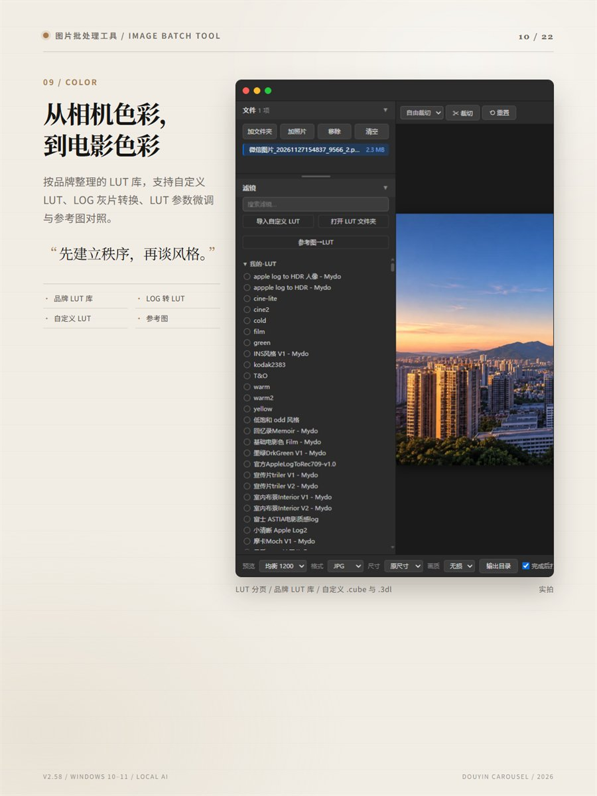
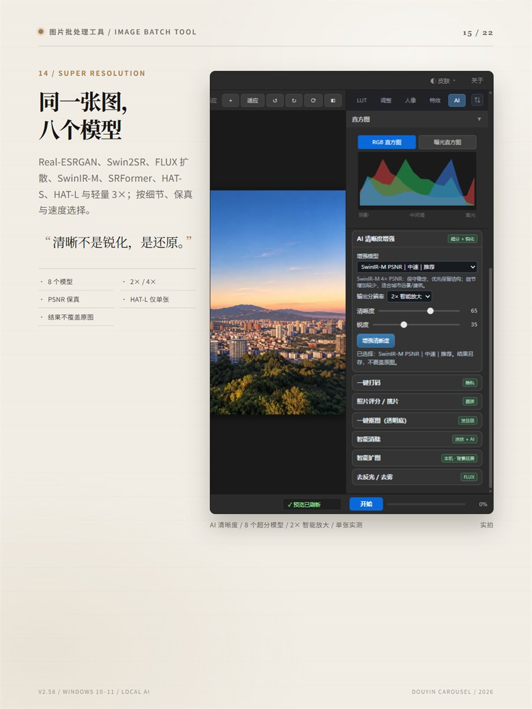
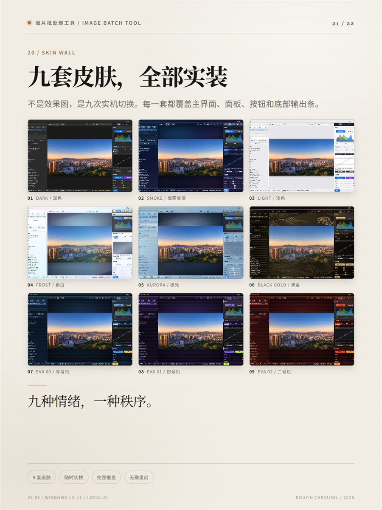

# 图片批处理工具

Windows 图片批处理与相册管理工具：LUT 滤镜、AI 调色、人像增强、美颜液化、景深虚化、超分、证件照、本地相册与去重。相册和图片编辑是两个可独立安装、独立运行的程序。

当前版本：**v2.58**

## 界面预览

> 以下均为 Windows 10 / 11 实机运行截图，不是效果图。

| 图片编辑 · 主界面 | 相册 · 主界面 |
|:---:|:---:|
| <a href="assets/gallery/v258/card_02.jpg"></a> | <a href="assets/gallery/v258/card_03.jpg"></a> |

| LUT 调色 | AI 工具箱 7 项 |
|:---:|:---:|
| <a href="assets/gallery/v258/card_10.jpg"></a> | <a href="assets/gallery/v258/card_14.jpg"></a> |

| AI 清晰度 · 8 个模型 | 九套皮肤总览 |
|:---:|:---:|
| <a href="assets/gallery/v258/card_15.jpg"></a> | <a href="assets/gallery/v258/card_21.jpg"></a> |

**[查看完整 22 张图文截图 →](SCREENSHOTS.md)**

v2.58 更新：

- 修复相册「我的相册」面板：界面缺少 `#albAlbums` 容器，点击按钮只切换状态却看不到面板；相册独立版和图片编辑内置相册都已补回侧栏容器，新建/打开相册恢复可用。
- v2.57 的自定义排列修复保持不变。

v2.57 更新：

- 修复图片编辑右侧「自定义排列」：进入排序模式后自动收起各分类内容，只显示分类标题，11 个分类一屏可见，不再因为分类正文过长而拖不到后面的分类。
- 拖拽从 HTML5 Drag & Drop 改为 Pointer Events：分类左侧手柄加宽到 23px 并高亮，分类标题区域也可直接拖动；拖到列表边缘会自动滚动，并有上/下插入线提示。
- 保留原有五页分类、11 个可排序分类、localStorage 顺序持久化，以及「恢复默认」只影响当前分页的行为；直方图仍固定不参与排序。

v2.55 更新：

- 「AI 清晰度增强」从固定模型改为用户自选：保留 Real-ESRGAN、Swin2SR、轻量 3×，新增 SRFormer 4×、HAT-L 4×、HAT-S 4×、SwinIR-M 4× PSNR，以及 FLUX 扩散重绘（实验）。
- 新增的保真 Transformer 模型都按 ONNX 输入类型自动转 FP16 / FP32，分块 256、32 像素羽化；大图先缩到 600 万像素，避免 4× 输出撑爆内存。
- SRFormer / HAT-L 在 DirectML 上会出现局部 NaN，已用同块 Lanczos 填充；HAT-S / SwinIR 走 DML，SRFormer / HAT-L 走 CPU 确保正确。
- 扩散重绘调用现有本地 FLUX.2 Klein 低强度 img2img，仅作为实验入口；不是 DiffBIR / StableSR / SUPIR，不能保证建筑结构不变，速度慢。
- 默认模型改为「保真 · SRFormer 4×」，更偏向保留远景建筑结构；Real-ESRGAN / Swin2SR 仍保留但标注会编造/重画。

v2.52 更新：

- 「AI 清晰度增强」新增「极致 · Real-ESRGAN x4plus」模型，基于 DirectML 在 NVIDIA / AMD 集显上 GPU 推理，优先 GPU，失败自动回退 CPU。
- Real-ESRGAN 采用 512 像素分块和 32 像素羽化重叠，降低接缝；4× 结果降采样时使用 Lanczos，保留更多边缘细节。
- 旧轻量模型保留为「快速 · 轻量」，适合大图或没有可用 GPU 的机器；默认仍为「极致」。
- 保留 v2.51 的分类拖动排序、自定义顺序持久化，以及 AI 清晰度 2× / 4× / 自定义输出。

## 下载安装

安装包通过 GitHub Releases 发布：

**https://github.com/lqy072072/image-batch-tool/releases**

- Release 资产名：`image-batch-tool_v2.52_setup.exe`
- 本地构建名：`图片批处理工具_v2.52_安装包.exe`
- 大小：1,377,909,104 字节（约 1.28 GB）
- SHA256：`1C427B3827BCD3F2BBAD08F59109EE383FD6BBF9EA045306D78A32D425AFAFEB`

安装包已内置两个模块的 Python 运行时、AI/OCR 模型、DirectML 运行库和 LUT；生成式修图的大模型不预装，首次使用时在程序内下载。Real-ESRGAN 模型文件约 64 MB，随包内置，不需额外下载。

运行安装包后按向导选择「相册」和/或「图片编辑」，默认路径为 `D:\Program Files\图片批量处理工具`，只勾选一个也能正常安装运行。

## 仓库内容

源码仓库只保留维护和构建所需的代码与界面资源：

```text
WebViewApp.cs           C# 主程序（相册 / 图片编辑共用）
AppModule.cs            模块标识、版本、图标与配置目录
AlbumMeta.cs            相册元数据
Extras.cs               专业调整算法
Uninstaller.cs          卸载程序
album.html              相册前端
edit.html               图片编辑前端
dedup.html              去重窗口前端
ui.html                 旧版单程序前端（兼容保留）
skins/                  九套皮肤 CSS / 背景图
assets/                 界面预览图和地图依赖
ai/                     Python 图像处理与 AI 脚本
native/                 原生图像处理 C++ 源码
installer/Installer.cs  安装向导源码
```

以下大体积或非源码文件不再进入仓库，统一放在 Release 安装包或本机构建目录：

- `luts/`：内置 LUT 文件
- `ai/models/`：ONNX 模型
- `ai/ort_dml/`：DirectML 版 ONNX Runtime（仅安装包内置；源码模式缺少时自动回退 CPU）
- `webview2/`：WebView2 SDK
- `docs/`、`promo_*`：截图、宣传素材
- 历史测试报告、Release 文案、旧安装包哈希与快捷方式

## 编译

需要 .NET Framework 4.x 的 `csc.exe`，以及 WebView2 SDK 的 `Microsoft.Web.WebView2.Core.dll` / `Microsoft.Web.WebView2.WinForms.dll`。

```bat
C:\Windows\Microsoft.NET\Framework64\v4.0.30319\csc.exe /target:winexe /platform:x64 /optimize+ /unsafe /nologo /d:ALBUM_BUILD /win32icon:相册.ico /out:"相册.exe" /r:System.dll /r:System.Core.dll /r:System.Drawing.dll /r:System.Windows.Forms.dll /r:System.Web.Extensions.dll /r:Microsoft.Web.WebView2.Core.dll /r:Microsoft.Web.WebView2.WinForms.dll WebViewApp.cs AppModule.cs AlbumMeta.cs Extras.cs GlassMouseBridge.cs

C:\Windows\Microsoft.NET\Framework64\v4.0.30319\csc.exe /target:winexe /platform:x64 /optimize+ /unsafe /nologo /d:EDIT_BUILD /win32icon:相册_编辑.ico /out:"图片编辑.exe" /r:System.dll /r:System.Core.dll /r:System.Drawing.dll /r:System.Windows.Forms.dll /r:System.Web.Extensions.dll /r:Microsoft.Web.WebView2.Core.dll /r:Microsoft.Web.WebView2.WinForms.dll WebViewApp.cs AppModule.cs AlbumMeta.cs Extras.cs GlassMouseBridge.cs
```

安装程序与卸载程序：

```bat
C:\Windows\Microsoft.NET\Framework64\v4.0.30319\csc.exe /target:winexe /platform:x64 /optimize+ /nologo /win32icon:app.ico /out:"安装程序.exe" /r:System.dll /r:System.Core.dll /r:System.Drawing.dll /r:System.Windows.Forms.dll installer\Installer.cs

C:\Windows\Microsoft.NET\Framework64\v4.0.30319\csc.exe /target:winexe /platform:x64 /optimize+ /nologo /win32icon:卸载.ico /out:"卸载图片批处理工具.exe" /r:System.dll /r:System.Core.dll /r:System.Drawing.dll /r:System.Windows.Forms.dll Uninstaller.cs
```

> 源码仓库不包含 `luts/`、`ai/models/` 和 `webview2/`。需要从源码完整运行或重新打包时，请从 Release 安装包或本机构建目录补齐这些运行资源；仓库中的 `.gitignore` 已阻止它们再次被提交。

## 系统要求

- Windows 10 64 位或更高
- WebView2 Runtime
- 不需要单独安装 Python（安装包已嵌入运行时）
- 「极致 · Real-ESRGAN」优先使用 DirectML GPU；没有可用 GPU 时会自动回退 CPU，处理速度会明显变慢

## License

MIT
