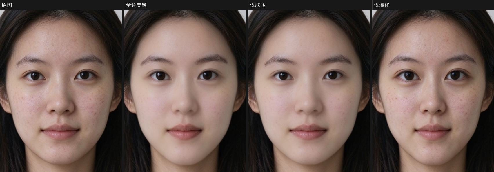
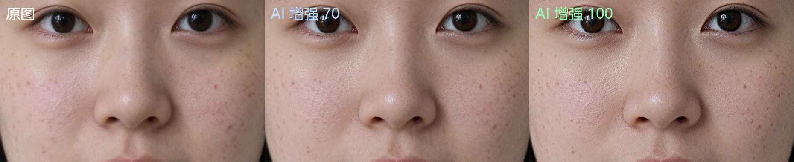

# 图片批处理工具

[](https://github.com/lqy072072/image-batch-tool/releases/download/v1.05/image-batch-tool_v1.05_setup.exe)
[](https://github.com/lqy072072/image-batch-tool/releases)
[](LICENSE)

批量图片处理工具，支持 LUT 滤镜套用、AI 调色、AI 人像增强（GFPGAN）、美颜与液化。

## 下载安装

直接下载最新安装包（约 516MB，已内置 Python 运行时与 AI 模型）：

**[👉 下载 image-batch-tool_v1.05_setup.exe](https://github.com/lqy072072/image-batch-tool/releases/download/v1.05/image-batch-tool_v1.05_setup.exe)**

或在 [Releases 页面](https://github.com/lqy072072/image-batch-tool/releases) 查看历史版本。运行安装包后按向导安装，默认路径 `D:\Program Files\图片批量处理工具`。

## 功能

- **LUT 滤镜**：支持 .cube / .3dl / .lut 格式，内置 ARRI/Canon 等品牌 LUT，支持自动/AI/直出三种套用模式
  - .3dl 多为 3DMESH 整数格点表（10-bit 0–1023，带输入网格声明行），按 **B 最快维**排列，载入时会转置成内部的 R 最快维；.lut 与 .cube 同构，走同一解析
- **AI 调色**：基于场景识别 + 像素分析，自动白平衡、曝光、对比度、饱和度
- **AI 人像增强**：YuNet 人脸检测 + GFPGAN 人脸修复，默认混合强度 0.7
- **美颜**：磨皮/美白/祛斑/黑眼圈/亮眼/口红（6 色号）/腮红 + 液化（瘦脸/大眼/瘦鼻/下巴），由 BiSeNet 人脸分割 + MediaPipe FaceMesh 468 关键点驱动，全部可调强度
  - 「AI 细节增强」为独立开关：GFPGAN 只提供干净低频，原图高频按边缘门控回注，避免传统 AI 修复常见的「越修越糊」
  - 瘦脸/瘦鼻带刚性保护区（眼/眉/唇），液化不会连带挤压五官
- **自动优化**：自适应白平衡 + 智能黑白场 + 中灰锚定 + 高光保护（v1.04 重写算法：正常图不再产生死白、过曝图不再压成黑片、暖偏色不再拉低整体亮度）
- **手动调色**：亮度/对比度/饱和度/色温/色调/暗角/高光/暗部/胶片对比
- **批量处理**：串行处理，支持无损输出
- **深色 Mac 风格 UI**：WebView2 渲染

## 技术栈

- C# / .NET Framework 4.0 / WinForms
- WebView2（前端 UI）
- Python 嵌入（onnxruntime + numpy + Pillow + OpenCV）
- ONNX 模型：SqueezeNet（场景分类）、YuNet（人脸检测）、GFPGAN v1.4（人脸修复）、BiSeNet ResNet18（人脸分割）、MediaPipe FaceMesh 468（关键点）

## 效果预览

| 美颜（原图 / 全套 / 仅肤质 / 仅液化） | 下巴液化修复（原图 / 修复前双下颌 / 修复后） | AI 细节增强（原图 / 70 / 100） |
|---|---|---|
|  |  |  |

- [美颜示例_全套.jpg](docs/screenshots/美颜示例_全套.jpg)（全参输出样张）

## 系统要求

- Windows 10 64位 或更高
- WebView2 Runtime（已内置 Evergreen 引导）
- 无需安装 Python（已嵌入）

## 编译

```bash
C:\Windows\Microsoft.NET\Framework64\v4.0.30319\csc.exe /target:winexe /platform:x64 /optimize+ /unsafe /nologo /win32icon:app.ico /out:"图片批处理工具.exe" /r:System.dll /r:System.Core.dll /r:System.Drawing.dll /r:System.Windows.Forms.dll /r:Microsoft.Web.WebView2.Core.dll /r:Microsoft.Web.WebView2.WinForms.dll WebViewApp.cs
```

> 从源码构建还需 AI 模型：`GFPGANv1.4.onnx`、`model.onnx`、`face_detection_yunet.onnx` 已在仓库（LFS），`bisenet_resnet18.onnx`（人脸分割）与 `face_mesh_468.onnx`（关键点）体积超出仓库直推上限，请从 [Release 资产](https://github.com/lqy072072/image-batch-tool/releases) 下载后放入 `ai/models/`。

## 目录结构

```
├── WebViewApp.cs          # C# 主程序
├── ui.html                # WebView2 前端界面
├── app.ico                # 应用图标
├── ai/
│   ├── ai_process.py       # AI 调色脚本
│   ├── beauty.py           # GFPGAN 美颜脚本
│   ├── beauty_pro.py       # 美颜 + 液化主脚本（分割/关键点）
│   └── models/
│       ├── model.onnx      # SqueezeNet 场景分类
│       ├── GFPGANv1.4.onnx
│       ├── bisenet_resnet18.onnx
│       ├── face_mesh_468.onnx
│       └── face_detection_yunet.onnx
├── luts/                  # .cube / .3dl / .lut LUT 文件
├── installer/
│   └── Installer.cs        # 安装包向导（WinForms）源码
├── native/                # C++ 原生图像处理 DLL 源码
└── webview2/               # WebView2 SDK
```

## 更新记录

### v1.05
- **新增美颜面板**（磨皮、美白、祛斑、黑眼圈、亮眼、口红 6 色号、腮红 + 液化：瘦脸、大眼、瘦鼻、下巴）
  - 分割用 BiSeNet ResNet18（MIT）、关键点用 MediaPipe FaceMesh 468（Apache-2.0），全部本地 ONNX 推理
  - 处理顺序：LUT → 色彩调整 → 移轴 → 美颜 → GFPGAN，预览与批量走同一套参数
- 修复**下巴液化方向反了**导致「双下颌 / 下边缘撕裂」：改为以上唇中线为不动点的纵向拉伸，边界位移归零并在下巴上下做权重衰减
- 修复**瘦鼻会把嘴唇一起挤窄、瘦脸会带动眼唇边缘**：眼/眉/唇设为刚性保护区，瘦鼻纵向作用带收窄
- 修复**AI 细节增强反而让画面变糊**：中转 JPEG(Q75) 改为无损 PNG，GFPGAN 输出只取低频、原图高频按边缘门控回注，贴回改羽化
- 输出 JPEG 改用 4:4:4 抽样，减少彩色边缘渗色
- 面板标题改为「美颜」

### v1.04
- 重写「自动优化」算法：近中性样本白平衡（亮度守恒）、智能黑白场端点保留 [8,247] 余量、中灰锚定 gamma、高光软滚降
- AI 模式主流程接入引擎的高光/阴影参数（此前仅「AI 优化」按钮使用）
- 修复无 Python 环境下 AI 静默失败：自动探测常见安装路径与沙箱运行时
- 修复默认 LUT 模式值非法，导致「自动」实际按直出执行
- 安装包内置 864 个可用 LUT（v1.03 为 190 个），支持 .3dl / .lut

### v1.03
- 首个公开版本

## License

MIT
