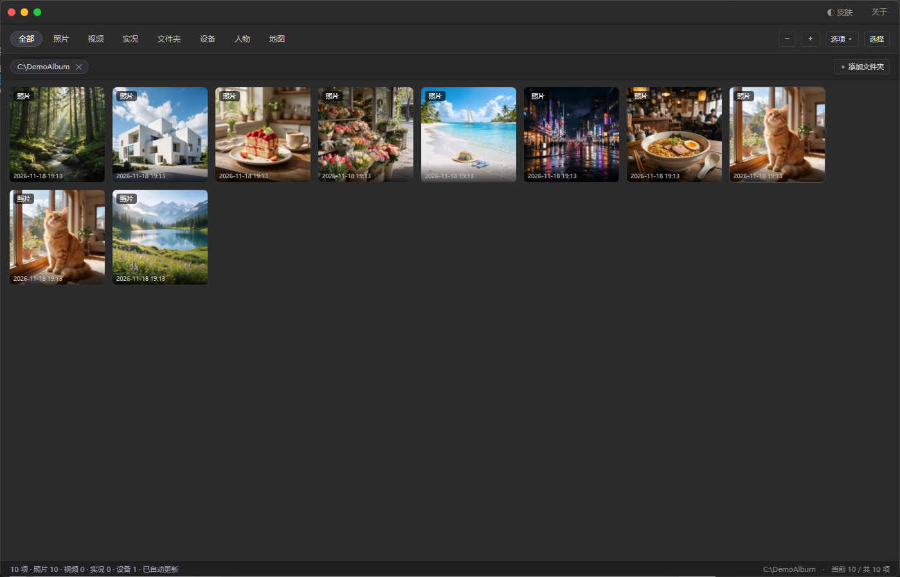
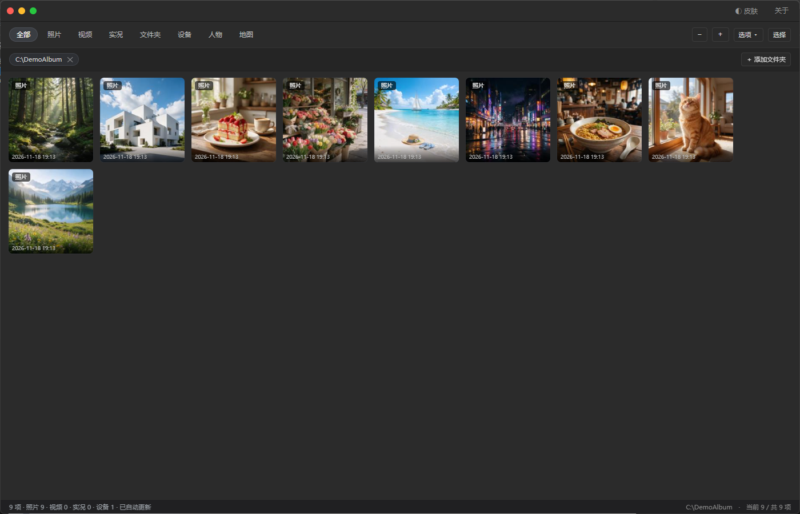
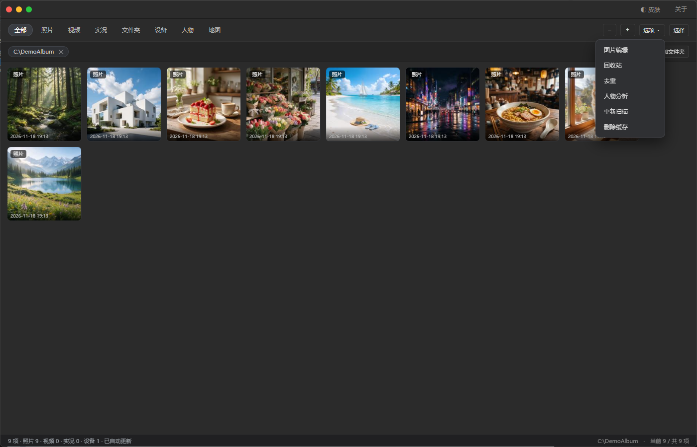

# 图片批处理工具 v2.00

本版新增独立「相册」模块，图片编辑与相册分成两个桌面入口；同时补齐相册的自动刷新、启动缓存与大目录优化。

## 新增入口

- **相册**（`相册.lnk`，`--album`）：打开即为相册管理界面，不再先进入修图界面
- **图片编辑**（`图片编辑.lnk`，`--edit`）：只启动修图功能
- 安装后在桌面生成上面两个快捷方式

## 相册能力

- 八个视图：全部 / 照片 / 视频 / 实况 / 文件夹 / 设备 / 人物 / 地图
- 多根目录（磁盘根或普通文件夹均可）、EXIF 详细信息、地图聚类缩略图、YuNet + SFace 人物聚类、dHash 去重
- 应用内回收站、滑动选择、右键菜单（详细信息 / 另存为 / 编辑 / 删除，支持多选）
- 批量导入修图、批量另存、批量删除

## 本次更新

### 自动及时更新
- 每个相册根目录挂文件系统监听，新增 / 删除 / 改名图片或视频后约 2 秒自动增量扫描
- 自动刷新时保留当前分类、滚动位置与选中状态，不会跳回「全部」

### 启动与缓存优化
- 扫描索引持久化到 `alb_index.dat`，按「文件大小 + 修改时间」复用 EXIF / 尺寸 / 拍摄参数 / 地理位置，命中缓存不再解码图片
- 缩略图写入磁盘缓存，二次打开直接读取
- 启动时先用上次索引秒开相册，后台再核对变化
- 枚举阶段只收集图片 / 视频扩展名，跳过回收站、系统卷、Windows、Program Files、node_modules 等目录
- 界面首次最多渲染 600 项，滚动到底部再按需加载，避免超大目录一次性建满 DOM
- 相册内删除文件后自动刷新计数与分页，不再需要手动刷新

### 选项菜单调整
- 「编辑」按钮改为二级菜单里的「图片编辑」，排在「回收站」前面
- 新增「删除缓存」：清理扫描索引、缩略图缓存、视频封面缓存与修图临时文件，并提示释放的空间

## 安装包

- 文件名：`image-batch-tool_v2.00_setup.exe`（约 720MB）
- 支持覆盖安装；安装前会自动关闭正在运行的程序再解压
- 默认安装目录：`D:\Program Files\图片批量处理工具`
