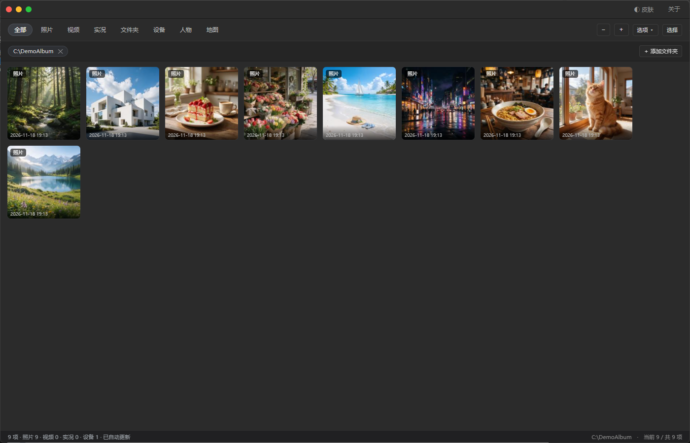
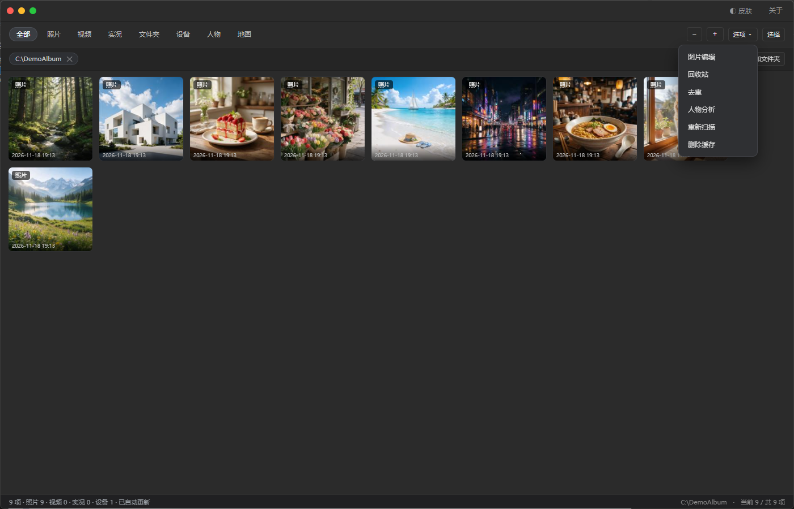

# 图片批处理工具 v2.01

本版集中优化相册的扫描、缓存和日常使用体验，并统一了 2.01 版本号与图标。

## 相册断点续扫

- 扫描过程中每 3 秒或每完成一个目录，把「已解析索引 + 已完成目录时间戳」写入磁盘
- 中途关闭程序后再启动：已扫完的目录直接跳过，没扫完的目录继续扫描
- 已解析过的文件凭「大小 + 修改时间」直接命中缓存，不重复读 EXIF 或解码
- 实测 500 张 / 25 个目录：扫到 20 张时关闭，重启后继续累积到 200 张，最终完整到 500 张

## 右键打开所在文件夹

- 相册右键菜单在「详细信息」下方新增「打开图片所在文件夹」
- 单选时打开资源管理器并选中该文件
- 多选时自动灰态，点击无效

## 覆盖安装保留进度

- 相册路径、扫描索引、去重指纹、缩略图缓存都保存在用户目录和临时缓存目录
- 安装器只覆盖程序目录，不删除 `%APPDATA%\ImageBatchTool` 和缩略图缓存
- 覆盖安装后启动先显示上次已加载的相册与缩略图，再后台做增量核对，不会全量重新解析

## 图标与版本

- 主程序按启动模式加载对应图标：相册启动用 `相册.ico`，图片编辑启动用 `相册_编辑.ico`
- 窗口、任务栏与安装包图标同步更新
- 关于界面、安装向导、安装脚本和安装包文件名统一为 2.01

## 流畅度优化

- 相册扫描线程、去重扫描线程降为低于正常优先级
- 后台补缩略图检测到用户正在滚动看图时主动让路，操作停顿后再继续
- 去重后台指纹分析同样给看图操作让路
- 扫描过程中边扫边显示改为每帧最多插入 50 张，避免一次插入大量 DOM 卡住界面
- 扫描检查点落在后台线程，按目录和定时分批写入

## 安装包

- 文件名：`image-batch-tool_v2.01_setup.exe`（约 720MB）
- 支持覆盖安装；安装前会自动关闭正在运行的程序再解压
- 默认安装目录：`D:\Program Files\图片批量处理工具`
